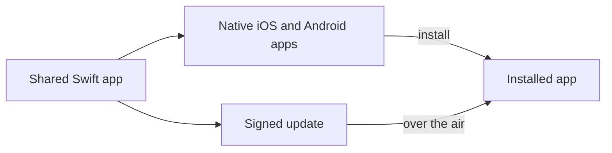

<p align="center">
  
</p>

<h1 align="center">
  <picture>
    <source media="(prefers-color-scheme: dark)" srcset="docs/assets/mixer-wordmark-dark.svg">
    
  </picture>
</h1>

<p align="center">
  <strong>Write Swift. Ship both.</strong><br>
  Native iOS and Android apps from one Swift codebase, with signed over-the-air updates.
</p>

<p align="center">
  <a href="https://github.com/snowdamiz/mixer/actions/workflows/verify.yml"></a>
  <a href="https://github.com/snowdamiz/mixer/actions/workflows/hosted.yml"></a>
  <br>
  
  
  
  <a href="#progress"></a>
  
</p>

<p align="center">
  <a href="#quick-start">Quick start</a> ·
  <a href="#progress">Progress</a> ·
  <a href="#documentation">Docs</a> ·
  <a href="docs/development.md">Contributing</a>
</p>

> [!IMPORTANT]
> Mixer is in active development. APIs are not stable and there is no release yet.

> [!NOTE]
> On November 23, 2026, Mixer approved a UI platform pivot. Shared screens
> will use a published SwiftUI subset, Android will render with Jetpack
> Compose, the iOS minimum will be iOS 17, and the shared-design Android host
> will support API 28. The badges and text below describe the current code
> until those steps land. See the [execution index](PLAN.md#ui-platform-pivot-november-23-2026).

## What is Mixer?

You write your app once in Swift. Mixer builds it into native iOS and Android
apps, and can also ship later changes as signed over-the-air updates.



- **One Swift codebase.** App state, effects, and UI are written once with
  `MixerCore` and `MixerUI`.
- **Native controls.** SwiftUI and UIKit on iOS, native widgets on Android.
- **Safe updates.** Compatible fixes ship over the air. A failed update falls
  back to the last healthy version. Updates never contain native code.
- **Local build service.** A web console and API for builds and releases run on
  your machine.

Supported targets: iOS 26 and later, and Android API 28 and later (proposed).

## Quick start

You need an Apple silicon Mac with Xcode and Swift 6.2 or later. From a checkout
of this repository, build the CLI and create an iOS Simulator app:

```sh
mixer_rev=c7956233d69caeffadfa5ab84227c3b2e09ff41d
work="$(mktemp -d "${TMPDIR:-/tmp}/mixer-local.XXXXXX")"
mkdir "$work/inputs"
git archive "$mixer_rev" cli sdk updates native/android | tar -xf - -C "$work/inputs"
swift build --package-path "$work/inputs/cli" --scratch-path "$work/cli-build" --product mixer
mixer_cli="$work/cli-build/debug/mixer"

"$mixer_cli" create MyApp --platform ios --directory "$work/MyApp" --sdk-path "$work/inputs/sdk"
```

[Getting started](docs/guides/getting-started.md) continues with building for
iOS and Android, exporting, and importing an existing Swift app.

## Progress

As of November 23, 2026, **6 of 8 local gates have passed**. Shared app and
native UI (L02) and FieldLog and documentation (L08) remain in progress.

- [x] **L01** Setup, adoption, and export
- [ ] **L02** Shared app and native UI
- [x] **L03** Compiler and owned runtime
- [x] **L04** Safe OTA and recovery
- [x] **L05** Local platform workflow
- [x] **L06** Free accounts and administration
- [x] **L07** Security and local reliability
- [ ] **L08** FieldLog and documentation

| Checklist | Passed | In progress | Not started |
| --- | :-: | :-: | :-: |
| [Local gates L01–L08](gates/local.json) | 6 | 2 | 0 |
| [FieldLog milestones D0–D6, D8](dogfood/receipts/milestones.json) | 6 | 2 | 0 |
| [Work packages W01–W18](work-graph.json) | 0 | 17 | 1 |
| [Launch gates G01–G38](gates/ga.json) | 0 | 8 | 30 |

See [progress details](docs/progress.md) for what each gate covers and the
known limitations, and [STATUS.md](STATUS.md) for the full history. Run
`python3 scripts/progress.py` to regenerate the table.

## Documentation

- [Getting started](docs/guides/getting-started.md): build the CLI, then create,
  export, and build apps for both platforms.
- [CLI reference](docs/guides/cli.md): commands, update inspection, and
  generated projects.
- [Upgrade, recover, and exit](docs/guides/upgrade-recover-and-exit.md)
- [Add a Mixer screen to a UIKit app](docs/guides/uikit-migration.md)
- [FieldLog fixtures and replays](docs/guides/fieldlog.md)
- [Store reviewer information template](docs/store-reviewer-information-template.md)
- [Product plan](mixer-product-plan.md): full scope and design.

## Contributing

[Develop Mixer](docs/development.md) covers requirements, running the tests,
using the SDK as a Swift package, and the repository layout.

## License

The license terms are still under review before public distribution.
[`THIRD_PARTY.yml`](THIRD_PARTY.yml) lists third-party dependencies.
