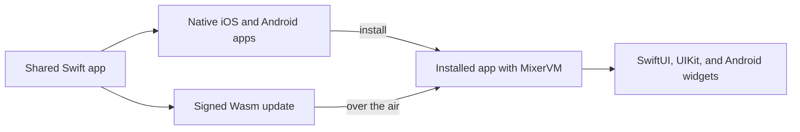

<p align="center">
  
</p>

<h1 align="center">
  <picture>
    <source media="(prefers-color-scheme: dark)" srcset="docs/assets/mixer-wordmark-dark.svg">
    
  </picture>
</h1>

<p align="center">
  <strong>Write Swift. Ship both.</strong><br>
  Native iOS and Android apps from one Swift codebase, with signed over-the-air updates.
</p>

<p align="center">
  <a href="https://github.com/snowdamiz/mixer/actions/workflows/verify.yml"></a>
  <a href="https://github.com/snowdamiz/mixer/actions/workflows/hosted.yml"></a>
  <br>
  
  
  
  <a href="#progress"></a>
  
</p>

<p align="center">
  <a href="#create-export-and-build-a-local-app">Quick start</a> ·
  <a href="#how-it-works">How it works</a> ·
  <a href="#progress">Progress</a> ·
  <a href="#guides">Guides</a> ·
  <a href="#cli-commands">CLI</a> ·
  <a href="STATUS.md">Status</a>
</p>

> [!IMPORTANT]
> Mixer is in active development. It does not yet meet its general-availability
> or FieldLog release gates. Its APIs have no stable release or compatibility
> guarantee.

## How it works

You write the app once in Swift. Mixer compiles it two ways. The native build
becomes the iOS and Android apps you install. The guest build becomes a
WebAssembly feature module that can ship later as a signed over-the-air update.



The native platform adapters are compiled into the installed app. An update
never contains native code such as `.so`, DEX, or Mach-O files.
`mixer release inspect` reports whether a change can ship over the air or needs
a new store build.

<table>
  <tr>
    <td width="50%" valign="top">
      <strong>One Swift codebase</strong><br>
      App state, effects, and UI are written once in Swift with <code>MixerCore</code> and <code>MixerUI</code>.
    </td>
    <td width="50%" valign="top">
      <strong>Native controls</strong><br>
      The app renders with SwiftUI and UIKit on iOS and with native Android widgets on Android.
    </td>
  </tr>
  <tr>
    <td width="50%" valign="top">
      <strong>Signed updates with fallback</strong><br>
      Compatible fixes run in MixerVM, Mixer's own Rust interpreter. A failed update falls back to a healthy version.
    </td>
    <td width="50%" valign="top">
      <strong>Local build and release service</strong><br>
      A Phoenix API, PostgreSQL, Oban workers, and a SolidJS console make up the build and release service that runs on your machine.
    </td>
  </tr>
</table>

The engine uses the official Swift compilers and no Patch or Skip
implementation. [mixer-product-plan.md](mixer-product-plan.md) defines the full
scope. The iOS target is iOS 26.0 and later, including iOS 27, and package and
generated app deployment minimums are 26.0. The proposed Android baseline is API
28 and later. Runtime qualification across supported versions is pending.

## Progress

As of November 19, 2026, **1 of 8 local gates has passed**. The implementation
plan is complete when all eight pass on iOS Simulator and Android emulator,
with the console, API, database, workers, and update delivery running locally.
Payments, physical phones, store approval, and live deployment are not part of
these gates. The separate launch checklist tracks them.

- [x] **L01** Setup, adoption, and export
- [ ] **L02** Shared app and native UI
- [ ] **L03** Compiler and owned runtime
- [ ] **L04** Safe OTA and recovery
- [ ] **L05** Local platform workflow
- [ ] **L06** Free accounts and administration
- [ ] **L07** Security and local reliability
- [ ] **L08** FieldLog and documentation

| Checklist | Passed | In progress | Not started |
| --- | :-: | :-: | :-: |
| [Local gates L01–L08](gates/local.json) | 1 | 7 | 0 |
| [FieldLog milestones D0–D6, D8](dogfood/receipts/milestones.json) | 0 | 4 | 4 |
| [Work packages W01–W18](work-graph.json) | 0 | 17 | 1 |
| [Launch gates G01–G38](gates/ga.json) | 0 | 8 | 30 |

Run `python3 scripts/progress.py` to print this table and the gates badge URL
from the current records.
[STATUS.md](STATUS.md) has the full history.

<details>
<summary><b>Verified behavior and open work for each gate</b></summary>

A checked item has a receipt that shows the behavior at the scope the receipt
states. It does not pass its gate by itself. Unchecked items are the main open
work, not a complete list.

**L01 Setup, adoption, and export.** Passed independent review on November 18.
The public CLI and SDK create, export, and build starter apps for both targets,
and the importer reports on FieldLog's iOS source.
[L01 decision](verification/receipts/l01-independent-final-review-41a05264.json)

**L02 Shared app and native UI**

- [x] The FieldLog task-conflict workflow ran on an iOS 27 Simulator and an
  Android 16 emulator against one shared task contract.
  [Receipt](verification/receipts/fieldlog-d2-task-conflict-source-sharing-20261119.json)
- [x] On Android, FieldLog returns from the report share sheet with its
  workspace and queued changes intact.
  [Receipt](verification/receipts/fieldlog-android-offline-report-return-41a05264.json)
- [ ] Save draft in the Android guest editor. The emulator showed blank frames
  after Save, and the workspace did not change.
  [Latest trace](verification/receipts/fieldlog-android-save-current-frame-root-r6016.json)
- [ ] Text scaling for accessibility. In a macOS probe, semantic fonts kept
  their size when the text size setting changed.
  [Probe](verification/receipts/fieldlog-localization-scale-c2bae0e57.json)
- [ ] The full screen, navigation, input, and accessibility matrix on both
  targets.

**L03 Compiler and owned runtime**

- [x] FieldLog guests run in the owned VM on macOS and save and reload a task.
  [Receipt](verification/receipts/fieldlog-guest-five-export-repair-r5790.json)
- [x] Five paired macOS runs matched native and guest results over 60 actions
  each. [Receipt](verification/receipts/fieldlog-matched-persisted-host-41a05264.json)
- [x] Both iOS guest variants passed exact input, Save, dismissal, and relaunch
  on Simulator as bundled guests.
  [Receipt](verification/receipts/fieldlog-ios-both-variant-save-reopen-root-r6054.json)
- [x] A macOS benchmark measured a median of 0.50 µs native and 317.27 µs in
  the owned VM from prepared input to frame. The guest is 2,691 bytes gzipped.
  [Receipt](verification/receipts/l03-d3-task-completion-host-benchmark-7b61fe1c.json)
- [ ] A compact guest for signed delivery. The bundled guests exceed the signed
  runtime's 4 MiB limit and use a different ABI.
- [ ] Guest parity and performance on iOS Simulator and Android emulator.
- [ ] Complete conformance, fuzzing, differential, and resource-limit checks.

**L04 Safe OTA and recovery**

- [x] On Android, a signed guest read the saved task before its first frame.
  The app kept its workspace through Activity recreation, rollback, and a cold
  offline reopen, and it resumed a partial download.
  [Receipt](verification/receipts/fieldlog-android-hydrated-signed-runtime-41a05264.json)
- [x] On iOS Simulator, one installed FieldLog task survived a signed baseline,
  review, and rollback, then launched without the delivery URL.
  [Receipt](verification/receipts/fieldlog-ios-hydrated-signed-runtime-41a05264.json)
- [x] Installed Android key rotation passed, and the app kept its update
  offline across the key change.
  [Receipt](verification/receipts/fieldlog-android-key-rotation-native-41a05264.json)
- [x] The release origin gives each Android runtime its own signed offer and
  refuses delivery to a different runtime.
  [Receipt](verification/receipts/fieldlog-android-runtime-cohort-offers-501eca8a.json)
- [x] `mixer release inspect` reports `ota-compatible` for an eligible edit and
  `store-build-required` for a new Android permission.
  [Receipt](verification/receipts/l04-release-inspector-source150-41a05264.json)
- [ ] Signed delivery through FieldLog's supported entry points, which the
  independent review requires.
  [Review](verification/receipts/l04-independent-review-9fd7e7f6eb-41a05264.json)
- [ ] iOS key rotation.
- [ ] Installed rollback with FieldLog's selected-draft adapter on both targets.
- [ ] Android in-place binary replacement that keeps the workspace.

**L05 Local platform workflow**

- [x] A browser **Create build** click returned HTTP 201 and queued one build
  and one job in PostgreSQL.
  [Receipt](verification/receipts/free-workspace-default-build-create-root-r5990.json)
- [x] A free iOS Starter build reached `native_succeeded` through Phoenix,
  restricted Oban, and one Xcode run.
  [Receipt](verification/receipts/l05-l07-native-starter-closed-20261119.json)
- [x] A free client downloaded the app, symbols, and inventory after worker
  shutdown. Cancellation during an Xcode run released capacity once.
  [Receipt](verification/receipts/l05-combined-native-build-41a05264.json)
- [x] Against provider fixtures, the store CLI reconciled a lost
  acknowledgement on both platforms with one submission each.
  [Receipt](verification/receipts/l05-local-submission-reconciliation-41a05264.json)
- [ ] Authenticated artifact delivery and a backup from one closed Starter
  build.
- [ ] One run of the whole workflow, including update, promotion, and rollback.

**L06 Free accounts and administration**

- [x] A real browser signed in and created a free organization and project
  with payments disabled.
  [Receipt](verification/receipts/free-workspace-browser-onboarding-root-r5946.json)
- [x] Over local HTTP, a free owner passed login, authorization, quotas,
  export, and deletion.
  [Receipt](verification/receipts/free-self-service-http-private-evidence-r5868.json)
- [x] The console refused organization exit until the owner's build settled.
  Another tenant kept its export and access.
  [Receipt](verification/receipts/l06-settled-exit-65c89e08.json)
- [ ] One browser journey in which a free owner manages the workspace and uses
  its build services.
  [Latest run](verification/receipts/l06-combined-console-browser-793196991d.json)

**L07 Security and local reliability**

- [x] Release metadata and artifacts restored from a PostgreSQL backup.
  [Receipt](verification/receipts/release-postgres-backup-restore-20261118.json)
- [x] The API recovered browser sessions after a refused pool checkout and
  after both browser lifecycle connections were exhausted.
  [Receipt](verification/receipts/l07-recovery-v33-41a05264.json) ·
  [Receipt](verification/receipts/l07-bounded-checkout-recovery-c2bae0e5.json)
- [ ] Backup and restore of one closed native build, reconciled with Phoenix.
- [ ] An independent provenance and licensing review.

**L08 FieldLog and documentation**

- [x] The public upgrade, recovery, and exit replay built FieldLog's Android
  APK without the original project, SDK checkouts, or Mixer CLI.
  [Receipt](verification/receipts/l08-public-upgrade-02002272.json)
- [x] In host checks, FieldLog's storage writers for both platforms refused
  overlapping draft and entry IDs and recovered after a write fault.
  [Receipt](verification/receipts/fieldlog-l08-cross-platform-draft-overlap-20261119.json)
- [ ] The complete FieldLog workflow on both targets through public tooling,
  including OTA, rollback, and export.
- [ ] The reviewed 20-change OTA corpus.

L08 also needs the local version of each FieldLog milestone except D7. The
statuses come from `dogfood/receipts/milestones.json`.

| Milestone | Status |
| --- | --- |
| D0 Baseline | Not started |
| D1 Engine adoption | Not started |
| D2 Shared Android | In progress |
| D3 Interpreted parity | In progress |
| D4 OTA delivery | In progress |
| D5 Recovery | In progress |
| D6 Platform workflow | Not started |
| D7 Production use | Deferred, not required |
| D8 Scenario confidence | Not started |

</details>

## Create, export, and build a local app

These steps need an Apple silicon Mac with Xcode, the iOS Simulator SDK, and
Swift 6.2 or later. Run them from a checkout of the public `snowdamiz/mixer`
repository. Local builds may resolve pinned SwiftPM dependencies. They need no
payment service and no store credentials.

### Build the CLI

The pinned revision supplies a matching CLI, SDK, and Android adapter. Set
`DEVELOPER_DIR` to your Xcode installation.

```sh
mixer_rev=c7956233d69caeffadfa5ab84227c3b2e09ff41d
work="$(mktemp -d "${TMPDIR:-/tmp}/mixer-local.XXXXXX")"
mkdir "$work/inputs" "$work/exports"
git archive "$mixer_rev" cli sdk updates native/android | tar -xf - -C "$work/inputs"
export DEVELOPER_DIR=/Applications/Xcode.app/Contents/Developer
swift build --package-path "$work/inputs/cli" --scratch-path "$work/cli-build" --product mixer
mixer_cli="$work/cli-build/debug/mixer"
"$mixer_cli" version
```

Keep the CLI beside its SwiftPM resource bundle.

### Build for iOS Simulator

```sh
"$mixer_cli" create LocalIOS --platform ios --directory "$work/LocalIOS" \
	--sdk-path "$work/inputs/sdk"
"$mixer_cli" export "$work/exports/LocalIOS" --directory "$work/LocalIOS"
"$mixer_cli" config validate --directory "$work/exports/LocalIOS"
ios_export="$work/exports/LocalIOS"
xcode_pins="$ios_export/Platforms/iOS/LocalIOS.xcodeproj/project.xcworkspace/xcshareddata/swiftpm"
mkdir -p "$xcode_pins"
cp "$ios_export/Generated/MixerSDK/Package.resolved" "$xcode_pins/Package.resolved"
"$mixer_cli" build --platform ios --directory "$work/exports/LocalIOS"
```

The fresh export seeds Xcode's workspace lock from the bundled SDK, so the app
uses the same Swift package revisions. The build creates an unsigned
`LocalIOS.app` under `.mixer/ios-build/Build/Products/Debug-iphonesimulator/`
in the export. The relocated starter built for arm64 Simulator in
[local verification](STATUS.md#november-18-local-verification).

### Build for Android

Install these tools and keep the same selections during creation, export, and
build:

- The official Swift 6.3.3 toolchain and its Android Swift SDK.
- NDK r27d, Android platform 37.0, and build-tools 37.0.0.
- JDK 25 and Python 3.
- Xcode 26.6 with its macOS 26.5 SDK for the Android cross-build.

Set these paths to your installations, then create, export, and build:

```sh
export DEVELOPER_DIR=/Applications/Xcode_26.6.app/Contents/Developer
export MIXER_SWIFT="$HOME/Library/Developer/Toolchains/swift-6.3.3-RELEASE.xctoolchain/usr/bin/swift"
export MIXER_SWIFT_SDKS_PATH="$HOME/Library/org.swift.swiftpm/swift-sdks"
export MIXER_ANDROID_ARTIFACT_PATH="$MIXER_SWIFT_SDKS_PATH/swift-6.3.3-RELEASE_android.artifactbundle/swift-android"
export ANDROID_HOME=/opt/homebrew/share/android-commandlinetools
export MIXER_JDK=/opt/homebrew/opt/openjdk@25/libexec/openjdk.jdk/Contents/Home

"$mixer_cli" create LocalAndroid --platform android --directory "$work/LocalAndroid" \
	--sdk-path "$work/inputs/sdk" --android-adapter-path "$work/inputs/native/android"
cmp "$work/LocalAndroid/Platforms/Android/Package.resolved" \
	"$work/LocalAndroid/Generated/MixerSDK/Package.resolved"
"$mixer_cli" export "$work/exports/LocalAndroid" --directory "$work/LocalAndroid"
"$mixer_cli" config validate --directory "$work/exports/LocalAndroid"
"$mixer_cli" build --platform android --directory "$work/exports/LocalAndroid"
```

Creation seeds `Platforms/Android/Package.resolved` with the admitted SDK pins,
and export keeps that lock. The build produces an unsigned arm64 APK at
`.mixer/android-build/LocalAndroid-unsigned.apk` in the export. The default
Android host is `legacy-v1`. To select the public V4 host, add
`--android-host public-v4` at creation. The default starter ran on an
[API 36 emulator](verification/receipts/l01-default-starter-pair24-runtime-41a05264.json).

### Export a project

Export to a new directory outside the source project. You can move the export
and build it after the original project and SDK checkout are gone. The export
includes the app source, the locked SDK, and the Android adapter when present.
It excludes build caches, dotenv secrets, signing credentials, and provisioning
profiles. Back up data stored by an installed app separately. See the
[independent export receipt](verification/receipts/l01-public-cli-independent-export-41a05264.json).

### Inspect an existing Swift app

```sh
"$mixer_cli" import "$work/LocalIOS/Sources" --output "$work/import.json"
```

Replace the source path with your app's Swift directory. The importer reads the
source and writes an advisory migration report. Apply the adaptations in your
own project. The report does not verify technical eligibility. For FieldLog,
use `ios/FieldLog` in its separate checkout. See the
[FieldLog import receipt](verification/receipts/fieldlog-advisory-import-root-r5864.json).

### Upgrade a locked project

`mixer upgrade` writes a new copy of the project with the new SDK, Android
adapter, and `mixer.lock`. It keeps an existing
`Platforms/Android/Package.resolved`. Export a recovery copy with the original
CLI before you upgrade. The
[upgrade, recover, and exit guide](docs/guides/upgrade-recover-and-exit.md)
walks through the full FieldLog Android example.

## Guides

- [Upgrade, recover, and exit](docs/guides/upgrade-recover-and-exit.md) covers
  SDK upgrades, recovery from an interrupted edit, installed upgrades, and
  Android builds without the Mixer CLI.
- [FieldLog fixtures and replays](docs/guides/fieldlog.md) reproduces the
  FieldLog Android export, lifecycle fixes, offline sync, and photo queue.
- [Produce and inspect a local FieldLog update](cli/release-tools/README.md)
  builds both update variants and inspects them.
- The [store reviewer information template](docs/store-reviewer-information-template.md)
  discloses the interpreter, update boundary, native fallback, and review
  steps for each submitted build.

## CLI commands

Run the source CLI with `scripts/mixer`, or build it as shown in
[Develop Mixer](#develop-mixer). Commands return JSON.

```sh
scripts/mixer doctor
scripts/mixer create MyApp
scripts/mixer test --directory MyApp
scripts/mixer run ios --device YOUR_BOOTED_SIMULATOR_UUID --directory MyApp
scripts/mixer release inspect --directory MyApp
scripts/mixer submit status --provider app-store-connect --app-id ASC_APP_ID --build-id BUILD_ID --directory MyApp
```

`doctor` returns 2 when required inventory is incomplete.

### Check whether an update can ship over the air

To inspect a signed FieldLog development update, pass the project that produced
the candidate, its qualification bundle, and your independently obtained build
producer trust file. The bundle has the build provenance, signed offers, and
observed guest behavior for each target.

```sh
scripts/mixer release inspect --directory "$FIELDLOG_PROJECT" \
  --qualification "$QUALIFICATION_DIR" --producer-trust "$PRODUCER_TRUST_FILE"
```

Read each entry in `targets`. In the verified confirmation-flow edit, iOS and
Android both reported `ota-compatible`, and the command exited 0. Adding the
Android camera permission changed the Android result to `store-build-required`,
and the command exited 2. Without both qualification options, the command
returns 2 with a blocked report. The operator still owns the publication
decision. See the
[verified cases](verification/receipts/l04-release-inspector-source150-41a05264.json).

### Check App Store Connect build status

`submit status` queries an existing App Store Connect build with a short-lived
`MIXER_ASC_BEARER_TOKEN` from the launch environment. It checks the provider's
app and build identity against the project's bundle ID. It keeps a local
observation under `.mixer/store`. Exit 0 means build processing succeeded, and
exit 2 means processing is pending.

### Generated projects

- `mixer.lock` bundles an exact SDK source snapshot and compiler identity.
- `mixer.yml` uses JSON syntax, which is a subset of YAML 1.2.
- Generated Xcode projects refuse to overwrite modified project bytes. App-owned
  native source stays editable.
- The Android build compiles the app's shared Swift feature and app-owned
  Android entry into an unsigned arm64 APK. It keeps native edits and rejects
  unsupported resources and capabilities. See the generated Android README and
  [`verification/android-generated-consumer/README.md`](verification/android-generated-consumer/README.md).
- The public Android host batches native input against one installed snapshot
  and publishes one model revision per batch. It keeps the original event bytes
  and refuses stale owners or revisions. API 37 emulator tests cover native
  typing, Add with draft reset, and Toggle.

## Use the SDK as a Swift package

The repository root is a Swift package. It exports `MixerCore`, `MixerUI`,
`MixerApple`, `MixerGuest`, and `MixerCapabilities` from the same sources as
`sdk/`. To use it from another project, add
`https://github.com/snowdamiz/mixer.git` with a full commit revision and the
package identity `mixer`. Pin a reviewed revision. These are development APIs
with no stable release tag. The root package does not ship the VM, updater, or
activation binary.

## Repository layout

| Directory | Implemented | Still missing |
| --- | --- | --- |
| `sdk/` | Swift state and effects, bounded UI protocol, reconciliation, native Apple controls, guest codecs | Broad UI, navigation, and plugins; physical behavior and accessibility; full guest parity |
| `cli/` | Create, doctor, locked source snapshots, host tests, iOS Simulator build and run, unsigned Android APK build, read-only inventory, export, App Store Connect build status | Full Android lifecycle, resources, and plugins; compiler semantic inventory; signing, distribution, and debug tools |
| `vm/` | Owned integer, numeric, and table-memory profiles with validation, execution, persistent C sessions, and inventory | Full emitted Swift profile and imports, aggregate memory design, fuzz campaigns, independent audit |
| `runtime/` | Typed native Swift sessions and complete validation without session allocation | Published native artifacts and full runtime identity |
| `activation/` | Signed cold-start selection into the owned VM, signed limits, retained state, health checks, and fallback | Full Swift, UI, and capability integration; physical lifecycle and recovery; FieldLog adoption |
| `capabilities/` | Generated Swift and Java codecs, bounded request ownership, typed HTTP hook, app-private key-value storage | Guest and JNI transport, bundled networking, other native families, physical qualification |
| `native/android/` | Swift, JNI, and native widgets with physical Pixel input and identity tests | FieldLog adoption; lifecycle, accessibility, performance, and device matrix |
| `updates/` | Swift signed artifact and assignment verifier, durable recovery store | Integrated physical activation, state migration, delegated key rotation |
| `hosted/` | Phoenix control plane with organizations, projects, usage, export, audit, artifacts, and build coordination over PostgreSQL and Oban | Live deployment, hosted identity, billing activation |
| `console/` | SolidJS console for sign-in, free workspaces, projects, and build creation | Release, promotion, and rollback journeys |
| `services/` | Signed CBOR contracts, authenticated development release API, local PostgreSQL tenant transactions, audit, and outbox | Hosted identity and durability, isolated workers and signers, stores, billing, SSO |
| `compiler/` | Full-SDK FieldLog model corpus, measured size and layout experiments | Full feature dependency graph, owned Swift execution, production budgets |

Each component's README documents its exact limitations.

## Known limitations

- Physical-device qualification is pending. Simulator, emulator, and host
  tests do not count toward it.
- A local backend reference is not a hosted product. A Wasm run in a
  development oracle is not a MixerVM pass.
- Published, immutable SDK packages and native VM, updater, and activation
  binaries do not exist yet.
- Release signing and store distribution are unfinished. Live App Store Connect
  qualification, TestFlight readiness, review approval, and availability are
  unverified.
- On Android, OS keyboard service behavior, keyboard and window parity, and
  broader lifecycle and device coverage are pending.
- General YAML parsing for `mixer.yml` is unfinished.
- The ordinary FieldLog mobile OTA workflow is still open.

## Develop Mixer

You need Xcode with Swift 6.2 or later, Rust, Go 1.26.4, and Python 3.12 or
later. Node is used only as a development test oracle. The default Xcode
compiler does not match the Android and Wasm SDKs. See
`release/toolchain-candidate.json` for cross-target compiler candidates.

The CLI tests need the `mixer` executable built with the same Swift toolchain.

```sh
swift test
swift build --package-path cli --product mixer -j 2
MIXER_STORE_CLI_BIN_DIR="$(swift build --package-path cli --product mixer -j 2 --show-bin-path)"
test -x "$MIXER_STORE_CLI_BIN_DIR/mixer"
MIXER_STORE_CUSTODY_DIR="$(mktemp -d "${TMPDIR:-/tmp}/mixer-cli-tests.XXXXXX")"
MIXER_STORE_TEST_CLI="$MIXER_STORE_CLI_BIN_DIR/mixer" \
	MIXER_STORE_CUSTODY_DIR="$MIXER_STORE_CUSTODY_DIR" \
	MIXER_SUITE_HOLD="$MIXER_STORE_CUSTODY_DIR/SUITE-HOLD.json" swift test --package-path cli
swift test --package-path updates
swift test --package-path capabilities
cargo test --manifest-path vm/Cargo.toml
cd services && go test -race ./...
```

Native session and activation tests need the owned static VM archive. Follow
[`runtime/README.md`](runtime/README.md) and
[`activation/README.md`](activation/README.md) to build a frozen source revision
and pass its isolated library directory to Swift. Do not point the linker at a
Cargo directory that has both static and dynamic VM libraries. CI does the
static build and runs the matching host suites.

`tests/integration/release-workflow.py` runs local HTTP delivery, the Swift
verifier, and the integer VM together. `mixer update verify` reads private,
bounded snapshots of all input files. It does not publish or activate an
update. See the integration README for build prerequisites.

`python3 scripts/check-policy.py` checks dependency manifests and gate
integrity. It is a guardrail, not an independent security, legal, or provenance
certification.

## Evidence and status records

- [STATUS.md](STATUS.md) is the integrated state, newest first, and
  [PLAN.md](PLAN.md) is the execution index.
- [`gates/local.json`](gates/local.json) holds the L01–L08 completion checklist.
  [Product plan §29](mixer-product-plan.md#29-completion-gates-and-later-qualification)
  maps each launch gate to it.
- [`gates/ga.json`](gates/ga.json) keeps the G01–G38 launch gates,
  [`work-graph.json`](work-graph.json) keeps the W01–W18 work packages, and
  [`dogfood/receipts/milestones.json`](dogfood/receipts/milestones.json) keeps
  the D0–D8 FieldLog milestones.
- `verification/receipts/` holds compact receipts. Transient build logs and
  generated apps stay in `verification/local/`. The
  [verification archive](verification/README.md) restores historical payloads
  on demand.

## License

The proposed open-engine license and commercial-service terms need release
review before public distribution. [`THIRD_PARTY.yml`](THIRD_PARTY.yml) records
the current third-party foundations.
