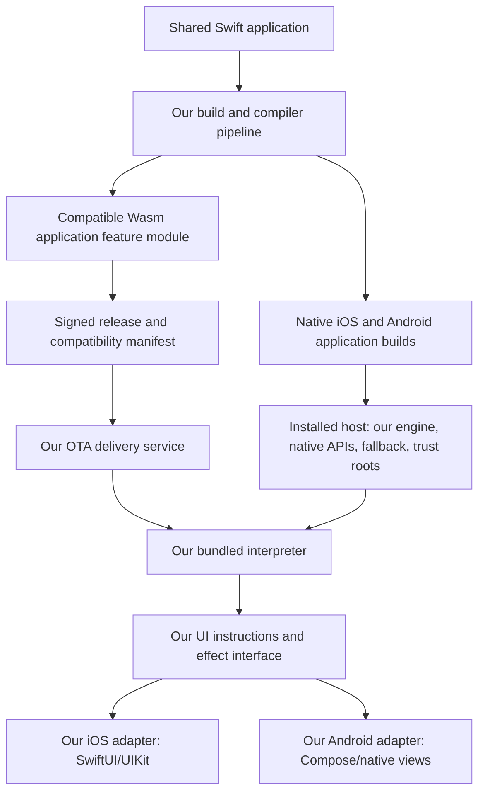
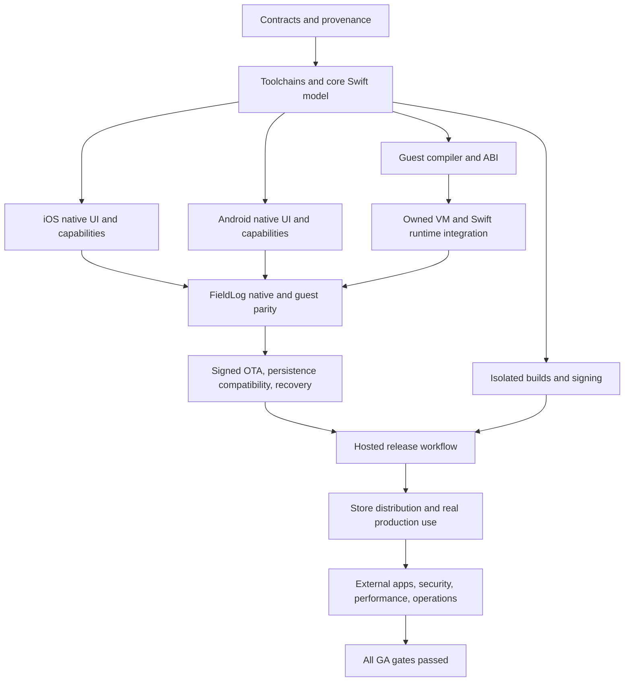

# mixer — Swift-First Mobile Platform Product and Engineering Plan

Version: 1.3 — updated October 24, 2026 (hosted stack and deployment decisions).

Prepared: October 22, 2026  
Status: Proposed implementation plan; no implementation or release evidence is claimed by this document.  
Project name: **mixer**. The CLI is `mixer`, configuration files are `mixer.yml` and `mixer.lock`, and owned Swift modules use the `Mixer*` prefix. These are the planned product interfaces; implementation status remains governed by the acceptance gates.

**Decision in brief:** Buildable with a supported Swift application/UI model, native platform adapters, and an independently implemented interpreted update runtime. It cannot promise unchanged compatibility with every existing SwiftUI app or OTA replacement of arbitrary native code. The business is plausible but demand remains unproven. Execution is designed for AI agents, organized by dependencies, concrete deliverables, and verified completion gates. FieldLog, a real Swift app, must prove each stage on both platforms.

**Navigation:** [Evidence and verdict](#3-evidence-assumptions-and-competitive-context) · [Independent ownership](#4-independent-implementation-and-provenance) · [Architecture](#5-system-architecture-and-ownership) · [Compiler](#7-swift-compilation-and-module-model) · [Owned interpreter](#10-our-interpreter-and-swift-execution-profile) · [OTA and recovery](#11-update-eligibility-packaging-and-trust) · [Hosted product](#13-hosted-release-and-control-plane) · [Real-app dogfood](#21-the-real-dogfood-application-fieldlog) · [Delivery sequence](#24-delivery-sequence-and-dependency-graph) · [AI-agent execution](#25-ai-agent-execution-model) · [Business model](#26-business-model-and-market-validation) · [GA gates](#29-general-availability-acceptance-gates) · [Sources](#33-primary-source-research-index)

## 1. Binding product direction

Build a finished commercial platform that lets developers author an application primarily in Swift, maintain one shared application codebase, ship native iOS and Android apps, and deliver compatible logic and UI updates over the air to both platforms. Provide the surrounding build, signing, distribution, debugging, release, monitoring, billing, and support services expected from an Expo-like product.

This is the delivery plan for that complete product. Internal milestones establish working slices of the production architecture; none is a substitute for completing the general-availability requirements.

The user's decisions govern the plan:

1. **Own the engine.** Independently implement the cross-platform application engine, Swift-facing UI layer, Android integration, compiler orchestration, bridge generation, OTA runtime, update protocol, and hosted service.
2. **No Patch or Skip code.** Do not copy, fork, vendor, translate, link, or depend on their implementations, generated code, test fixtures, or proprietary services. Their public product behavior can inform competitive requirements.
3. **Dogfood continuously.** Build and operate a real Swift application throughout development. Every major milestone requires evidence from that application on physical devices and, once distribution is ready, through real store builds.
4. **Deliver both platforms.** iOS-only success does not satisfy a milestone whose scope includes Android, and Android emulator success does not establish physical-device qualification.
5. **Make limitations explicit.** The service must explain which changes are OTA-compatible, which require a store release, and which APIs are platform-specific.
6. **Use the specified agent models.** The user selects **Astra Extra High** as the main controlling agent when launching development. Astra directs and integrates the work, using **Sol 6.1 Extra High** subagents in parallel as much as practical. These model choices and reasoning levels are binding for development execution.

### 1.1 Meaning of “our own engine for everything”

The owned product layer includes the application model, UI reconciliation, platform adapters, capability interfaces, compiler pipeline, module format, WebAssembly interpreter, scheduler integration, build orchestration, compatibility analysis, release system, and developer experience.

Use standard foundations: the official Swift compiler/LLVM, Swift standard library, documented Apple SDKs, Android SDK/NDK, AndroidX/Compose as a native UI toolkit, operating-system networking, and vetted cryptographic primitives. Using the system text renderer, TLS implementation, or Swift compiler does not outsource the product engine.

The production runtime will **not** depend on WasmKit or another third-party Wasm engine under this baseline. Implement our interpreter from the WebAssembly specification. Independently maintained reference runtimes and standards conformance suites may be used as development/test oracles under their licenses, never as copied implementation material. Do not invent a cryptographic algorithm or implement crypto primitives merely to claim ownership.

### 1.2 Product promise

> Write your application in Swift. Build native experiences for iOS and Android. Ship compatible fixes through one controlled release workflow.

Avoid promises of arbitrary native binary replacement, universal SwiftUI compatibility, instant delivery to offline devices, guaranteed store approval, or zero overhead.

## 2. Completion definition and scope

The product is complete for general availability only when every mandatory gate in Section 29 passes for a documented support matrix. A command-line demo, a compiler that builds, or an OTA module that executes is insufficient.

### 2.1 Mandatory GA capabilities

| Area | Required finished behavior |
| --- | --- |
| Project creation | Create a Swift project, run on both platforms, inspect generated native projects, and build without a cloud account. |
| Existing app adoption | Import a real Swift project with an actionable compatibility report and incremental migration path. |
| Shared app engine | Shared Swift logic, state, navigation, resources, lifecycle, and tested platform integrations. |
| Native UI | Product-owned Swift API and renderer using native iOS and Android controls, accessibility, text input, and platform navigation conventions. |
| OTA | Signed, compatibility-scoped logic and supported UI updates on iOS and Android; staged release, local recovery, offline behavior, and server rollback. |
| Builds | Managed macOS/iOS and Android builds; deterministic inputs, logs, artifact retention, caches, quotas, cancellation, and isolation. |
| Distribution | Development builds, internal testing, TestFlight/Play testing, and production submission with accurate status reporting. |
| Credentials | Secure signing credentials, store connections, key rotation, access control, and customer-owned keys. |
| Developer tooling | Local CLI, Swift diagnostics, native and guest debugging, profiler, patch eligibility report, emulator/device support, and reproducible bug reports. |
| Console/API | Projects, environments, releases, builds, devices in aggregate, rollout health, audit history, billing, and documented automation API. |
| Operations | On-call, backups, restore testing, incident response, status page, abuse controls, and measured reliability. |
| Trust | Open SDK/tooling strategy, provenance, security review, export/ejection, support policies, and clear licensing. |
| Dogfood | A real Swift application used regularly, published on both stores, and maintained through our own platform. |

### 2.2 Explicit boundaries of the first complete release

- Target production iOS and Android phones, with basic tablet/adaptive-layout support included. Desktop, web, watch, TV, and XR are later product lines.
- Support a documented, broad mobile UI/API surface. Do not claim implementation of every Apple framework or every private SwiftUI behavior.
- Support standard utility, productivity, commerce, content, and collaboration applications. A new game engine, unrestricted graphics engine, and arbitrary native-code hot replacement are outside GA.
- Provide adapters to customer backends. A generic hosted database/auth product is not required to compete in the specified development/build/OTA category.
- Include a useful first-party SDK catalog and documented custom extensions. An unreviewed third-party marketplace is not required for GA.
- Corporate SSO, audit export, and dedicated build runners are GA Team/Enterprise capabilities. Formal certifications and every possible deployment region are separately tracked commitments, not implied claims.

### 2.3 Operationally complete, not feature-count complete

For every required capability, delivery means: implementation, documented semantics, error behavior, security controls, compatibility tests, physical-device evidence where applicable, observability, support runbook, migration path, and dogfood usage. Unsupported combinations must fail clearly before distribution.

## 3. Evidence, assumptions, and competitive context

As of the research date, Skip distinguishes native Swift compilation for Android from its Kotlin transpilation mode. Patch documents a Swift-to-Wasm OTA architecture. An Android-support draft PR exists in Patch's repository but is not a complete shipped integration. These establish feasibility signals and competitive context; they do not establish that our independent implementation exists or will meet its budgets. [Skip modes](https://skip.dev/docs/modes/), [Patch architecture](https://docs.patchrelease.com/how-it-works/), [Android proposal](https://github.com/patch-release/patch-swift/pull/2)

Official Swift SDKs provide Android and WebAssembly compilation foundations. Host toolchains and cross-compilation SDK versions must match according to the official documentation. The plan therefore starts with supported official compiler distributions and pins them as an atomic toolchain release. [Swift Android SDK](https://www.swift.org/documentation/articles/swift-sdk-for-android-getting-started.html), [Swift Wasm SDK](https://www.swift.org/documentation/articles/wasm-getting-started.html)

The proposed architecture, pricing, execution workflow, and performance targets below are design decisions or hypotheses. They are not benchmark results or vendor commitments. Implementation advances through verified dependencies and completion gates.

### 3.1 Competitive goal

| Comparison | Product must win by |
| --- | --- |
| Skip | Supplying our own complete Swift-to-Android development experience with integrated OTA, builds, diagnostics, and operations. |
| Patch | Supporting both platforms as a first-class release unit and owning the framework/runtime contract that makes updates predictable. |
| Expo | Offering comparable workflow completeness for developers who want Swift and native platform UI. |
| Separate native apps | Reducing duplicated application work while preserving native integrations and a practical escape route. |

A unified logo over two external tools would not meet this goal. All required interfaces and release behavior must be owned and supported by this project.

### 3.2 Verification of the original Patch + Skip question

**Your concern is supported by the public evidence: do not treat Patch + Skip Fuse as a supported, production-ready Android OTA solution today.** Patch's Android PR is still marked draft as of October 22, 2026. This is a documentation/repository-status assessment, not a device test of that combination, and it does not prove that integration is technically impossible. [Android proposal status](https://github.com/patch-release/patch-swift/pull/2)

One terminology correction: **Skip Fuse compiles Swift natively for Android; Skip Lite transpiles Swift to Kotlin.** A Swift app running on Android does not automatically carry an OTA interpreter, compatible UI/effect interface, package loader, or recovery system. Those are separate requirements. [Skip mode definitions](https://skip.dev/docs/modes/)

Patch's documented iOS architecture uses a Wasm module and native host. Android needs its own qualified host integration and release path; the portability of a Wasm file alone does not establish them. [Patch architecture](https://docs.patchrelease.com/how-it-works/)

### 3.3 Store-policy feasibility

Apple's agreement permits interpreted code subject to conditions, including consistency with the submitted app's primary purpose. App Review Guideline 2.5.2 separately restricts downloaded code that introduces or changes functionality. These provisions must be considered together; using Wasm is not blanket permission to change an app. [Apple agreement, §3.3.1(B)](https://developer.apple.com/support/terms/apple-developer-program-license-agreement/), [App Review software requirements](https://developer.apple.com/app-store/review/guidelines/#software-requirements)

Google Play prohibits self-updating executable binaries outside Play and describes an exception for interpreted/VM code with indirect Android API access. Other Play policies still apply. A signed Wasm payload is not automatically compliant simply because it is interpreted. [Google Play Device and Network Abuse](https://support.google.com/googleplay/android-developer/answer/16559646?hl=en)

Our product policy will therefore permit only approved-purpose changes within the installed capability envelope. A release report separates technical compatibility from policy review. Store submissions disclose the interpreter and update behavior, include reviewer instructions, and retain working native fallback. Actual acceptance of transparently submitted dogfood apps is a required commercial gate, not a universal future approval guarantee. Native libraries, permissions, entitlements, new capabilities, and engine changes go through store releases.

### 3.4 Feasibility and business verdict

**Technically feasible, commercially plausible, and a substantial platform company undertaking.** The strongest offering is a Swift-first workflow with one owner for the framework, builds, updates, and recovery. The weak proposition is an unrestricted promise that every existing Swift app runs unchanged on Android and every edit can ship OTA.

The addressable customer set is narrower than all mobile developers: Swift teams that need Android, value native UI, and accept a supported cross-platform API. The business becomes attractive only if that audience pays enough to cover compiler/runtime maintenance, macOS build capacity, security, and developer support. No market-size or demand claim is established by the technical research. Paid customer evidence is part of the plan, alongside engineering evidence.

## 4. Independent implementation and provenance

### 4.1 Allowed and prohibited material

| Material | Rule |
| --- | --- |
| Patch/Skip source, patches, generated source, assets, tests | Prohibited in our product and implementation prompts. Do not translate or lightly rewrite them. |
| Public product documentation and observable behavior | Allowed for understanding user expectations and identifying gaps. Record the source of requirements. |
| Official platform documentation and public specifications | Primary design references. |
| Standard toolchains and platform SDKs | Allowed with version, license, redistribution, and hosting obligations recorded. |
| Third-party general-purpose libraries | Require dependency review; no hidden alternate mobile/OTA engine. |
| Reference runtime comparisons | Development-only differential testing; preserve test-suite licensing and provenance. |

Earlier source inspection was research, not a formal clean-room process. Do not represent the project as legally certified clean-room work. Establish independent architecture records, design authorship, and reviewable implementation provenance from the start.

### 4.2 Controls

- Maintain `THIRD_PARTY.yml` with origin, version, license, purpose, distribution mode, and owner.
- Maintain `docs/provenance/` for architecture sources and imported test corpora.
- Add dependency-policy CI rejecting `skiptools/*`, `patch-release/*`, their packaged artifacts, and undisclosed alternate engine dependencies.
- Review generated files and template provenance, not only package manifests.
- Keep benchmark apps' original licenses; do not redistribute restricted customer source or assets.
- Publish SDK source and notices with every binary distribution where required by chosen licenses.
- Original SDK, engine, and CLI code: proposed Apache-2.0; hosted console/control-plane code: commercial. Confirm patent and trademark position before public branding.

For context only, source inspection found MPL-2.0 in Skip's UI/bridge libraries and AGPL-3.0 in skipstone. These implementations are excluded under the user's decision, so the product does not depend on satisfying a competitor-code reuse plan. [UI license](https://github.com/skiptools/skip-ui/blob/main/LICENSE.txt), [Engine license](https://github.com/skiptools/skipstone/blob/main/LICENSE.txt)

## 5. System architecture and ownership

### 5.1 Major components

| Component | Owned responsibility | Implementation direction |
| --- | --- | --- |
| `MixerCLI` | Create, inspect, build, test, release, rollback, export, diagnose | Swift executable with machine-readable output. |
| `MixerBuild` | Source graph, toolchain lock, native project generation, artifact manifest | Swift tooling; Xcode/SwiftPM/Gradle orchestration. |
| `MixerCompiler` | Feature extraction, API validation, capability analysis, dual compilation, source maps | SwiftSyntax/macros for syntax plus actual compiler type checking; limited compiler integration where unavoidable. |
| `MixerCore` | Lifecycle, feature registry, effects, state coordination, configuration | Swift. |
| `MixerUI` | Swift declarative API, stable view identities, state observation, UI instruction representation | Independently implemented Swift API and engine. |
| `MixerApple` | SwiftUI/UIKit adapters and native host capabilities | Swift with documented Apple APIs. |
| `MixerAndroid` | Kotlin/Java/JNI integration, Android lifecycle, Compose/widgets | Swift, minimal C ABI, and Kotlin adapter code. |
| `MixerGuest` | Wasm-facing Swift UI/effect/state interface | Swift; no Apple or Android frameworks in guest. |
| `MixerVM` | Wasm validation, execution, metering, imports, memory management, traps | Independently implemented memory-safe Rust core behind a stable C ABI. |
| `MixerUpdates` | Verification, download, atomic activation, local recovery, telemetry | Shared core plus small OS-specific storage/network adapters. |
| Build service | Worker scheduling, isolation, logs, artifact provenance, signing handoff | Elixir/OTP services with Phoenix and Oban; isolated macOS/Linux build workers. |
| Release service | Compatibility, channels, policies, staged rollout, revocation, audit | Elixir/Phoenix REST API, Ecto/Postgrex, Oban, and Neon-hosted PostgreSQL; Cloudflare Containers deployment. |
| Artifact delivery | Immutable payloads, private build outputs, cacheable signed assignments | Cloudflare R2 object storage, Workers, and Cloudflare CDN. |
| Console | Team/project/build/release/support workflows | SolidJS + TypeScript + Vite + Solid Router; Cloudflare Workers Static Assets. |
| Commercial billing | Subscriptions, invoices, payment collection, usage reconciliation | Stripe Billing, Checkout, and Customer Portal; Phoenix webhook processing and Oban reconciliation. |
| FieldLog | Real Swift application proving the platform works | Swift app in a separate consumer repository. |

The customer application's language is Swift. It is acceptable for the engine's native adapter and cloud infrastructure to use the languages appropriate to those platforms.

### 5.2 Execution architecture



Native and patched feature implementations emit the same logical UI/effect contracts. Native platform adapters remain compiled into the store binary. Downloaded modules do not contain replacement `.so`, DEX, Mach-O, or executable runtime libraries.

### 5.3 Architecture decisions

| ID | Baseline decision | Rationale and consequence |
| --- | --- | --- |
| ADR-01 | Compile Swift natively for Android; no general Swift-to-Kotlin transpiler | Full language compilation is supplied by official Swift. We own interoperability and packaging. |
| ADR-02 | Own a Swift declarative UI API with familiar SwiftUI conventions | A published compatibility surface is supportable; arbitrary Apple framework replication is not promised. |
| ADR-03 | Own native adapters over platform toolkits | Keep platform accessibility, IME, text rendering, gestures, and lifecycle behavior. |
| ADR-04 | Build features both natively and for Wasm | Native baseline and safe fallback; compatible feature code can later execute in our interpreter. |
| ADR-05 | Use an independently implemented Wasm interpreter | Own execution semantics, budgets, diagnostics, and distribution. This adds substantial engineering and audit scope. |
| ADR-06 | Activate production changes at a safe cold start | Avoid replacing live Swift object graphs and in-flight UI state. Development reload is separate. |
| ADR-07 | Initially publish one coherent guest module per platform/runtime target | Avoid mixed module versions and an unnecessary dynamic linker in the first complete release. |
| ADR-08 | Exact native-runtime identity before capability-range optimization | Prefer conservative incompatibility to an update that fails on installed devices. |
| ADR-09 | Local build and native project export remain available | Cloud outage or subscription cancellation cannot prevent app maintenance. |
| ADR-10 | Independent dogfood app consumes published candidate packages | Exposes real installation, migration, documentation, and support failures. |
| ADR-11 | Elixir/Phoenix hosted API and orchestration, with Oban durable jobs | OTP supervision and transactionally persisted jobs fit builds/releases; retries still require idempotent external effects and fencing. |
| ADR-12 | Neon hosts the production PostgreSQL database | Ecto/Postgrex connect directly over verified TLS initially; bounded pools and Oban notification/recovery behavior require Neon qualification. |
| ADR-13 | Cloudflare hosts every suitable workload | Containers host Phoenix; Workers host edge routing and the SolidJS console; R2/CDN deliver artifacts. macOS builds and isolated key custody retain explicit exceptions. |
| ADR-14 | SolidJS web console and Stripe commercial billing | Fix the web framework and payment provider; retain the existing usability, metering, entitlement, and recovery requirements. |

## 6. Customer workflow

### 6.1 New project

Illustrative commands; these form requirements for the eventual CLI, not commands available today:

```sh
mixer create MyApp
mixer doctor
mixer run ios
mixer run android
mixer test --platform all
mixer build --platform all --profile development
mixer release inspect
mixer build --platform all --profile production
mixer submit --platform all --track testing
mixer update prepare --platform all
mixer update verify <candidate>
mixer update publish <candidate> --channel production --rollout 5
mixer update promote <release> --rollout 25
mixer update rollback <release> --reason "validation regression"
```

Every release command resolves to immutable artifacts and a recorded intent. Publishing and promotion are distinct operations. Automated pipelines may be authorized in advance using explicit environment policies and scoped identities.

### 6.2 Project layout

```text
MyApp/
  mixer.yml
  mixer.lock
  Package.swift
  Sources/
    AppFeatures/          # shared Swift UI, state, and application logic
    AppModels/            # shared value models and supported algorithms
    NativeServices/       # typed service interfaces; implementations stay native
  Platforms/
    iOS/                  # app-owned native extensions
    Android/              # app-owned native extensions
  Resources/
  Tests/
  UITests/
  Generated/              # reproducible, clearly marked artifacts
```

The app developer can inspect and edit designated native extension points. Regeneration must preserve owned files and fail rather than overwrite ambiguous changes.

### 6.3 Existing Swift app adoption

1. Import a repository read-only and identify targets, packages, framework use, resources, signing settings, and SwiftUI usage.
2. Produce a report separating supported shared code, supported-with-adapter code, iOS-only code, and unsupported constructs.
3. Generate migration edits on a branch with a preview. Preserve the current shipping iOS application.
4. Move feature code behind documented module boundaries; migrate imports/UI surfaces incrementally.
5. Create an Android host and bridge catalog; prove equivalent user workflows.
6. Instrument eligible features for future updates and ship the resulting native binaries through the stores.
7. Publish OTA only to these instrumented, matching binaries.

Do not claim that arbitrary existing `import SwiftUI` applications can compile unchanged on Android. Provide a compatibility importer and conversion assistance. New projects use `MixerUI`; existing projects receive precise changes and a preserved native-only path.

### 6.4 Environment and account model

Use organizations, projects, apps, environments, channels, native runtimes, and release groups as distinct concepts. A developer can work locally without login. Cloud login adds builds and delivery; it does not change application semantics. Development, staging, and production have separate signing/update policies and clear visual labels.

## 7. Swift compilation and module model

### 7.1 Dual compilation contract

`AppFeatures` is the principal patchable boundary. The build produces a native version linked into each store binary and a Wasm version compiled against `MixerGuest`. Both implement an explicit feature interface and use the same logical models. The guest interacts with the host only through versioned capability calls and UI messages.

The installed host chooses the native or compatible guest implementation at process startup. It does not patch arbitrary machine instructions or exchange live heap pointers between native Swift and guest Swift. Native reference identity never crosses the boundary accidentally.

Shared feature code can use normal Swift functions, value types, generics, protocols, collections, closures, errors, and supported async APIs. Platform frameworks are accessed through typed services. Native-only high-performance code remains a host capability with an explicit input/output contract.

### 7.2 Compiler work packages

- Resolve a reproducible Swift package graph separately for native and Wasm targets.
- Use syntax analysis to locate supported declarations; use compiler type checking to validate meaning. Syntax matching alone must never authorize an update.
- Generate feature registries, stable IDs, capability adapters, state/effect codecs, and source maps.
- Compile original source under both target environments and report target-specific errors at original source locations.
- Build a transitive dependency graph of every capability, resource, model schema, UI opcode, and compiler/runtime feature used by a guest module.
- Ensure compiler optimizations, macros, conditional compilation, and imported generic code cannot bypass the compatibility inventory.
- Emit the exact supported Wasm profile and reject artifacts outside the interpreter's verified feature set.
- Include compiler and standard-library identity in artifact provenance; isolate changes in unstable compiler APIs behind an owned adapter.
- Prefer public compiler facilities and generated Swift modules. If a compiler patch becomes necessary, define maintained-fork ownership, source publication obligations, upstreaming strategy, and version qualification.

### 7.3 Language support matrix

Maintain a generated public matrix with four values: native supported, guest supported, host bridge required, or unsupported. Each entry links to executable positive/negative tests.

Initial critical areas: generics, associated types, result builders, property wrappers, macros, optionals, enum payloads, `Codable`, Unicode strings, floating-point behavior, `Date`/locale abstractions, cancellation, actor isolation, and closure capture lifetimes. Foundation APIs must be tested individually; importing Foundation does not prove every API is guest-compatible.

Unsafe pointers, C/ObjC interop, arbitrary dynamic loading, threads, and framework reflection remain native-only unless a reviewed, explicit bridge exists. Do not silently substitute behavior to increase apparent coverage.

### 7.4 State ownership

- Feature-local transient state lives in the active native or guest feature implementation.
- Auth sessions, native resource handles, device services, and persistence connections live in the host.
- Persistent data uses versioned schemas accessible to the bundled fallback.
- Navigation/restoration state uses a versioned value representation, not serialized arbitrary Swift objects.
- Update activation happens before feature instances start. Live state transfer is not required for production GA.
- Cross-feature interactions use typed events or services; no hidden references to an inactive implementation.

## 8. Native UI engine

### 8.1 Authoring API

Implement familiar Swift concepts: `View`, result builders, modifiers, state, bindings, observable models, environment, navigation, lists, forms, and async lifecycle hooks. Names are API-design proposals, not a claim of binary compatibility with Apple SwiftUI.

`MixerUI` has native and guest-compatible implementations under our control. Both produce an owned UI instruction representation. iOS adapters create native SwiftUI/UIKit behavior; Android adapters create Compose/native-view behavior. Own reconciliation, identity, event routing, and capability negotiation. Do not copy Skip's mapping implementation.

### 8.2 Required UI inventory

| Family | GA scope | Required behavioral evidence |
| --- | --- | --- |
| Layout | Vertical/horizontal/overlay stacks, spacing, alignment, safe areas, adaptive layouts, grids | Orientation, keyboard, split layout, RTL, extreme content sizes. |
| Text | Styled text, localization, interpolation, selection where supported, links | Unicode, truncation, line wrapping, accessibility text size, locale changes. |
| Controls | Button, toggle, slider, stepper, picker, text/secure field, progress | Focus, IME composition, validation, disabled state, accessibility actions. |
| Collections | Lazy lists/grids, sections, stable IDs, pagination, refresh, swipe actions | 1,000-row reference dataset, insert/remove/reorder, retained scroll position. |
| Navigation | Stack, tabs, modal/sheet, deep links, restoration | iOS back gesture, Android back/predictive back where supported, process recreation. |
| Visuals | Images, bundled/remote assets, colors, fonts, shapes, common transitions | Cache behavior, dark mode, asset compatibility, rendering and memory budgets. |
| Interaction | Tap, long press, drag, keyboard shortcuts where relevant | Gesture arbitration, cancellation, native scroll interoperation. |
| Native surfaces | Camera/photo picker, maps, web content, media, share sheet | Stable native-view identity and explicit native-only behavior. |
| Accessibility | Labels, roles, values, actions, focus order, announcements | VoiceOver and TalkBack workflows on physical devices. |

### 8.3 UI instruction contract

Use versioned, bounded messages describing node type, stable identity, properties, child references, actions, and state bindings. Separate structural updates from frequently changing properties. Batch changes so JNI and interpreter transitions do not occur for every scalar property or every frame.

The host validates node counts, nesting, lengths, resource references, and supported operations before reconciliation. Unsupported required nodes reject the candidate update; no blank placeholders in production. Optional decorative behavior can degrade only when the manifest explicitly permits it and the preview shows the degradation.

One codebase produces the same app design on both platforms. A MixerUI screen renders with the same layout, hierarchy, content, colors, typography scale, iconography, spacing, and component appearance on iOS and Android. Adapters still render through native toolkits (SwiftUI/UIKit and Compose/native views), but they style controls from the app's shared theme rather than each platform's default look. An app that wants a platform-specific appearance must declare it explicitly; it is never the default.

Accessibility and navigation behavior stay native. That covers VoiceOver and TalkBack roles, labels, values, actions, and focus order; the iOS back gesture; Android system and predictive back; and native text input and keyboard handling. System-owned surfaces outside the app's screens keep their platform appearance, including status bars, permission prompts, share sheets, and the keyboard.

The correctness criterion is design parity on reference screens, reviewed side by side on physical iOS and Android devices. Pixel-identical output is not required where native text shaping, font rasterization, display density, or safe-area geometry legitimately differ.

### 8.4 Performance design

Keep layout, text shaping, scrolling, image decoding, animation execution, and input services native. Run feature logic and view construction in the selected implementation, with coarse state/effect messages. Use dependency tracking, stable identity, incremental diffs, cancellation, and bounded caches. Measure native baseline, engine-native mode, and OTA mode separately on the same app and devices.

## 9. Native capability and extension system

Define a typed capability interface with stable IDs, schema versions, declared permissions, thread/executor requirements, synchronous/asynchronous behavior, cancellation, failure codes, and resource ownership. Generate our Swift host adapters and Android JNI/Kotlin stubs from that schema.

| Capability family | Native implementation | Dogfood requirement |
| --- | --- | --- |
| Network | OS HTTP/TLS, streaming, resumable transfers, connectivity | Authenticated sync and photo upload. |
| Storage | App-private files, preferences, SQLite abstraction | Offline entries, durable upload queue, schema migration. |
| Identity/security | Keychain/Keystore-backed secrets, secure random, biometrics | Login persistence, logout, secret cleanup. |
| Device/lifecycle | Foreground/background, orientation, locale, memory pressure | Reliable restoration and safe update activation. |
| Photos/camera | Native pickers and capture | Permission grant/deny/revoke, large images. |
| Maps/location | Native map surface and location service | Foreground location and project-site map. |
| Notifications | APNs/FCM integration and deep-link dispatch | Assignment notification opens correct record. |
| Sharing/files | Native share sheet, document picker, export | Share an inspection report and import attachments. |
| Purchases | Native store SDK with server validation | Sandbox entitlement and restore flow. |
| Accessibility/haptics | OS-specific primitives | Forms, feedback, screen-reader navigation. |

The guest receives only capabilities granted by the installed app and release manifest. It never receives arbitrary Java class lookup, Objective-C selector execution, native pointers, or unrestricted file-system access. Extensions that add native functionality require a new store binary; updates can invoke only already-registered compatible extensions.

Plugin packages include their public schema, native implementation, guest stub, permission declarations, privacy metadata, test fixtures, supported toolchains, and owner. Publish first-party plugin qualification results. Customer plugins can run locally, but cloud signing/publication requires the project's configured trust policy.

## 10. Our interpreter and Swift execution profile

### 10.1 Implement a specified execution target

Implement `MixerVM` against a published, versioned WebAssembly feature profile sufficient for the pinned Swift SDK and our guest libraries. The official WebAssembly specification is the normative reference. Do not claim conformance to proposals or the entire latest specification unless qualified. [WebAssembly specification](https://webassembly.github.io/spec/core/)

Work proceeds through a binary decoder, structural/type validator, executable internal representation, interpreter dispatch, linear memory and tables, host imports, limits, traps, debugging, and optimization. The internal representation may predecode instructions and resolve branch targets, but must not generate downloaded native machine code. No JIT or executable-memory entitlement is part of the mobile design.

The compiler and VM teams jointly produce a machine-readable opcode/import inventory from actual FieldLog builds. Start from that inventory and standards requirements; never guess that the minimal integer instruction set will run the Swift runtime. Support compiler-emitted exception, reference, bulk-memory, or other features when required, or explicitly configure the compiler to emit a validated alternative. Unknown features fail validation before publication and on the device.

### 10.2 Swift runtime integration

- Begin with the full supported Swift Wasm SDK. Evaluate Embedded Swift only for isolated modules whose semantics and library dependencies fit; do not assume it supports the entire app language surface.
- Supply the exact WASI/environment functions required by the selected SDK through bounded, capability-controlled host adapters. Do not expose a general POSIX process, arbitrary filesystem, subprocesses, or unrestricted sockets.
- Implement allocator and memory-growth limits, clocks, secure randomness through the host, string/Unicode behavior, logging, and error propagation.
- Route asynchronous effects through request IDs and executor queues. Validate cancellation, actor isolation, task lifetime, reentrancy, main-thread UI dispatch, and app suspension.
- Keep guest and native heaps separate. Encode values at the boundary; use generation-checked opaque resource handles for native objects. Detect use-after-close and stale callback delivery.
- Restore state through versioned data, never serialized pointers or an archived Swift object graph.

### 10.3 Security and resource limits

Validate every module before execution, even if the server previously validated it. Bound section sizes, nesting, function count, stack depth, table size, memory, decompression, host-call frequency, and execution time. Use instruction metering and cancellation checks to prevent a loop from monopolizing a device thread. Meter long native imports independently; instruction fuel cannot bound a blocking host call.

Use Rust for the interpreter core, isolate necessary `unsafe` code, and audit every C ABI boundary. No Rust panic or Swift exception may unwind across that boundary. Check arithmetic, alignment, pointer lifetimes, and buffer sizes at each transfer. Host functions return structured failures and cannot bypass capability checks.

The VM is a sandbox boundary, not a proof that a correctly signed app behaves well. A publisher can still write a destructive database operation or misuse an allowed API. Preserve application authorization, release review, and data-recovery controls outside the VM.

### 10.4 Correctness and performance qualification

Run the applicable standards suites, independently authored negative tests, differential execution against development-only reference runtimes, Swift language regression cases, and continuous fuzzing of the decoder, validator, interpreter, UI protocol, and bridge codecs. Record any imported test licenses. Check NaNs, integer overflow, floating-point conversion, traps, malformed modules, out-of-bounds memory, recursion, cancellation, and memory pressure.

Profile real FieldLog tasks before optimizing dispatch. Keep image processing, database execution, native text/layout, cryptography, media codecs, and similar expensive services in precompiled host capabilities. Moving ordinary app logic to native merely to hide poor interpreter performance does not satisfy the OTA coverage gate.

Deliver readable Swift stack traces, original source locations, module IDs, sanitized effect traces, and a debugger transport. A Wasm byte offset alone is insufficient developer tooling.

## 11. Update eligibility, packaging, and trust

### 11.1 Eligibility is an explicit contract

The installed binary records its native runtime fingerprint: engine and guest ABI, compiler/SDK identity, bridge schemas, UI instruction set, native dependency versions, build configuration, relevant permissions/entitlements, and platform/architecture requirements. The server and client both enforce compatibility. GA uses exact fingerprint matching; broader compatibility ranges require separately proven rules.

Each release inspection reports:

| Result | Meaning | Action |
| --- | --- | --- |
| OTA compatible on both platforms | Both guest compilations and all installed contracts match. | Can enter the dual-platform OTA release workflow. |
| OTA compatible on only one platform | One platform changed its native contract or lacks an implementation. | Block a claimed dual-platform release; explicitly choose separate release plans. |
| Store build required | Native SDK, capability, permission, ABI, or incompatible storage contract changed. | Build and distribute new binaries. |
| Unsupported | Semantics cannot be preserved within the published support matrix. | Show file/line, dependency chain, and remediation; do not silently omit behavior. |
| Policy review required | Technically possible but purpose, content, payment, or permission implications changed. | Complete project release review; technical eligibility is not approval. |

Classify the complete dependency graph and generated code, not just edited files. A dependency upgrade can change the runtime fingerprint without editing an app function. Resource changes are OTA-compatible only within supported formats and the installed UI/capability contract. App icons, entitlements, extensions, signing, and store metadata have separate native/store paths.

### 11.2 Release artifact

Each immutable artifact contains one coherent guest module per target runtime, an asset index, source-map references, schema declarations, capability requirements, resource limits, provenance, and checksums. A release group ties the iOS and Android variants to the same source revision and product change. The module bytes may differ across platforms; one codebase does not mean one universally interchangeable binary.

Use a canonical serialization specification for the signed manifest; select canonical CBOR in the initial protocol. A readable JSON rendering is for inspection only. Define exactly which bytes are signed and domain-separate artifact signatures from rollout-assignment signatures. Hash each payload and the complete manifest with a standard cryptographic hash. Verify declared compressed and expanded sizes before allocation.

The manifest includes application ID, environment, release ID, source commit, target platform, runtime fingerprint, protocol/guest ABI version, capability schema hashes, UI schema version, state-schema range, payload hashes/sizes, asset hashes, limits, signing-key ID, and build provenance ID. Store creation time for audit; do not trust a client clock as the only replay defense.

### 11.3 Separate artifact authorization from delivery authorization

- An artifact signature authorizes specific content for a specific app/environment/runtime.
- A separately signed assignment authorizes a channel/cohort to run that immutable artifact, with a monotonically increasing assignment sequence.
- The client pins the applicable trust roots in the store binary, validates delegation scope, and rejects cross-app/environment substitutions.
- Enterprise customers can supply their release signing key or use an isolated managed signer. The CDN and ordinary web application never receive that private key.
- Key delegation, revocation, expiry, rotation, and emergency response are versioned protocol features, with offline-device behavior tested explicitly.

A rollback uses a new assignment sequence pointing to a previously authorized compatible artifact. It does not ask the device to accept an old sequence. Download expiry must not disable a healthy, previously activated offline app. A compromised root embedded in a binary may require a new store binary; do not promise the control plane can repair every trust failure remotely.

## 12. Device update lifecycle and recovery

### 12.1 State machine

```text
native fallback / last healthy artifact
    -> assignment checked
    -> downloading to temporary storage
    -> payload and signature verified
    -> compatibility and resource validation passed
    -> staged
    -> pending activation at next safe cold start
    -> running provisionally
    -> healthy

Any validation error -> discard candidate, retain healthy implementation
Activation failure -> quarantine candidate, restore compatible last healthy/fallback
Server rollback -> new signed assignment, activate at next safe cold start
```

Do not switch a feature implementation in the middle of a purchase, database transaction, form edit, or active native callback. GA activates the app feature module at cold start. Development reload may use additional reset behavior, but that is not the production activation contract.

Download resumably into an app-private staging directory. Verify before activation, flush files and metadata, and use an atomic pointer/rename operation for selecting a completed artifact. Synchronize concurrent checks and app extensions. Retain a bounded set of compatible healthy artifacts and reserve disk space for recovery. Handle OS eviction, low disk, interrupted downloads, process death at every step, and a device clock moving backward.

### 12.2 Health and crash recovery

Record a boot attempt before loading the module. Mark a release healthy only after required startup milestones and a bounded observation period. Track launch IDs, prior attempt state, module identity, and failure reason. Distinguish a deterministic startup trap from an OS kill, user force-quit, background eviction, and an unrelated native crash; do not roll back every incomplete launch indiscriminately.

After the configured startup-failure threshold, quarantine the candidate locally and select the last compatible healthy implementation. A native fallback must remain launchable without network access. Bound recovery attempts so that the app cannot loop forever between two failing patches. Publish diagnostic explanations without exposing user content.

Remote rollout health aggregates activation success, startup failure, crash-free sessions, hangs, and business-flow errors. Sparse telemetry must be shown as insufficient evidence. Local recovery works even when telemetry is disabled or the release service is down.

### 12.3 Persistent state makes rollback harder than code rollback

OTA updates may perform only schema changes compatible with every implementation kept as a recovery target. Use additive fields/tables, defaults, versioned envelopes, idempotent migrations, and expand/contract server APIs. Destructive migrations, changed encryption formats, or irreversible rewrites require a new binary plus a separately reviewed data migration strategy.

Run the native fallback against data produced by the candidate before publication. Also test previous healthy patches against that data. Do not declare rollback working because the screen opens while saved records become unreadable.

External effects need their own protections: idempotency keys for purchases and uploads, durable outboxes, transactional writes, and explicit reconciliation. Rolling back code cannot unsend a message, reverse a payment, or automatically undo a remote database write.

### 12.4 Fleet coordination

Use stable per-install cohort assignment within each app/environment; use bounded, privacy-preserving identifiers. Support internal, beta, and production channels, with deterministic percentage expansion and explicit exclusions. Reinstall and account switching semantics are documented.

Promoting a release group coordinates compatible iOS and Android variants, but cannot make all devices update atomically. Offline devices, old binaries, suspended apps, and store-rollout lag remain normal. Customer backends must support the advertised mixed-version window. Show installed-binary coverage, eligible devices, downloaded devices, activated devices, and observed health as different measures.

## 13. Hosted release and control plane

### 13.1 Domain model

Persist organizations, memberships, projects, applications, environments, runtime fingerprints, native builds, artifacts, release groups, channels, signed assignments, rollout policies, health aggregates, credentials, audit events, usage records, invoices, and support incidents. Every mutable tenant record has an organization/project scope enforced at the API and storage layers.

Artifacts are immutable and content-addressed. Published releases reference artifacts rather than mutating them. Environment promotion creates an explicit authorized binding; it does not rewrite the original signed manifest. Audit events capture actor, scope, reason, previous/new values, source IP where appropriate, and correlation ID, with sensitive fields redacted.

### 13.2 API behavior

Implement the versioned REST API in **Elixir with Phoenix**, using Phoenix controllers/routers, Plug, and the Bandit HTTP server. Use Ecto with the Postgrex driver for Neon PostgreSQL, and generate the CLI client from the versioned API contract. Endpoints cover creating builds, uploading artifacts, validating releases, signing, publishing assignments, promoting stages, rolling back, exporting logs, and inspecting usage. Require idempotency keys for chargeable or publishing operations. Document pagination, rate limits, retries, webhook authentication, and error codes.

Use **Oban backed by the same Neon PostgreSQL database** for durable jobs. Commit domain changes and job insertion together with Ecto.Multi; Oban's persisted jobs provide the transactional outbox for dispatched work, while immutable domain/audit records remain separate. This is the queue advantage motivating Elixir: OTP supervision plus durable retries, scheduling, and bounded queue concurrency without a separate queue database. Phoenix itself is the HTTP framework, not the durable queue. Start with Oban's open-source functionality; its queue concurrency is per node, so fleet-wide build/signing quotas require Mixer-owned transactional admission/leases. Do not assume an unselected commercial queue feature supplies global limits. [Oban transactions](https://hexdocs.pm/oban/Oban.html#module-transactions), [Oban queue concurrency](https://oban.hexdocs.pm/defining_queues.html)

Separate API and Oban processor roles, with distinct queues and capacity for builds, signing requests, store submissions, releases, telemetry aggregation, and Stripe reconciliation. Build/signing/submission jobs retain leases, fencing tokens, explicit attempt records, and idempotent reconciliation. Oban execution is not exactly-once external execution: crash/redelivery tests must prove that retries cannot authorize a duplicate release or silently create a second charge. A coordinator dispatches fenced work to isolated build/signing workers; customer scripts never execute inside the API or Oban control-plane process. Administrative operations require project permissions rather than possession of a public app ID.

The device update endpoint exposes only the public assignment information needed for an eligible app. Do not embed a project administrator secret in the app. Scope telemetry ingestion, rate-limit abuse, and prevent arbitrary high-cardinality labels. Customer business data remains outside platform telemetry by default.

### 13.3 Delivery path and failure independence

Serve immutable payloads from **Cloudflare R2 through Cloudflare CDN**, and small signed assignment documents through a dedicated TypeScript Worker and cacheable delivery path. Use production custom domains and explicit cache rules; keep private source uploads, build outputs, logs, and source maps behind tenant authorization. Never expose private objects through a public bucket route or share authenticated cache entries between tenants. Cache immutable payloads by content hash; bound assignment freshness and preserve signed sequence/replay checks. Separate this read path from console, billing, build scheduling, and live database availability for already-published content. A console outage must not prevent a healthy installed app from starting. A billing dispute must not remotely brick already installed applications. [R2 delivery and access](https://developers.cloudflare.com/r2/buckets/public-buckets/)

Host the primary PostgreSQL database on **Neon**, with encrypted backups, tested restore, and regional delivery. The chosen Neon tier/region/topology must demonstrate the required multi-zone availability and Section 18.3 recovery objectives; provider branding does not pass these gates. Document failover interruptions, backup retention, restore/export procedures, and region-loss recovery. GA does not need active-active global writes. Retain provenance and release history for the contracted period; allow source/artifact exports and project deletion with explicit retention rules.

### 13.4 Hosted stack and deployment placement

These choices supersede the earlier Go hosted-service direction. Existing independently authored Go services and their receipts remain local reference/compatibility evidence until an explicit migration is implemented and qualified; this plan update does not claim that migration has happened.

| Workload | Language/framework or service | Selected placement and boundary |
| --- | --- | --- |
| Public REST API and release/build orchestration | Elixir/OTP, Phoenix, Plug/Bandit | A pinned Linux OCI release image on **Cloudflare Containers**, reached through a small TypeScript Worker and Durable Object routing layer. Phoenix owns tenant authorization and business logic. |
| Durable background work | Oban, Ecto.Multi, PostgreSQL | Separate BEAM processor role backed by **Neon**. Cloudflare Containers is the first deployment target, subject to the lifecycle checks below. |
| Relational persistence | Ecto, Postgrex, PostgreSQL | **Neon**, with environment-specific databases/roles, existing tenant/RLS controls, bounded connections, and serialized migrations. |
| Console | SolidJS, TypeScript, Vite, Solid Router | Build to static assets and deploy on **Cloudflare Workers Static Assets**; use the Phoenix API for server operations. Node.js is a build tool, not an additional production API runtime. |
| Edge and update delivery | TypeScript Workers, Cloudflare CDN | Routing, narrowly scoped artifact access, cache policy, and delivery of already-authorized signed assignments. Edge code never gains release-signing authority. |
| Blobs | Cloudflare R2 | Content-addressed guest packages/assets plus separately authorized source uploads, native artifacts, logs, symbols, and source maps. PostgreSQL stores metadata/references, not blob payloads. |
| Billing | Stripe Billing, Checkout, Customer Portal | Hosted Stripe payment flows; Phoenix verifies webhooks and persists billing state, with Oban reconciliation and idempotent outbound Stripe requests. |
| iOS compilation and signing | Xcode, SwiftPM, Apple SDKs | Dedicated ephemeral **Apple/macOS workers outside Cloudflare's Linux container runtime**; signing remains a separate trusted stage. |
| Android compilation | Swift SDK, Android SDK/NDK, Gradle | Prefer isolated **Cloudflare Linux Containers** only after resource, toolchain, hostile-code isolation, cache, and egress qualification; use external ephemeral Linux runners when these requirements cannot be met. |
| DNS, TLS, ingress protection | Cloudflare DNS/proxy, WAF and rate limits | Cloudflare in front of console/API/delivery; application authorization and signed update validation remain mandatory. |

**Runtime placement.** Phoenix/BEAM runs in a Linux container, not directly in the ordinary Workers runtime. Containers are generally available, but optional beta scheduling/snapshot features are not prerequisites. Start with the GA service scheduling policy, the direct Durable Object Container API, and a pinned supported image/Workers configuration. This is a selected deployment design inferred from Cloudflare's Linux container contract, not a vendor-certified Phoenix integration. Container disk is disposable; authoritative state lives in Neon/R2. Implement bounded instance routing/scaling and account for API/Worker/container compatibility during rolling deployments. Do not assume inbound distributed Erlang networking; database-backed jobs must recover without a BEAM cluster. [Containers capabilities](https://developers.cloudflare.com/containers/), [GA scope](https://developers.cloudflare.com/changelog/post/2026-04-13-containers-sandbox-ga/), [Container API](https://developers.cloudflare.com/containers/api/)

**Queue liveness.** A serverless container can stop while no user request is arriving; an in-process OTP supervisor cannot restart an absent container. Implement durable wake/reconciliation using the Cloudflare routing controller's alarms or scheduled Worker, and prove that delayed/retry jobs execute with zero customer HTTP traffic. Qualify inactivity shutdown, process death, deploy/drain, reconnect, duplicate wake, and missed-wake recovery against queue latency objectives. Keep API and processor scaling independent and account for every replica's database connections. If Cloudflare lifecycle limits cannot meet these tests, place the Oban processor role on a continuously running external BEAM host behind Cloudflare, record that exception in an ADR, and retain Cloudflare for suitable workloads. No production queue acceptance follows from simply booting Phoenix in a container. [Container lifecycle](https://developers.cloudflare.com/containers/concepts/architecture/)

**Neon connection contract.** Start with direct TLS PostgreSQL connections for Phoenix/Ecto, Oban notifications, and migrations, with certificate verification and bounded pools. Neon's transaction-pooler endpoint does not support LISTEN/NOTIFY, so do not route Oban's default Postgres notifier through it. Introducing pooled query traffic later requires a separately configured direct notification path or a qualified Oban notifier change. Disable production scale-to-zero for the queue database; test connection loss/failover, notification reconnect and polling/reconciliation, capacity limits, and database recovery. Align container placement with the selected Neon region, and qualify native PostgreSQL TCP egress separately from HTTP-only egress policies. [Neon pooling limits](https://neon.com/docs/connect/connection-pooling), [Neon scale to zero](https://neon.com/docs/introduction/scale-to-zero)

Pin exact package/runtime versions and licenses in lockfiles and THIRD_PARTY.yml when implementing this stack. Keep remaining operational choices explicit: Neon tier/region, container sizing/wake policy, any required external runner/processor host, signing-key custody, application identity/SSO provider, and observability tooling need scoped ADRs and measured acceptance. The selected vendors/frameworks are fixed by this revision; their deployments are not yet qualified.

### 13.5 Hosted migration and qualification

Implement the Phoenix service in an explicitly owned new service directory; preserve active Go work and historical evidence. Before changing the authoritative hosted route, replay shared wire/signature vectors and verify tenant/RLS boundaries, canonical signed bytes, monotonic assignments, idempotency conflicts, audit ordering, and rejection behavior against the supported Go contracts. Plan schema/outbox migration and recovery without two independent dispatchers authorizing the same operation. Never reinterpret an old Go/local/PostgreSQL receipt as Phoenix/Neon evidence.

Required hosted receipts include atomic domain/job commit and rollback; crash before/after an external effect; orphan-job rescue and stale-fence rejection; per-node versus organization-wide concurrency; zero-traffic scheduled/retry execution and missed-wake recovery; Neon connection exhaustion, failover and notification resubscription; restore reconciliation against completed external effects; private R2/cache isolation; and Stripe test-mode event/order/retry reconciliation. Record exact versions, provider configuration, source revision, measured output and limitations. All relevant GA gates remain open until this evidence exists.

## 14. Managed builds and supply-chain isolation

### 14.1 Build pipeline

1. Resolve an authorized source revision or upload and a pinned toolchain lock.
2. Verify package origins/checksums and dependency-policy rules.
3. Generate native projects deterministically and record their hashes.
4. Execute tests and dual compilation on isolated workers.
5. Produce native binaries, guest artifacts, resource inventories, debug symbols, compatibility reports, SBOMs, and provenance.
6. Move an authorized build output to a separate signing stage.
7. Publish immutable artifacts and accurate job status.
8. Optionally submit to a configured store/testing destination under the project's release policy.

iOS jobs run on appropriately licensed Apple hardware with supported Xcode. Android jobs run on isolated Linux workers; macOS local Android builds remain supported. Maintain explicit images for supported toolchain versions and deprecate images with advance notice.

The Elixir/Phoenix control plane schedules these jobs through Oban; database job completion and external runner completion require fenced reconciliation. Use Cloudflare Containers for Android workers where Section 13.4 qualification passes, keeping control-plane and untrusted build images/identities separate. Apple/macOS workers are an explicit hosting exception. A generic Cloudflare Workers invocation is not a native build worker, and a Linux container cannot satisfy the macOS requirement. Route caches and artifacts through scoped R2 access; stream bounded logs without granting workers broad account credentials.

### 14.2 Untrusted customer code

Assume build scripts, compiler plugins, macros, dependencies, and test executables are hostile. Workers are ephemeral with no cross-tenant filesystem persistence. Scope source tokens to a checkout, control egress, prevent metadata-service access, redact credentials, and tear down workers after jobs. Separate public dependency caches from private/tenant caches; verify cache provenance and prevent poisoning.

Never expose release signing keys to arbitrary customer build scripts. Signing workers accept a narrowly scoped, authorized artifact plus expected app identity and entitlements. Validate the bundle before signing and retain a signed attestation. Secret-bearing integration tests need separately scoped credentials and documented risk; they cannot inherit production signing authority.

### 14.3 Capacity and reliability

Provide queue position, estimated wait based on current capacity, concurrency limits, cancellation, timeouts, bounded retries, and clear billing attribution. Retry infrastructure failures; do not blindly retry an expensive compiler error. Keep warm capacity for paid latency commitments while measuring utilization and idle cost.

Measure reproducibility at the unsigned artifact or normalized content level where signatures/timestamps make byte-identical signed outputs impractical. Keep enough metadata to reproduce a failure locally. Maintain cache hit rate, queue wait, worker boot time, build duration, failure classification, and cost per successful platform build.

## 15. Signing, store distribution, and lifecycle

Customers retain their Apple and Google developer accounts and application identities. The product supports managed credentials, bring-your-own credentials, and local signing. Clearly identify developer-account fees and store agreements as external responsibilities.

Integrate certificate/profile creation and renewal where authorized, App Store Connect and Play credentials, Android upload keys, and supported signing arrangements. Encrypt stored secrets, minimize service roles, log access, support rotation, and test account disconnection. Do not confuse an Android upload key with the Play app-signing key.

Model submission states precisely: prepared, uploaded, processing, validation failed, ready for testing, submitted for review, rejected, approved, release pending, and available. Provider-specific transitions remain visible. An upload success is not a TestFlight-ready build or a live Play release. Reconcile status after timeouts instead of blindly resubmitting the same version.

Support staged store release, internal testing links, reviewer notes, screenshots/metadata handoff, and actionable rejection records. When a provider requires a new agreement, identity verification, or a human decision, mark the operation awaiting that action and preserve progress. Never label an external gate as passed.

Ship a reviewer-information template explaining the installed interpreter, signed updates, capability limits, native fallback, and example permitted changes. Recheck policy and SDK-submission requirements before each release train. Marketing must match the accepted functionality and actual product limitations.

## 16. Developer experience and migration

### 16.1 Daily workflow

Install one signed CLI distribution; `doctor` reports toolchain, SDK, Java, Gradle, simulator/emulator, signing, and device readiness. Every failure includes the failing stage, original diagnostic, relevant configuration, and a concrete next step. A failed Android build must not be summarized as a successful overall build because iOS passed.

Use the developer's preferred editor, with Xcode and Android Studio integration for native debugging. Provide generated projects that can be inspected and opened directly. Preserve original Swift file/line diagnostics through compilation, code generation, and guest execution. Do not require a proprietary editor.

Support local simulator/emulator and physical-device runs, incremental builds, resource reload, guest reload in development, network/effect inspection, UI tree inspection, and native/guest profiling. Clearly display which implementation and release is running. Development permissions and signing differ from production; test the production execution path before promotion.

A custom development client includes that project's native capabilities. A universal preview app cannot demonstrate arbitrary new native plugins. Offer the universal preview only for the explicitly bundled capability set, with a custom client whenever the native contract changes.

### 16.2 Import and migration product

The importer inventories Swift packages, Apple-only APIs, UI patterns, persistence, dependencies, entitlements, native extensions, and resources. It produces a per-module report: shared unchanged, shared after API adaptation, native plugin, platform-specific, or unsupported. Report source locations and transitive causes.

Migration tools provide reviewable edits to a separate branch and never silently replace user code. Generate a working native project before attempting broader migration. The customer can migrate one screen or feature while retaining native screens. Explain that existing store binaries cannot receive our updates until a new binary containing the engine and trust configuration is installed.

Ship migration guides for a plain SwiftUI app, UIKit integration, SwiftPM business-logic package, common networking/persistence approaches, and an app with custom native SDKs. Competing-framework migration guides are independently written from public APIs; they do not import competitor implementations.

### 16.3 Export and business continuity

Local build, native project export, SDK source, dependency lockfiles, release artifacts, and signing-key export where supported must permit continued store releases if the hosted service is unavailable. Document how to disable hosted update checks in a future binary and preserve the last healthy installed release.

An export is considered working only when FieldLog builds and launches through a documented independent CI setup using exported artifacts/tooling. Do not promise arbitrary removal of the framework without application migration. Publish the OTA wire format and SDK behavior so an alternate delivery service can be implemented without reverse engineering.

## 17. Console, organizations, and commercial administration

Build the console with **SolidJS, TypeScript, Vite, and Solid Router**, served by Cloudflare Workers Static Assets. Keep privileged operations in the Phoenix API. The console uses ordinary customer API authorization, and renders precise pending/failed states when a provider or queued operation has not completed. [SolidJS setup](https://docs.solidjs.com/quick-start), [Workers Static Assets](https://developers.cloudflare.com/workers/static-assets/)

Use the existing Mixer website's visual identity throughout the hosted builds platform: the same Flick logo, lowercase Mixer wordmark, current color palette, typography, and visual styling. Aim for the clarity and polish of Expo's hosted console, with readable build and release information, consistent navigation, accessible controls, and responsive layouts. The website is the branding source of truth; do not introduce a separate console brand.

Implement complete workflows for onboarding, project creation/import, repository connection, runtime inspection, builds, signing setup, test distribution, release diff, staged promotion, rollback, incident review, member management, invoices, quotas, support, and deletion/export.

Roles include owner, administrator, developer, release manager, billing manager, and viewer. Environment-specific release rights, service accounts, short-lived CI credentials, and optional two-person production approval are first-class. Respect a customer's configured authorization policy without inserting an additional manual step into already authorized automation.

The release screen shows changed behavior, source revision, target binaries, compatibility result, required capabilities, policy-review status, test receipts, payload size, signing identity, rollout stage, and available recovery target. It must not bury a platform failure under a green group status.

Usage and billing explain build minutes by platform, active update devices, storage, included quotas, overage prices, and spending caps before work is incurred. Support seat removal, organization transfers, expired payment methods, refunds/credits, cancellation, and grace periods. Installed apps remain functional after account cancellation; new paid work can be suspended under documented terms.

Use **Stripe Billing** for subscriptions/invoices, **Stripe Checkout** for hosted purchase flows, and **Stripe Customer Portal** for customer billing management. Mixer retains an authoritative, deduplicated usage ledger in Neon and reconciles metered usage to Stripe with stable idempotency keys. Verify webhook signatures against the unmodified request body in Phoenix, commit a deduplicated event and Oban job before acknowledging receipt, and handle duplicate/out-of-order events by reconciling current Stripe state. Test payments, trials, failed renewals, cancellation, credits/refunds, retries, delayed webhooks, and usage corrections in Stripe test mode. Hosted update delivery and local recovery do not depend on a synchronous Stripe call. [Stripe subscriptions](https://docs.stripe.com/billing/subscriptions/overview), [Stripe webhooks](https://docs.stripe.com/webhooks), [Stripe idempotency](https://docs.stripe.com/api/idempotent_requests)

Console accessibility, keyboard navigation, time zones, readable logs, downloadable diagnostics, and API parity are required. Use customer-visible terminology; internal VM and queue details appear only when they explain an actionable failure.

## 18. Security, privacy, and operations

### 18.1 Threat model

Protect against compromised release accounts, malicious dependencies, hostile build jobs, altered CDN responses, key theft, replay/downgrade, cross-tenant access, VM escape, unsafe native imports, malformed UI data, accidental wide release, telemetry leakage, and recovery failure. Assign an owner and a verification method to each boundary.

Use established cryptographic libraries, standard authenticated transport, isolated key custody, scoped authorization, rate limits, signed provenance, least-privilege services, and immutable audit records. Protect operator access with MFA, short-lived access, and audited emergency procedures. Separate production/customer data from development.

Do not assume source-code signing proves safety or that a memory-safe VM makes native adapters memory-safe. Require an independent review of the interpreter, bridge ABI, update verifier, activation logic, signer, and tenant isolation before GA. High-severity unresolved findings block launch. Run a vulnerability disclosure program and publish a remediation policy supported by a verified incident-response process.

### 18.2 Privacy defaults

Collect only app/runtime/release identity, coarse environment information, bounded operational metrics, and sanitized failure data by default. Do not upload form contents, tokens, photos, precise locations, full URLs with query secrets, or database records. Crash attachments and source maps have restricted access and explicit retention.

Use app-scoped identifiers rather than a global cross-app device identity. Publish retention, deletion, subprocessor, region, and telemetry-disable behavior. Billing metering must minimize identifiers and deduplicate events without collecting customer app business data. Verify mobile privacy declarations and native SDK data practices before distribution.

### 18.3 Operations and service objectives

Initial proposed GA objectives, measured over a rolling 30 days:

| Service | Objective | Measurement and limitation |
| --- | --- | --- |
| Assignment/payload delivery | 99.95% service availability | Synthetic and real success from supported regions; device offline time excluded and separately reported. |
| Control-plane API | 99.9% availability | Authorized valid requests; external store outages separately attributed. |
| Paid build queue | p95 start within 10 minutes | Defined concurrency tier and regional capacity; publish excursions. |
| Release halt | p95 assignment change visible within 60 seconds | Reachable clients checking after cache expiry; not a promise to stop offline running code. |
| Metadata disaster recovery | RPO ≤15 minutes; RTO ≤4 hours | Demonstrated restore exercise, including keys and artifact references. |
| P1 incident response | Acknowledgment within 30 minutes, 24/7 | Verify automated alerting and accountable escalation before selling this commitment. |

Define error budgets, deployment freeze triggers, status-page communication, severity levels, escalation, forensic retention, and postincident actions. Practice CDN outage, database failover, lost worker, expired credential, compromised publisher key, bad patch, and region loss. Store status and support operations cannot depend on the same failing primary application path.

Qualify the selected hosted stack explicitly: Phoenix/Oban container stop/wake with no user traffic, Neon disconnect/failover and restore, R2/CDN cache isolation and assignment freshness, separate runner/signing failures, and delayed/duplicate Stripe events. Measure the Section 18.3 objectives across these dependencies. Database/job durability, container availability, and external-effect idempotency are separate claims, each requiring evidence.

## 19. Support and compatibility matrix

### 19.1 Launch platform baseline

The iOS minimum is **iOS 26.0**, fixed by the user. Support iOS 26, iOS 27, and subsequent iOS releases; do not impose an upper major-version cutoff in the public SDK or generated applications. Generated projects, Swift packages and native build defaults must target iOS 26.0 or later. iOS 17–25 compatibility is outside the supported product baseline. Android API 28+ remains the proposed baseline, subject to qualification against the selected Swift/NDK/Compose versions and market demand.

Qualify the oldest supported iOS 26 release, representative iOS 26 updates, iOS 27, and each subsequent stable major release. Monitor beta releases and repair compatibility before declaring that version verified. Forward support is a product commitment, not a claim that future or untested operating systems already passed. A temporary private prototype allowlist, such as the current iOS 26.5 appearance experiment, does not satisfy this product matrix or authorize public integration. Keep those gaps explicit until qualified. Any proposal to raise the iOS minimum beyond 26 requires an explicit product decision with evidence and user approval.

Support physical arm64 iOS and Android devices, Apple-silicon iOS simulators, and the Android emulator architectures supported by the selected toolchain. Qualify current Android native page-size requirements, JNI packaging, native library alignment, lifecycle, and background restrictions. An emulator build alone does not qualify a physical architecture.

Pin the Swift host compiler, Swift Android/Wasm SDKs, Xcode, NDK, JDK, Gradle, Android Gradle Plugin, Kotlin, Compose, Rust, and engine versions in a signed toolchain manifest. Changes undergo native and OTA regression testing before becoming the default.

### 19.2 Device coverage

Maintain an oldest-supported iPhone class, a current mainstream iPhone, a high-refresh iPhone, a low/midrange Android device, a current Pixel-class device, a Samsung-class device, and iPad/Android tablet coverage. Include minimum OS, representative intermediate OS, current stable OS, and beta OS monitoring. Freeze exact devices and versions for each benchmark report.

Test large text, VoiceOver/TalkBack, right-to-left layout, multiple locales, dark mode, reduced motion, keyboard input, rotation, process death, denied permissions, constrained network, low disk, and low-memory behavior. Physical device tests are required for latency, memory, energy, camera, push, purchases, and lifecycle claims.

### 19.3 Lifecycle contract

Maintain the current and previous major engine lines for an initial target of at least 18 months after a new major release, with an explicit published support policy. Keep immutable runtime images for that window and provide security backports where technically feasible. Do not force old binaries to accept incompatible patches.

Version independently: public Swift SDK, native runtime fingerprint, guest ABI, UI protocol, capability schemas, cloud API, and update protocol. Publish compatibility and deprecation tables. Old installed apps continue with their last healthy implementation when hosted support ends; customers receive an actionable store-upgrade path.

## 20. Verification strategy and performance budgets

### 20.1 Test layers that matter

| Layer | Required evidence |
| --- | --- |
| Language/compiler | Supported syntax/type patterns compile; unsupported semantics produce actionable errors; original-source diagnostics preserved. |
| VM | Standards-profile conformance, malformed-input rejection, fuzzing, differential execution, resource enforcement. |
| UI | Independently authored behavior tests, native interaction tests, visual comparison with tolerances, accessibility semantics, state identity. |
| Bridge | Schema round trips, ownership, concurrency, cancellation, thread affinity, permissions, callback-after-destruction. |
| Updates | Signature/compatibility/replay checks, interruption at each lifecycle transition, offline recovery, state compatibility. |
| Cloud | Tenant separation, idempotency, worker isolation, signer authorization, usage consistency, backup restore, fault injection. |
| Store lifecycle | Real processing/testing/availability receipts; no mock status used as acceptance evidence. |
| Customer adoption | Independently authored apps, imports, unaided onboarding, actual paid usage and support burden. |

The same FieldLog feature tests run against native iOS, native Android, interpreted iOS, and interpreted Android. Compare observable behavior and persisted data, not only snapshots. A skipped environment is recorded as deferred and cannot pass a release gate.

### 20.2 Proposed performance targets

All figures below are initial acceptance budgets to validate, not measured results. Establish a plain-native baseline before engine migration and compare on identical hardware, data, OS, and release optimization settings.

| Metric | Initial target |
| --- | --- |
| Native engine startup overhead | p95 ≤100 ms above the equivalent baseline app. |
| Activated OTA startup overhead | p95 ≤200 ms above the engine-native mode for the representative app. |
| Added steady-state memory in OTA mode | ≤30 MiB above engine-native mode for the benchmark workload; separately report peak and total app RSS. |
| Input responsiveness | p95 tap-to-visible-response ≤100 ms for local app actions on the minimum performance device. |
| Scrolling | ≥99% of frames within the device's selected frame interval during defined 60 Hz workload; report 120 Hz separately. |
| Representative patch size | p95 ≤3 MiB compressed over the dogfood change corpus, including required guest runtime code; report assets separately and total transfer too. |
| Device activation success | ≥99.9% among fully downloaded eligible attempts, excluding deliberate fault tests; confidence and sample count disclosed. |
| Development loop | Warm guest rebuild/reload p95 ≤5 seconds for FieldLog on the published reference Mac. |
| Sharing | ≥90% of FieldLog app-owned Swift source shared across platforms; UI and logic reported separately. |
| Practical OTA coverage | ≥80% of the last 20 qualifying FieldLog fixes/enhancements OTA-capable on both platforms. |

Define coverage before measuring. Source sharing excludes generated code, dependencies, tests, and engine code; count platform-specific application adapters in the denominator. Practical OTA coverage includes ordinary user-facing fixes and improvements within existing product purpose, including failures caused by unsupported framework behavior. Exclude only changes inherently requiring a native capability/permission or store-metadata change, and publish all exclusions with reasons. Report coverage across all changes as a second figure to prevent cherry-picking.

Benchmarks include a 1,000-row list with realistic cell content, typing/validation, navigation/state restoration, photo selection and resumable upload, offline database operations, map embedding, background/foreground transitions, and an active downloaded module. Synthetic stress records stay isolated from production user data.

If a budget fails, optimize and remeasure. If a target is objectively incompatible with the chosen product contract, record a reviewed target revision and customer impact; never quietly relabel the failed measurement as a pass.

## 21. The real dogfood application: FieldLog

### 21.1 Product purpose and real users

Build FieldLog, a Swift application for small teams recording project/site work: jobs, assigned tasks, checklists, notes, photos, status, and shareable reports. The development team and recruited operators use it for actual work throughout the platform project. It is a real maintained product with its own backlog, support, privacy policy, backend, and store presence.

Use an independently authored application, not a competitor sample. Start with a normal native Swift iOS version to establish behavior/performance and then migrate its app layer to our public SDK. Implement Android as soon as the native engine supports the required slices. Preserve the same project identity and meaningful saved data across engine and OTA upgrades.

### 21.2 Functional scope

| Screen/flow | Required behavior | Platform capability exercised |
| --- | --- | --- |
| Welcome and account | Sign in/out, recovery, session expiry, account deletion | Networking, secure secrets, native auth callback. |
| Workspace/project list | Search, pagination, empty/error/loading states | Lists, state, async effects, accessibility. |
| Project dashboard | Recent activity, progress, refresh | Shared models, observation, conditional UI. |
| Task/checklist | Assign, complete, validate, reorder | Forms, bindings, gestures, persistence. |
| Entry editor | Rich-enough plain-text notes, date, category, save draft | Keyboard, locale/date, focus, restoration. |
| Photo capture/attachment | Capture/select, resize through native service, upload/resume | Permissions, native media, progress, cancellation. |
| Offline queue | View pending/failed actions and retry | Durable outbox, connectivity, idempotency. |
| Conflict resolution | Explain concurrent edits and choose merge | Data modeling, versioned persistence, recovery. |
| Site map | Show site and optional current position | Native embedded view, location permission. |
| Notifications | Assignment notification opens correct task | APNs/FCM, deep links, lifecycle. |
| Report/share | Generate/export report and share attachment | Files, native sharing, resource handling. |
| Settings/help | Theme, locale, accessibility preferences, diagnostics | Environment propagation, privacy, support. |
| Subscription/entitlement | Sandbox purchase, restore, cancellation state | Native purchase integration and server validation. |

Subscriptions are tested as a platform capability; whether FieldLog itself charges users is a separate product decision. Do not force a paid feature merely to exercise billing. Additional small fixtures may test APIs that are unnatural in FieldLog, but cannot replace the real application's acceptance evidence.

### 21.3 Architecture and independence

Use a separate repository, separate CI pipeline, real app identities, a simple production backend, and the same published packages, CLI, console, quotas, release permissions, and support channel available to customers. Prefer the selected Elixir/Phoenix, Neon PostgreSQL, and Cloudflare R2 stack for this backend, with separately qualified Cloudflare deployment; customer app code remains Swift.

The app must not import engine internals, use unpublished checkout paths, bypass compatibility validation, access release-service databases, or rely on privileged distribution endpoints. Every discovered SDK gap becomes an engine issue or a documented supported extension. An app-only workaround that violates the advertised platform contract does not close that issue. The FieldLog backend may share the selected Phoenix/Neon/R2 technology, but uses separate application credentials/data and never the platform control-plane database or administrative identity.

Dogfood releases include ordinary product fixes unrelated to demonstrating the platform. Track weekly active use, task completion, saved records, successful uploads, support requests, and usability feedback. Measure whether the platform helps app work, not how many sample buttons can be rendered.

### 21.4 Team responsibilities

The app owner prioritizes real user needs and can reject an engine release. Platform owners fix failures without rewriting away the challenging app behavior. A release captain assembles evidence from both platforms. QA maintains the cross-mode behavioral suite and audits exclusions from coverage metrics.

Keep private user content out of public artifacts. Publish a sanitized reference version or selected reproducible flows with original authorship, while using a real production instance internally and with consenting testers.

## 22. Dogfood milestones and proof requirements

### 22.1 Continuous adoption milestones

| Gate | FieldLog milestone | Required proof |
| --- | --- | --- |
| D0: Baseline | Real iOS Swift app with login, projects, entries, offline draft, photos | Source tag, physical-device recording, baseline timings, saved user records, signed test build. |
| D1: Engine adoption | Same iOS flows use public MixerCore/UI in native mode | Behavior comparison, migration report, no data loss, no private SDK imports. |
| D2: Shared Android | Shared Swift flows work on physical Android and iOS | Same scenario results, device versions, source-sharing report, native platform differences documented. |
| D3: Interpreted parity | Same feature module runs through our VM on both platforms | Native/interpreted differential tests, performance report, original Swift crash/source mapping. |
| D4: OTA delivery | Existing installed binaries receive a real UI and logic fix | Before/after source and recordings, immutable artifact IDs, runtime fingerprints, no binary reinstall. |
| D5: Recovery | Interrupted/corrupt/incompatible/failing patches recover correctly | Controlled test-channel fault receipts, offline relaunch, preserved drafts/records, no repeat-crash loop. |
| D6: Cloud workflow | App builds, signs, distributes, updates, and rolls back through our hosted service | Public CLI/API logs, isolated build provenance, store processing/testing receipts, usage/billing audit. |
| D7: Production use | Transparently reviewed iOS and Android store apps used for real work | Store links/versions, actual tester/customer activity, real product changes, support history. |
| D8: Sustained confidence | Repeated real production use, updates, and recovery across the required scenario corpus | Incident history, performance trends, latest 20-change coverage report, practiced recovery, export build. |

D0–D8 are cumulative. D4 does not pass with a label/color-only update: require at least one meaningful validation/logic fix and one supported UI/state/interaction change. D5 failure injection occurs in isolated internal/beta channels with recoverable test data, never as an intentional crash campaign on unsuspecting production users.

### 22.2 Required update scenarios

1. Fix an incorrect task-completion calculation without replacing the native binary.
2. Correct form validation while preserving an existing saved draft.
3. Change a list row and associated interaction on both platforms.
4. Add a compatible optional field, then roll back and read the same record correctly.
5. Change localization/resources without breaking right-to-left or large-text layout.
6. Receive a valid update over a flaky connection, resume it, and activate only when complete.
7. Reject a payload signed for another app/environment or another runtime fingerprint.
8. Reject malformed, oversized, truncated, replayed, and altered artifacts.
9. Quarantine a module that fails startup; relaunch offline using healthy code and intact data.
10. Halt a staged rollout after adverse health signals; inspect devices already activated versus pending.
11. Rotate a release key and validate devices that were offline during the transition.
12. Attempt to add a new native capability; require a store build and keep old binaries on their compatible release.
13. Upgrade the engine/store binary and prove old and new runtime cohorts receive the correct artifacts.
14. Keep the app useful during control-plane, CDN, telemetry, and billing outages.
15. Export and build the app through independent CI; publish a subsequent store build using the documented escape path.

### 22.3 Evidence receipt format

Every acceptance run records the requirement/gate ID, app commit and tag, SDK/toolchain versions, source-sharing scope, installed binary version/build, runtime fingerprint, module hash/release ID, device/OS, selected execution mode, dataset identity, exact action, expected/actual result, metric samples, logs/recording locations, reviewer, and status.

Allowed statuses are `planned`, `running`, `passed`, `failed`, and `blocked`. A blocked external store review, missing device, skipped test, or unmeasured performance target is not passed. Store evidence links with immutable build artifacts so a dashboard cannot rewrite historical failures into success.

### 22.4 Independent consumer validation

FieldLog is necessary but insufficient. Before GA, qualify at least two independently authored external applications in different categories, including one existing Swift app migration. Their developers use public documentation and normal support. Record unsupported APIs and time-to-first-build without the engine team quietly editing their projects behind the scenes.

Recruit initial FieldLog users in stages: approximately 10 weekly users during internal development, 30 during external beta, and 100 during sustained production qualification. These are recruitment targets, not fabricated evidence or statistical guarantees. Security correctness and deterministic recovery tests remain mandatory even with low real-world traffic.

## 23. Engineering work packages

Each package has a directly responsible owner, versioned design, implementation backlog, test plan, documentation, operational implications, and an acceptance receipt. Assign an owning agent lane before execution; the roles below identify responsibilities.

| ID | Owner | Deliverables | Dependencies | Acceptance evidence |
| --- | --- | --- | --- | --- |
| W01 Product and contracts | Technical lead + product | Supported app categories, API contract, policy envelope, architecture decisions, provenance rules | None | Approved specification; no competitor code in dependencies/templates; customer interviews recorded. |
| W02 Toolchain and local build | Compiler lead | Signed version lock, SDK installation, doctor, native project generation, local CI | W01 | Clean machine builds FieldLog for both targets with reproducible input graph. |
| W03 Core Swift model | Framework lead | Lifecycle, state, effects, navigation model, resources, errors | W01–02 | Same state/effect tests in native targets; restoration works. |
| W04 iOS UI adapter | iOS lead | Public MixerUI implementation, SwiftUI/UIKit mapping, input and accessibility | W03 | D1 and UI matrix pass on physical iOS. |
| W05 Android UI adapter | Android lead | JNI boundary, Compose/native controls, lifecycle, back behavior, native resources | W02–03 | D2 with native Android interaction and accessibility evidence. |
| W06 Capability generator | Framework/compiler lead | Schema, generated adapters, ownership/cancellation, permission metadata | W03 | Cross-language codec and lifecycle suite; first native plugin consumed by FieldLog. |
| W07 Guest compilation | Compiler lead | Guest libraries, module extraction, API diagnostics, source maps, dependency closure | W02–03, W06 | FieldLog feature graph compiles to native and Wasm with no silent behavior loss. |
| W08 Owned interpreter | Runtime lead | Validator/interpreter, resource controls, imports, Swift runtime integration, debugger | W07 profile; early work parallel | D3, standards-profile tests, fuzzing and differential results. |
| W09 First-party integrations | iOS/Android leads | All capability families in Section 9, plugin authoring guide | W04–06 | FieldLog flows pass on both devices; native additions correctly require binary changes. |
| W10 Device updater | Runtime/release leads | Verifier, cache, activation, health, quarantine, recovery, key rotation | W07–08 | D4–05, data-preserving rollback, offline recovery, fault matrix. |
| W11 Release backend | Cloud lead | Elixir/Phoenix/Bandit API, Ecto/Postgrex on Neon, Oban jobs, R2/Workers delivery, compatibility, assignment signing, rollout/rollback | W10 protocol | Dual-platform release with immutable audit/correct cohorts; Go-contract parity, transactional enqueue, zero-traffic job wake, Neon recovery, and tenant-safe delivery qualified. |
| W12 Build/signing service | Infrastructure lead | Elixir/Oban orchestration, isolated Cloudflare Linux and external macOS workers, R2 caches/artifacts, separate signer, provenance, quotas | W02, W11 identity | Cross-tenant adversarial tests and signed FieldLog builds from clean workers; Cloudflare worker sizing/lifecycle/isolation or recorded external-runner exception qualified. |
| W13 Store distribution | DevEx/build lead | Store connections, submissions, status reconciliation, test links | W12 | D6 with actual ready-for-testing states on both stores. |
| W14 Console and commercial | Product/cloud leads | SolidJS/TypeScript/Vite console on Cloudflare Workers Static Assets, onboarding, permissions, SSO, usage ledger, Stripe billing, support | W11–13 | New organization completes full workflow through public UX/API; Stripe duplicate/out-of-order/test-mode and usage reconciliation cases pass. |
| W15 Debug/import/export | DevEx lead | Native/guest debug, migration reports, profiler, export/ejection guide | W02, W07–10 | Original source diagnostics, external app import, independent CI export build. |
| W16 Security and reliability | Security/QA/SRE | Threat review, audit remediation, monitoring, Neon backups/restore, Cloudflare/Oban lifecycle and R2/CDN isolation drills, Stripe recovery, load tests | Starts W01; final W10–14 | No unresolved launch-blocking findings; measured service objectives across selected providers and explicit hosting exceptions. |
| W17 FieldLog delivery | Dogfood app lead | Real product, backend, users, both stores, continuous updates | Starts W01; consumes all | D0–08 with independently reviewable evidence and no private escape routes. |
| W18 External qualification and launch | Product + DevEx | Two external apps minimum, paid pilots, docs, support, migration, release train | W09–17 | Section 29 gates; customers onboard and pay without bespoke engine forks. |

### 23.1 Repository and release structure

Use the mixer monorepo for tightly versioned engine/tooling work, plus separate FieldLog and external-consumer repositories. Suggested owned layout:

```text
mixer/
  sdk/MixerCore/ MixerUI/ MixerGuest/ MixerUpdates/
  native/apple/ android/
  compiler/ cli/ build/
  vm/                         # independently authored Rust interpreter
  schemas/                    # UI, capabilities, manifests, compatibility
  plugins/                    # first-party native integrations
  services/                   # existing Go reference; new Phoenix/Oban hosted app in an explicitly owned subdirectory
  console/                    # SolidJS + TypeScript + Vite
  infrastructure/             # Cloudflare Workers/Containers/R2; Neon and external-worker configuration
  tests/conformance/ integration/ security/ performance/
  docs/adrs/ provenance/ migration/ operations/
  release/                    # lockfiles, SBOM/provenance, qualification
fieldlog/                     # separate consumer repository and release cycle
```

SDK/engine changes use contract tests to protect deployed binaries. FieldLog upgrades only after packages are published to the same registry path as customer packages. Release train artifacts are immutable and signed. A local filesystem link into the engine repository is acceptable for debugging, never for an acceptance run.

## 24. Delivery sequence and dependency graph

### 24.1 Completion-driven execution

Build the full product with AI agents. Organize work by dependencies, executable contracts, and evidence-backed completion gates. No development duration, staffing model, or development-cost estimate is assigned to this plan.

| Stage | Required inputs | Product work | Exit condition |
| --- | --- | --- | --- |
| P0: Contracts and real app baseline | Product direction and original repositories | Architecture, provenance, FieldLog native app, toolchain CI, UI/capability schemas | W01 and D0; actual app behavior and baseline measurements. |
| P1: Native shared application engine | P0 contracts and reproducible toolchains | Core/state/effects, iOS UI, Android Swift integration, key native controls, bridge foundation | D1 and initial D2; real shared feature flows on both phones. |
| P2: Broad framework and interpreter | Stable core/UI/capability interfaces | UI coverage, first-party plugins, guest compiler, owned VM, import/debug tools | Full D2 and D3; representative app behavior in both execution modes. |
| P3: Safe dual-platform OTA | Qualified guest/native contract and VM | Packaging, signatures, fingerprinting, recovery, state compatibility, staged delivery | D4–05; meaningful OTA changes and preserved-data rollback on both platforms. |
| P4: Complete hosted workflow | Build and release protocols | Build/signing service, submissions, console, teams, billing, SSO, support tooling | D6; public end-to-end workflow with actual store receipts. |
| P5: External qualification and production use | Integrated SDK and hosted workflow | External apps, performance, migration, operations, security review, paid pilots | D7–08; real usage and critical gaps fixed in the shared engine. |
| P6: GA qualification and launch | All required work packages integrated | Release candidate stabilization, complete gate review, docs, operational exercises | Every mandatory Section 29 gate passed with evidence. |

Run independent packages concurrently once their interfaces and test contracts are stable. For example, iOS and Android adapters can implement the same UI contract independently; the console can use an executable API contract while the backend is developed. A mock or interface fixture enables parallel work but never qualifies an integrated gate.

Ship the first useful FieldLog Android store version as soon as the native engine qualifies its real workflows. Introduce the interpreter transparently in a reviewed binary, then enable permitted production OTA after recovery and state compatibility pass. Replace the app's independent CI with our managed workflow when that service is ready. Keep the finished all-in-one product as the final scope.

### 24.2 Dependency graph



The decisive integration chain is supported Swift semantics → native/guest contract → native UI and capabilities → owned VM correctness → real-app parity → state-preserving OTA → store acceptance → operational qualification. Work prioritization follows unresolved dependencies and observed failures.

### 24.3 Gate failure handling

Every failed gate produces a reproducible issue with an owning agent lane, affected contract, customer impact, required correction, and verification command. Repair the component and rerun the affected integration evidence. A narrower internal milestone can sequence work but cannot replace the complete product scope. Do not substitute competitor code or a third-party production interpreter to close a gate.

## 25. AI-agent execution model

### Controlling model and subagent configuration

| Responsibility | Required model | Model identifier | Reasoning effort |
| --- | --- | --- | --- |
| Main controlling agent | **Astra Extra High**, selected by the user before sending the development launch prompt | `gpt-6-astra` | `xhigh` |
| Implementation, research, testing, and review subagents | **Sol 6.1 Extra High**, explicitly selected by Astra for delegated work | `gpt-6.1-sol` | `xhigh` |

Astra owns the complete product objective, architecture decisions, dependency graph, task assignment, integration, verification status, and final acceptance. It also implements work on the critical path while subagents handle independent tasks. The main model is set by the user at launch; the development workflow uses that selection.

Every delegated task explicitly requests `gpt-6.1-sol` with `reasoning_effort: "xhigh"`; do not rely on inheriting Astra's model or a default reasoning level. When the agent tool requires a fresh context to override the child model, use `fork_turns: "none"` and include the complete bounded task contract, relevant file paths, decisions, interfaces, and verification requirements in the task message. Record the selected model and reasoning level with each task's completion evidence.

If the requested model or reasoning setting is unavailable, report the specific limitation and keep the affected task accurately marked. Do not silently substitute a different model or effort level. Continue independent work that remains executable within the specified configuration.

**Parallel execution is the default.** Astra continuously identifies dependency-ready work and dispatches independent tasks to Sol 6.1 Extra High subagents up to the practical concurrency supported by the environment. Keep available capacity occupied when useful independent work exists. Practical limits are shared-file ownership, interface readiness, build/device contention, and verification dependencies. Do not force independent work into a serial sequence; do not create conflicting edits merely to increase agent count.

### 25.1 Agent lanes and ownership

The lanes below describe responsibilities, not required headcount. Activate as many independent agents as the work graph and available execution environment can support without file conflicts or unverified integration. One agent may cover multiple lanes; split a lane when its contracts permit independent work.

| Lane | Owns | Completion artifact |
| --- | --- | --- |
| Coordinator/integrator — Astra Extra High | Dependency graph, requirements, Sol 6.1 Extra High task allocation, integration branch, gate status | Current work graph, integrated release candidate, evidence index. |
| Compiler/toolchain | Swift SDK locking, native/guest build, API validation, source maps | Reproducible compilation and original-source diagnostics. |
| VM/runtime | Our parser, validator, interpreter, Swift runtime imports, limits | Conformance/fuzzing/differential receipts and real guest execution. |
| Shared framework | Core state/effects, MixerUI semantics, capability schemas | Versioned contracts and cross-mode behavior tests. |
| iOS adapter | Native controls, lifecycle, accessibility, native integrations | Physical iOS evidence and platform contract tests. |
| Android adapter | Swift/JNI/Compose integration, controls, lifecycle, accessibility | Physical Android evidence and platform contract tests. |
| Update/release | Packaging, signatures, activation, recovery, cohort assignment | Complete fault matrix and dual-platform update receipts. |
| Build/cloud | Worker isolation, signing, APIs, storage, submission, operations | Public end-to-end build/release workflow and isolation tests. |
| Developer experience | CLI, import/export, debugging, console, documentation | Unaided developer workflow and migration/export receipts. |
| FieldLog consumer | Real Swift app/backend, actual workflows, regression reports | D0–D8 evidence using only public platform interfaces. |
| Verification/security | Independent review, hostile inputs, device matrix, operational faults | Reproductions, test reports, security findings and resolution. |

### 25.2 Task contract

Every agent task receives a bounded specification containing:

1. Requirement IDs, intended observable behavior, and dependencies.
2. Files/modules owned by the task and interfaces it may change.
3. Relevant architecture decisions, provenance restrictions, and supported toolchain versions.
4. The real FieldLog flow that should consume or expose the change.
5. Acceptance commands, required device/OS targets, and expected artifacts.
6. Explicit forbidden shortcuts, including mocks counted as integration, silent native-only substitution, and competitor-code reuse.
7. A completion report with commit/artifact IDs, changes, verification results, remaining failures, and contract changes.

Tasks must be concrete enough for another agent to reproduce their results. Do not assign vague tasks such as “finish Android” without a behavior matrix and verification contract.

### 25.3 Parallel work and integration

- Astra decomposes each ready work package into independent implementation, test, review, documentation, and dogfood tasks, then assigns useful parallel work to Sol 6.1 Extra High subagents.
- As a subagent completes, Astra reviews its evidence, integrates or requests corrections, and assigns the next dependency-ready task. Keep the work graph current and proceed on independent work while other agents run.
- Give concurrent implementation tasks isolated branches/worktrees and non-overlapping ownership where possible.
- Freeze versioned UI, capability, guest, and release schemas before dependent agents implement against them. Schema changes require updating all affected consumers and tests in the same integration unit.
- Land small complete vertical slices with real app coverage. Avoid giant disconnected components that first meet at the end.
- The integrator reconciles interfaces, resolves conflicts, runs the relevant native/guest/device checks, and publishes an SDK candidate.
- FieldLog consumes the published candidate from its separate repository. Its acceptance run cannot import the integrator's unpublished local state.
- Serialize changes to shared protocol registries, release metadata, signing configuration, and production assignments.
- Preserve user changes and repository instructions; never reset unrelated work to simplify integration.

### 25.4 Verification independent of implementation claims

A Sol 6.1 Extra High implementation agent saying a task is complete is not acceptance evidence. A separate Sol 6.1 Extra High verifier reproduces the required behavior from the committed state, checks the actual outputs, and records failed or blocked environments. Astra reviews the evidence and remains responsible for integration and gate acceptance. Review assumptions, boundary conditions, unsafe code, data migrations, and recovery targets rather than merely rereading the implementation.

Use automated language/VM/bridge tests for broad coverage, native UI automation for interaction, and physical devices for hardware/lifecycle/performance. Keep signed builds, logs, source maps, recordings, and metric samples traceable to exact commits. A code change that passes unit tests but breaks FieldLog remains incomplete.

Security-sensitive changes receive independent adversarial review. External store decisions and user-visible product acceptance retain their actual external status; agents cannot create evidence for an approval or device run that did not occur.

### 25.5 Durable project context

Maintain these machine-readable and human-readable artifacts so agents can resume without reconstructing decisions from chat history:

```text
PLAN.md                      # this product scope and architecture
AGENTS.md                    # repository workflow, provenance and verification rules
docs/adrs/                   # versioned decisions and consequences
contracts/                   # schemas and compatibility rules
work-graph.json              # tasks, dependency IDs, owner lane, current state
gates/                       # G01–G38 definitions and evidence references
dogfood/receipts/             # D0–D8 and real app scenario results
verification/                # reproducible commands and environment manifests
STATUS.md                    # current integrated state and concrete next blockers
```

Task states are `ready`, `in_progress`, `review`, `verified`, and `blocked`. A blocked dependency identifies the exact missing input or external action. Progress is measured by integrated behavior and satisfied gates, with no calendar-based completion claim.

### 25.6 Release and operational authority

Agents can implement, test, review, prepare release artifacts, and operate within configured authorization. Production signing, publication, credential changes, destructive migrations, and customer-visible communications follow the project's explicit policy. Already authorized automation proceeds within that policy; unresolved external actions are recorded accurately.

Use scoped credentials, isolated signing, audit trails, and reproducible release inputs. Keep secrets out of prompts, source files, logs, and generated test fixtures. Maintain automated compatibility monitoring and an escalation path for production incidents. Agent-built software must satisfy the same data integrity, security, and usability contracts as the product promises.

## 26. Business model and market validation

### 26.1 What the live alternatives establish

| Alternative | Verified public positioning as of research date | Implication for this business |
| --- | --- | --- |
| Skip | Pricing page currently describes the product as free/open source. | Charging simply for Swift-to-Android compilation faces strong price pressure; sell reliable integrated operations and support. [Skip pricing](https://skip.dev/pricing/) |
| Patch | Free tier includes production OTA up to 100 devices; paid tiers add team/rollout capacity and features. | Basic OTA alone is not a sufficient premium moat. [Patch plans](https://docs.patchrelease.com/billing/) |
| Expo/EAS | Current published tiers include Starter at $19/month and Production at $199/month, plus usage. | Customers already understand subscription plus metered infrastructure; workflow quality is a high bar. [Expo pricing](https://expo.dev/pricing) |
| Shorebird | Patches Flutter/Dart; native changes still require the relevant native release path. | Strong adjacent competition, but does not deliver the requested Swift authoring model. [Shorebird FAQ](https://docs.shorebird.dev/code-push/faq/) |
| Zipline | Runs Kotlin/JS through QuickJS in Kotlin hosts. | Portable interpreted app logic is an established adjacent design category; language/ecosystem differ. [Zipline project overview](https://github.com/cashapp/zipline) |
| Ketoy | Documents Android Kotlin/Compose OTA and currently labels itself alpha. | Adjacent native-UI update competition is emerging; do not assume the gap stays empty. [Ketoy FAQ](https://ketoy.dev/docs/faq) |

These are vendor descriptions and observed public status, not independently audited performance or adoption claims. Recheck pricing and capabilities before using this comparison in sales material. No third-party engine listed here becomes a product dependency.

### 26.2 Initial customer

Prioritize small and medium Swift teams with an existing useful iOS app, a real Android requirement, frequent UI/business-rule fixes, and enough revenue or funding to pay for reliable development infrastructure. Agencies maintaining several apps are a second segment. Avoid beginning with games, heavily Apple-exclusive applications, or organizations whose first requirement is every enterprise deployment variation.

The initial sales promise is lower duplicated app work and a controlled release process. Demonstrate it with migration effort, shared-source percentage, actual supported UI, time-to-first-Android-build, update eligibility, recovery, and support responsiveness. Do not lead with an unbounded claim that store review disappears.

### 26.3 Proposed packaging and pricing experiments

All prices below are hypotheses to test, not commitments:

| Tier | Proposed base | Included purpose | Metering approach |
| --- | --- | --- | --- |
| Local/Open | Free | SDK, CLI, local builds, export, public docs; tightly bounded hosted evaluation | No hosted SLA; avoid an unlimited free macOS fleet. |
| Starter | $39/month | Small production app, basic hosted builds/updates, safe rollout and rollback | Small build credits and update-device allowance; explicit overages. |
| Team | $149–$299/month | Collaboration, production environments, release controls, expanded build concurrency, audit tools | Larger allowances plus build-minute and device usage. |
| Enterprise | Annual contract | SSO, audit export, dedicated runners, customer keys, support/SLA, procurement | Platform fee plus committed usage and support scope. |

Basic signature checks, compatibility validation, local recovery, and emergency rollback belong to every tier. Monetize collaboration, scale, infrastructure, convenience, and support. Do not make a small customer disable safe release behavior to fit a free tier.

Prefer organization/project pricing over punitive per-developer charges. Bill hosted builds by platform-specific compute minutes and OTA by **monthly active update installations**: a unique app installation receiving at least one eligible update assignment during the month, counted once under a published rule. Show how reinstalls, multiple environments, testing devices, retries, and opted-out telemetry affect metering. Assignment-service counts can support billing without making crash telemetry mandatory.

Define separate storage/egress and enterprise concurrency limits, with spending caps, usage alerts, and quotas. Never charge for every update poll or retry without a clearly disclosed reason. Avoid uncapped “unlimited” promises before cost evidence exists.

### 26.4 Unit economics model

Use measured costs rather than assuming OTA bandwidth dominates. A sample scale calculation in decimal units:

- 100,000 updated installations × 4 monthly deliveries × 150 kB transferred = 60 GB/month.
- If each transfer is instead a full 2 MB bundle, the same workload is 800 GB/month, before assets and retries. The 150 kB case is a hypothetical small/delta payload, not a promised GA result.
- 100,000 active installations × 2 checks/day × 30 days = 6 million assignment requests/month; test peak bursts at least 20× average and cache appropriately.
- 500 platform-specific builds × 15 minutes = 7,500 compute minutes, or 125 worker-hours. A pair of iOS and Android builds counts as two platform builds.
- Add macOS idle capacity, storage, logs, backups, telemetry, signing services, security, payment fees, and hands-on support.

Calculate contribution margin per organization after infrastructure and direct support. Initial targets: >70% contribution margin for the combined subscription/OTA offering, positive contribution on build overages, and no high-usage free cohort capable of exhausting the fleet. These are business targets requiring measurement; enterprise support can materially change them.

Use actual service telemetry and invoices to set quotas and pricing. Track infrastructure cost per successful build, per active update installation, and per organization, plus measured support load. Adjust the commercial offering from observed usage and customer willingness to pay.

### 26.5 Demand and go-to-market gates

For market validation, interview approximately 25 qualified Swift teams about current app architecture, Android plans, migration willingness, release pain, and budget. Ask them to bring a real app/module, not just react to a landing page. Record negative evidence and alternatives they prefer.

Recruit 5–10 design partners; at least two supply independently authored apps for technical qualification. Before GA, seek at least five unrelated paying pilot organizations, with at least three repeatedly shipping real app changes through the workflow. These thresholds indicate meaningful engagement, not proof of venture-scale demand. Track paid conversion, time to integration, migration hours, support hours per account, retained use, and reasons for abandonment.

Launch with public source/documentation for the owned SDK, independently authored examples, transparent benchmark methodology, a real store app, reproducible release/recovery demonstrations, migration guides, and native-Swift community education. Agency partnerships can distribute the platform across several apps. Do not spend heavily on broad paid acquisition before repeatable onboarding and retention.

### 26.6 Why it could win, and why it could fail

The defensible asset is the combined correctness and operating experience: Swift/native UI semantics, supported plugins, a real-app regression corpus, compatibility contracts, safe recovery, and dependable build/release operations. A proprietary interpreter alone is not a compelling customer benefit.

The main commercial failure modes are insufficient willingness to migrate to our UI API, free competitors closing the gap, low practical OTA coverage, expensive native-integration support, unpredictable store policy, and a customer base too small to fund specialist maintenance. The plan is attractive as a focused platform business if paid evidence supports it. It is a high-risk investment if justified only by the apparent absence of one existing integration.

## 27. Risk register and decision triggers

| Risk | Early indicator | Owner | Mitigation and decision trigger |
| --- | --- | --- | --- |
| Store interpretation rejects intended OTA model | Reviewer questions/rejection tied to downloaded functionality | Product/policy + technical lead | Disclose early in real submissions; narrow permitted release behavior where needed. If the required lawful product promise cannot be delivered, reassess commercial viability rather than hide behavior. |
| Full Swift runtime is too heavy in our VM | FieldLog startup/memory/patch size misses budgets | Compiler/runtime leads | Profile emitted features, strip unused code, optimize interpreter and guest libraries, keep appropriate native services. Keep the gate open if ordinary app code still cannot meet the performance targets. |
| Async/actor behavior differs between modes | Deadlocks, missed cancellation, UI isolation violations | Compiler/core leads | Define executor/import contract, differential lifecycle tests, explicit supported semantics. Do not market unsupported concurrency as transparent. |
| Android UI lacks native quality | Keyboard/back/accessibility failures, visible jank | Android lead | Native interaction ownership, device testing, Compose integration, stable UI identity; fix shared contract where needed. |
| Existing apps require too much rewriting | Migration effort exceeds partner willingness; platform-specific code grows | DevEx/product | Improve importer and native embedding; choose suitable initial segment. Record remaining migration cost honestly. |
| OTA coverage is mostly cosmetic | Real-change coverage falls below target | Compiler/framework leads | Expand supported UI/effects in engine; measure entire change corpus. If usefulness remains low, reconsider value proposition. |
| Rollback corrupts or loses data | Fallback cannot read post-update records | Runtime/storage leads | Additive migrations, compatible envelopes, host-owned durability, fault tests. Block the release. |
| VM or bridge security flaw | Fuzzing/audit finds memory escape or unbounded work | Runtime/security | Memory-safe core, audited unsafe boundaries, limits, external review, store patch path for runtime defects. |
| Cloud build isolation fails | Cross-job artifacts or secret exposure | Infrastructure/security | Ephemeral workers, cache boundaries, signer separation, adversarial tests. Stop affected builds and rotate exposed credentials. |
| Key compromise | Unauthorized assignment/artifact signatures | Security/release | Scoped delegation, isolated keys, revocation and store-root replacement runbooks, user notification procedures. |
| Toolchain churn consumes capacity | New SDK breaks many projects or compiled modules | Compiler/build leads | Pin complete toolchains, qualify upgrades in advance, maintain supported release lines. |
| Third-party plugin maintenance scales poorly | Repeated one-off integrations and forks | Framework/product | Contracted plugin API, first-party core set, usage-driven expansion, clear support ownership. |
| macOS build costs exceed revenue | Paid queues lose money or free usage dominates | SRE/finance | Metered credits, capacity limits, utilization management, cost-based overages, customer runners. |
| Paid demand is weak | Interest without app adoption or payment | Product/founder | Qualified interviews, paid pilots, explicit migration and budget evidence; prioritize product gaps using actual adoption evidence. |
| Competition closes the perceived gap | A mature competing combined workflow ships | Product | Compete on supported experience, evidence, migration, and operations; refresh the comparison when relevant competing capabilities change. |
| Dogfood overfits framework | External apps expose basic unsupported patterns | QA/DevEx | Two independent app categories minimum, public onboarding, independently authored regression cases. |
| Ownership requirement silently erodes | Unreviewed engine dependency, copied code in generated output | Technical lead | Provenance/dependency CI, review training, reproducible generation, remediation before distribution. |
| Agent context loss and inconsistent integration | Decisions disappear between tasks or implementations disagree | Coordinator/integrator | Durable contracts, work graph, evidence receipts, isolated ownership, independent verification. |

## 28. Initial execution sequence: durable foundations and the real app

This is the opening execution sequence for the full roadmap. It does not define a smaller product to ship in place of the requested platform.

### Batch A: Contracts, repositories, and real-app setup

- Establish repositories, ownership, CI, signed release conventions, dependency/provenance policy, and issue/gate schema.
- Freeze the first proposed app/UI/effect boundary and the initial support matrix.
- Create the original FieldLog Swift app and backend schema; recruit its first users and define their actual workflows.
- Establish physical iOS and Android devices, benchmark harness, and artifact retention.
- Confirm the official Swift SDK/toolchain combinations through reproducible native Android and Wasm compilation jobs.
- Begin qualified customer interviews and name the first technical design partners.

Acceptance: versioned architecture decisions, first real app source, device inventory, reproducible toolchain manifests, baseline user-flow definitions, and a current risk register. No claim of completed OTA or cross-platform UI.

### Batch B: Native app baseline and engine contracts

- Deliver FieldLog sign-in, project list, entry editor, offline draft storage, and photo attachment on native iOS.
- Capture startup/input/memory baselines on the reference iPhone.
- Implement MixerCore state/effects and the first owned MixerUI view/state contracts.
- Build the Android Swift host, lifecycle shell, JNI boundary, and native text/button/list adapters.
- Specify the capability ABI, UI representation, native runtime fingerprint, and VM feature profile.
- Start our Wasm parser/validator with independently authored invalid-input tests and continuous fuzzing.

Acceptance: D0 candidate, actual saved records, first native-engine feature running on iOS and Android, and evidence that standard Swift compilation produces the inputs our runtime must support.

### Batch C: Shared app adoption and owned execution

- Migrate FieldLog's project list and entry editor to the public SDK on iOS.
- Bring the same Swift features to physical Android, including keyboard, navigation, and durable draft storage.
- Implement core interpreter execution and minimum SDK imports required by real app model code.
- Generate typed HTTP/storage capability stubs and qualify cancellation/ownership behavior.
- Implement source mapping from guest failures to original Swift source.
- Specify signing, artifact verification, activation metadata, and recovery invariants before adding network delivery.
- Produce the first migration report for an independently authored partner module.

Acceptance: D1 progress and an initial D2 slice with physical-device receipts; real model logic executes in our VM; missing semantics remain explicit issues.

### Batch D: Integrated app behavior and local recovery

- Expand shared FieldLog to task/checklist and offline queue flows; use it for actual team work.
- Run native versus interpreted behavioral comparisons for supported models and view construction.
- Exercise permission denial, process death, right-to-left text, and state restoration on both platforms.
- Implement local signed-artifact verification and cold-start candidate selection against a fixed installed runtime.
- Demonstrate rejection of incompatible/corrupt candidates and launch of the embedded fallback in a controlled test build.
- Publish the first internally consumable SDK/CLI packages and have FieldLog consume them without source checkout links.
- Update the agent work graph from performance findings, customer migration evidence, and unresolved integration dependencies.

Acceptance: durable production code and contracts, a useful real Swift app, measurable native cross-platform progress, and an executable backlog for the remaining interpreter/UI/OTA requirements. Cloud production, full UI coverage, and complete OTA are still later mandatory deliverables.

## 29. General-availability acceptance gates

All unchecked items below are **planned, not passed**. Each item must link to immutable evidence and an accountable reviewer before launch. Product completion requires both technical and operational gates; commercial readiness is reviewed alongside them.

### Ownership and product contract

- [ ] G01: No Patch/Skip code, generated artifacts, tests, or engine dependencies in the product; provenance/dependency review passed.
- [ ] G02: Owned compiler integration, UI engine, bridges, interpreter, updater, and hosted workflow are implemented and supported.
- [ ] G03: Public support matrix, limitation list, version policy, licensing/notices, and migration contract match actual behavior.
- [ ] G04: Product naming/trademarks, customer terms, privacy material, and third-party redistribution obligations are reviewed.

### Application engine and developer experience

- [ ] G05: A new developer can create and locally run a shared Swift app on physical iOS and Android using public documentation.
- [ ] G06: FieldLog's required native UI, state, navigation, input, and accessibility matrix passes on both platforms. Reference screens must meet shared-theme design parity per section8.3, reviewed side by side on physical iOS/Android devices.
- [ ] G07: The published language/runtime/capability profile passes in native and guest modes without silent feature omission.
- [ ] G08: Compiler, guest, bridge, and native failures map to actionable original-source diagnostics.
- [ ] G09: All first-party capability families in Section 9 pass their platform-specific behavior/permission tests.
- [ ] G10: Existing-app migration and native-screen embedding work for an independent Swift project.
- [ ] G11: Local/exported CI can build and maintain FieldLog independently of hosted service availability.

### OTA correctness and safety

- [ ] G12: Meaningful logic and UI updates reach already-installed binaries on both platforms without reinstalling them.
- [ ] G13: Client and server reject wrong app, environment, runtime, signature, protocol, capability, size, and replayed assignment.
- [ ] G14: Interruption at every download/activation transition preserves a launchable healthy implementation.
- [ ] G15: Failed guest startup is quarantined; offline recovery works without an infinite crash loop.
- [ ] G16: Rollback preserves saved drafts, records, uploads, and compatible schema behavior; external effects are reconciled correctly.
- [ ] G17: Key rotation/revocation, old offline clients, and root-compromise limitations are exercised and documented.
- [ ] G18: Staged promotion/halt and dual-platform cohort targeting work across mixed native binary versions.
- [ ] G19: New native capabilities/permissions/SDKs correctly require a store build.

### Hosted product

- [ ] G20: Elixir/Oban orchestration and isolated macOS/iOS and Android builds produce signed, traceable artifacts with usable logs and debugging symbols; Cloudflare workers or recorded hosting exceptions pass resource/isolation/lifecycle qualification.
- [ ] G21: Store integrations reach verified ready-for-testing and available states; provider errors are accurately represented.
- [ ] G22: SolidJS console on Cloudflare and Phoenix API support onboarding, teams, permissions, SSO, audit export, customer keys, and dedicated-runner workflows end to end.
- [ ] G23: Stripe billing, Neon usage reconciliation, usage caps, credits, cancellation, export/deletion, and support workflows pass realistic account and duplicate/out-of-order webhook cases.
- [ ] G24: Phoenix API/CLI/SolidJS behavior agrees; domain writes and Oban enqueue are atomic; publishing and chargeable actions remain idempotent under redelivery and worker failures, including migration parity with existing Go contracts.

### Security, reliability, and measured behavior

- [ ] G25: Independent VM/bridge/update/signing/tenant-isolation review has no unresolved launch-blocking findings.
- [ ] G26: Applicable standards-profile conformance, differential tests, fuzzing, and resource-limit tests pass.
- [ ] G27: Performance, memory, patch size, sharing, and real-change OTA coverage meet the approved budgets with published methodology.
- [ ] G28: Device/OS/accessibility/localization matrix passes, with physical evidence for performance and native capabilities.
- [ ] G29: Service objectives have sufficient operating/load-test evidence, including Cloudflare container stop/wake with no user traffic and Neon/Oban reconnect behavior; low-volume uncertainty is disclosed.
- [ ] G30: Neon backup restoration/region-loss, R2/CDN isolation/freshness, separate worker/signer loss, Stripe reconciliation, compromised publisher, and bad-release drills are complete.
- [ ] G31: Alerting, accountable escalation, status page, incident communication, and security response are configured and rehearsed.

### Real usage and launch readiness

- [ ] G32: D0–D8 complete; FieldLog is available through real iOS/Android store distribution with transparent update behavior.
- [ ] G33: FieldLog has repeated real production use, a reviewed 20-change OTA coverage corpus, and verified recovery across the required scenarios.
- [ ] G34: Two independently authored external apps qualify, including an existing Swift app migration.
- [ ] G35: Documentation and onboarding have been tested by developers outside the engine team.
- [ ] G36: Paid-pilot evidence and contribution-margin model support the commercial offering; weak demand is explicitly reviewed.
- [ ] G37: SDK upgrade, native release, OTA release, rollback, and customer-exit guides are complete and exercised.
- [ ] G38: Every failed/blocked mandatory item is resolved; release approval references actual evidence rather than planned work.

## 30. Release trains and post-launch operation

Maintain stable and preview SDK channels. Changes enter preview, FieldLog internal, FieldLog beta, consenting external pilots, and stable according to their risk. Production customer apps never receive a new native runtime merely because the SaaS was deployed.

Separate cloud deployments from SDK releases and customer update publications. A cloud change must remain compatible with supported clients. Protocol migrations use additive fields and explicit negotiation; retain old verification paths for the support window.

Include in each release train OS/toolchain qualification, plugin updates, performance comparison, security fixes, docs, customer migration help, and support review. Track support load per capability and remove recurring causes through product changes. Do not indefinitely accumulate customer-specific framework forks.

Potential later expansions include richer tablet/desktop support, a wider plugin catalog, additional regions, advanced fleet analytics, larger enterprise deployment options, and more flexible guest-module composition. These are post-GA expansions only after the original two-platform product is complete. They cannot replace unresolved first-release UI, recovery, or operations requirements.

## 31. Decision register

| Decision | Status | Rationale / resolution rule |
| --- | --- | --- |
| Project name: mixer | Fixed by user | CLI `mixer`, configuration `mixer.yml`/`mixer.lock`, owned modules `Mixer*`. |
| Controlling agent: Astra Extra High | Fixed by user | User selects `gpt-6-astra` with `xhigh` before launching development; owns coordination, integration, and acceptance. |
| Subagents: Sol 6.1 Extra High | Fixed by user | Explicit `gpt-6.1-sol` with `xhigh`; use parallel subagents as much as practical for independent work. |
| Independent engine; no Patch/Skip implementation | Fixed by user | Applies to source, tests, generated output, and indirect dependencies. |
| Swift as customer application language | Fixed | Engine adapters and cloud can use suitable other languages. |
| Native Swift compilation for Android | Selected architecture | Avoid owning a separate Swift-to-Kotlin language translator; own runtime/UI/JNI integration. |
| Product-owned Swift UI API | Selected architecture | Familiar declarative API with documented migration; no universal Apple SwiftUI compatibility claim. |
| Owned Wasm interpreter | Selected to satisfy ownership | Standard bytecode format and official Swift compilation; no production third-party VM. |
| Full Swift SDK first | Selected, qualification required | Preserve useful language/library coverage; Embedded Swift evaluated only where appropriate. |
| Native plus guest compilation of the feature layer | Selected architecture | One authored feature model, native fallback, compatible interpreted replacement. |
| One coherent guest module per target runtime | GA baseline | Avoid mixed-module state/version complexity; revisit after proven need. |
| Cold-start activation | GA baseline | Avoid live object/state migration and in-flight effect switching. |
| Exact runtime fingerprint | GA baseline | Conservative compatibility rule until broader compatibility is demonstrated. |
| Hosted API and orchestration: Elixir/Phoenix, Plug/Bandit | Selected under October 24 user instruction | OTP supervision and Oban's transactional queue provide the requested job-management advantage; existing Go references require explicit contract-preserving migration. |
| Durable jobs: Oban, Ecto/Postgrex, Neon PostgreSQL | Selected architecture | Atomic domain/job writes, retries and bounded queues; retain fencing/idempotency and qualify direct TLS connections, always-available production database and notification recovery. |
| PostgreSQL hosting: Neon | Fixed by user | Selected tier/region must meet availability, backup/restore, privacy and recovery requirements; hosting is not qualified by this decision. |
| Cloudflare-first hosting: Containers, Workers, R2, CDN | Fixed by user where reasonable | Phoenix in Containers, SolidJS/edge in Workers, artifacts in R2; qualify Oban lifecycle and Android builds, retain necessary macOS/signing/external processor exceptions. |
| Console framework: SolidJS with TypeScript/Vite/Solid Router | Fixed framework by user; selected tooling | Static console deployment on Cloudflare Workers Static Assets, Phoenix owns privileged API operations. |
| Billing: Stripe Billing, Checkout, Customer Portal | Fixed provider by user; selected integrations | Neon usage ledger and idempotent Oban reconciliation; signed webhook handling, realistic billing tests and installed-app continuity remain required. |
| iOS 26.0+, including iOS 27 and later | Fixed by user; qualification required | Target iOS 26.0 in packages and generated/native builds; qualify minimum, current stable and future releases without a public upper-version cutoff. |
| Android API 28+ | Proposed baseline | Freeze after toolchain/dependency/device qualification and partner input. |
| Open SDK/engine/CLI, paid hosted service | Proposed business model | Developer trust and exit path; price managed value and support. |
| FieldLog as mandatory consumer | Selected | Real application throughout, separate repository and ordinary customer workflow. |
| Performance and coverage thresholds | Proposed acceptance budgets | Validate early; revisions require recorded evidence and product impact. |
| Pricing and quotas | Hypotheses | Finalize from measured costs and paid-pilot willingness to pay. |
| AI-agent execution | Fixed by user | Advance by dependencies, verified deliverables, and full-product acceptance gates. |

Remaining implementation decisions include the exact Swift-emitted Wasm feature profile, actor/executor integration, UI protocol encoding, Rust/Swift ownership tooling, cryptographic library/provider, Neon tier/region, Cloudflare container sizing/wake policy, necessary external build/processor hosts, identity/SSO and observability providers, and detailed metering allowances. The hosted language/framework, database vendor, Cloudflare-first placement, console framework and billing provider are selected above. Owners resolve remaining choices through documented evidence during implementation; they are not prerequisites to delivering this plan.

## 32. Illustrative configuration and release records

These are proposed interfaces for implementation planning, not commands or schemas that currently exist. They deliberately use example identifiers and do not contain working credentials or fabricated release evidence.

### 32.1 Application configuration

```yaml
schema: 1
application: com.example.fieldlog
language: swift
targets: [ios, android]
toolchainLock: mixer.lock
features:
  module: AppFeatures
  nativeFallback: required
  guestCompilation: required
ui:
  module: MixerUI
updates:
  activation: cold-start
  compatibility: exact-runtime-fingerprint
  requireArtifactSignature: true
  requireAssignmentSignature: true
  persistentStatePolicy: compatible-with-recovery-targets
  channels: [internal, beta, production]
capabilities:
  - network.http
  - storage.database
  - security.secrets
  - media.photo-picker
  - location.foreground
  - notifications.push
  - sharing.files
  - purchases.store
```

The final schema must add explicit version constraints, permission descriptions, native dependency identities, and per-platform configuration. Configuration declares desired capabilities; it cannot make them appear in an already-installed binary.

### 32.2 Human-readable release assessment

```text
Release group: example-fieldlog-validation-fix
Source: selected immutable commit
Platforms: iOS + Android
Artifacts: separately compiled and signed for each compatible runtime
Native changes: none detected, confirmed by dependency/manifest comparison
UI contract: installed schema supports all required operations
State contract: additive change, fallback and previous healthy release tested
Technical eligibility: pending actual compilation and verification
Policy assessment: pending project release review
Evidence: no receipts yet; this is a format example
Publication: blocked until required checks pass
```

### 32.3 Acceptance receipt template

```yaml
requirement: G16
scenario: rollback-preserves-offline-draft
status: planned
appCommit: null
sdkVersion: null
toolchainManifest: null
installedBinary: null
runtimeFingerprint: null
candidateModuleHash: null
recoveryModuleHash: null
devices: []
dataset: null
steps: []
expected: draft remains readable and editable after recovery without network
actual: null
metrics: {}
evidenceLinks: []
reviewer: null
```

## 33. Primary-source research index

Research checked on October 22, 2026. Dynamic product status, prices, SDK requirements, and store policies must be refreshed before implementation commitments and public launch. Vendor claims are identified as such; no benchmark or store acceptance of our proposed engine has been performed.

| Source | What it supports |
| --- | --- |
| [Skip: Lite and Fuse modes](https://skip.dev/docs/modes/) | Native Swift versus Kotlin-transpiled mode distinction. |
| [Skip pricing](https://skip.dev/pricing/) | Current free/open-source positioning and resulting competitive price pressure. |
| [Patch architecture](https://docs.patchrelease.com/how-it-works/) | Documented Swift/Wasm/native-host approach. |
| [Patch Android proposal PR #2](https://github.com/patch-release/patch-swift/pull/2) | Draft proposal status; not proof of shipped Android support. |
| [Patch plans](https://docs.patchrelease.com/billing/) | Free/paid service packaging and device tiers. |
| [Skip UI license](https://github.com/skiptools/skip-ui/blob/main/LICENSE.txt) | MPL-2.0 research correction; code excluded from implementation. |
| [Skipstone license](https://github.com/skiptools/skipstone/blob/main/LICENSE.txt) | AGPL-3.0 research correction; code excluded from implementation. |
| [Official Swift Android SDK guide](https://www.swift.org/documentation/articles/swift-sdk-for-android-getting-started.html) | Supported cross-compilation foundation and toolchain matching. |
| [Official Swift Wasm SDK guide](https://www.swift.org/documentation/articles/wasm-getting-started.html) | Official Wasm compilation foundation; not a complete mobile OTA product. |
| [WebAssembly core specification](https://webassembly.github.io/spec/core/) | Normative basis for our interpreter profile and validation. |
| [Android Compose documentation](https://developer.android.com/compose) | Native Android UI foundation, with our adapter/engine above it. |
| [Apple Developer Program License Agreement](https://developer.apple.com/support/terms/apple-developer-program-license-agreement/) | Conditions relevant to interpreted code, alongside review rules. |
| [Apple App Review software requirements](https://developer.apple.com/app-store/review/guidelines/#software-requirements) | Downloaded-code/functionality restrictions relevant to product scope. |
| [Google Play Device and Network Abuse](https://support.google.com/googleplay/android-developer/answer/16559646?hl=en) | Executable-download restriction and interpreted-code provisions. |
| [Android dynamic code-loading security guidance](https://developer.android.com/privacy-and-security/risks/dynamic-code-loading) | Additional security context for remotely delivered code. |
| [Expo EAS Build introduction](https://docs.expo.dev/build/introduction/) | Managed mobile build workflow reference. |
| [Expo EAS Update introduction](https://docs.expo.dev/eas-update/introduction/) | Adjacent OTA workflow and release-service category. |
| [Expo runtime versions](https://docs.expo.dev/eas-update/runtime-versions/) | Public compatibility concept reference, not implementation to copy. |
| [Expo pricing](https://expo.dev/pricing) | Current subscription plus usage reference. |
| [Shorebird FAQ](https://docs.shorebird.dev/code-push/faq/) | Flutter/Dart adjacent product and native-change boundary. |
| [Zipline project overview](https://github.com/cashapp/zipline) | Kotlin/JS interpreted logic in native hosts, adjacent architecture only. |
| [Ketoy FAQ](https://ketoy.dev/docs/faq) | Emerging Android native-UI OTA competitor, with alpha status disclosed. |
| [Phoenix releases](https://hexdocs.pm/phoenix/releases.html), [Bandit](https://bandit.hexdocs.pm/) | Elixir release/container packaging and selected Phoenix HTTP server. |
| [Oban transactions](https://hexdocs.pm/oban/Oban.html#module-transactions) | Database-backed job insertion in the same transaction as domain changes; framework choice does not imply exactly-once external effects. |
| [Neon pooling](https://neon.com/docs/connect/connection-pooling), [scale to zero](https://neon.com/docs/introduction/scale-to-zero) | Direct connection/notifier requirements and production queue-compute configuration. |
| [Cloudflare Containers](https://developers.cloudflare.com/containers/), [lifecycle](https://developers.cloudflare.com/containers/concepts/architecture/) | Phoenix/Linux runtime placement and the need for explicit queue wake/recovery qualification. |
| [Cloudflare R2](https://developers.cloudflare.com/r2/buckets/public-buckets/), [Workers Static Assets](https://developers.cloudflare.com/workers/static-assets/) | Artifact delivery/access boundaries and selected console hosting. |
| [SolidJS quick start](https://docs.solidjs.com/quick-start), [Solid Router](https://docs.solidjs.com/solid-router/getting-started/installation-and-setup) | Selected TypeScript web framework and routing/tooling. |
| [Stripe subscriptions](https://docs.stripe.com/billing/subscriptions/overview), [webhooks](https://docs.stripe.com/webhooks), [idempotency](https://docs.stripe.com/api/idempotent_requests) | Subscription integration, signature verification, event reconciliation and retry-safe billing requests. |

## 34. How to execute and maintain this plan

Convert W01–W18 into tracked epics, preserve G01–G38 as the release checklist, and attach D0–D8 receipts to both. Keep requirements, implementation work, and verification evidence distinct. A merged implementation is progress; a passed acceptance gate requires the specified behavior and evidence.

Commit coherent, validated implementation and evidence slices as work progresses, and periodically push meaningful checkpoints to the user-owned [snowdamiz/mixer repository](https://github.com/snowdamiz/mixer). The root integrator coordinates pushes to `main`, preserves unfinished agent work, avoids force-pushing, and inspects hosted CI after each push. This source-delivery authorization does not authorize production deployments, store submissions, or customer messages. `PLAN.md` records the delivery workflow and current execution constraints.

The user's October 23 verification instruction accepts iOS simulator and Android emulator tests as sufficient for development acceptance and advancing dependent implementation. Apply this sequencing to earlier milestone and work-package references to physical-device evidence: implement and test the flows on simulators/emulators now, then run the physical-phone matrix at final acceptance and correct any differences. Disconnected phones must not block development slices. Keep each receipt labeled with its actual environment, preserve earlier physical receipts against their exact revisions, and retain final hardware checks as pending. Do not attempt phone runs or request reconnection until the user changes the disconnected-device constraint. This does not pass untested store, customer, operational, or other final launch requirements.

Verify each integrated FieldLog release on both platforms. Update the work graph, critical dependencies, customer evidence, and gate status after each integration. Record decision changes with reasons and evidence; do not silently remove requirements when they become difficult.

The immediate deliverable is this detailed implementation plan. The platform and FieldLog application remain to be built, operated, and qualified against it. The completion target is the full independently owned commercial product described above.
