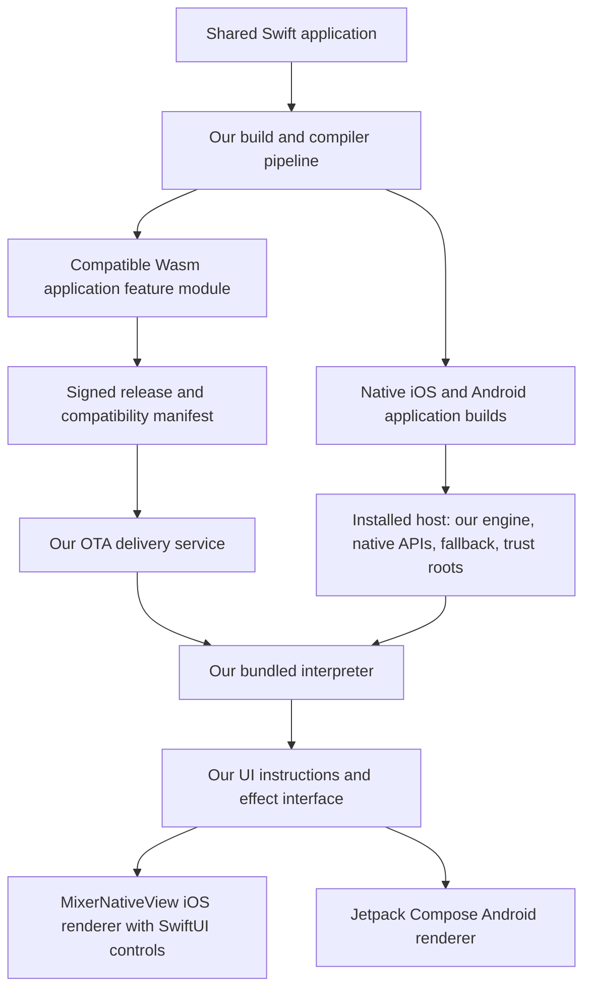
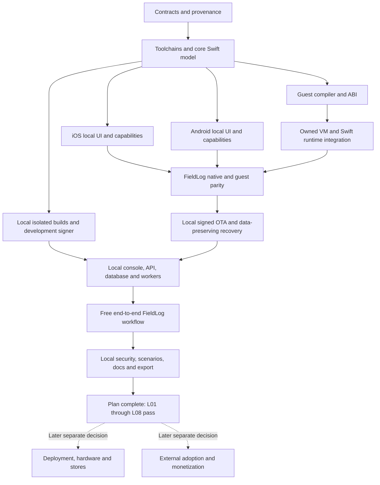
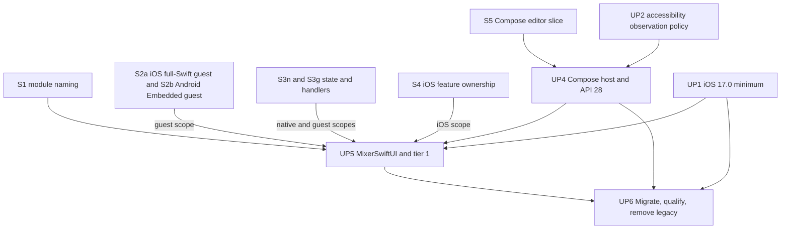

# mixer — Swift-First Mobile Platform Product and Engineering Plan

Version: 1.7, updated November 23, 2026 for the UI platform pivot (Section 1.3) and the licensing and revenue model (Section 26.7). Version 1.6 of November 17 set local end-to-end completion, free testing and early launch, and separate deployment and monetization tracking.

Prepared: October 22, 2026  
Status: Proposed implementation plan; no implementation or release evidence is claimed by this document.  
Project name: **mixer**. The CLI is `mixer`, configuration files are `mixer.yml` and `mixer.lock`, and owned Swift modules use the `Mixer*` prefix. These are the planned product interfaces; implementation status remains governed by the acceptance gates.

**Decision in brief:** Buildable with shared screens written in a published SwiftUI subset, native renderers (Apple SwiftUI controls on iOS and Jetpack Compose on Android), and an independently implemented interpreted update runtime. It cannot promise unchanged compatibility with every existing SwiftUI app or OTA replacement of arbitrary native code. The business is plausible but demand remains unproven. Execution is designed for AI agents, organized by dependencies, concrete deliverables, and verified completion gates. FieldLog, a real Swift app, must prove each stage on both platforms.

**Navigation:** [Evidence and verdict](#3-evidence-assumptions-and-competitive-context) · [Independent ownership](#4-independent-implementation-and-provenance) · [Architecture](#5-system-architecture-and-ownership) · [Compiler](#7-swift-compilation-and-module-model) · [Owned interpreter](#10-our-interpreter-and-swift-execution-profile) · [OTA and recovery](#11-update-eligibility-packaging-and-trust) · [Hosted product](#13-hosted-release-and-control-plane) · [Real-app dogfood](#21-the-real-dogfood-application-fieldlog) · [Delivery sequence](#24-delivery-sequence-and-dependency-graph) · [AI-agent execution](#25-ai-agent-execution-model) · [Business model](#26-business-model-and-market-validation) · [Completion and later gates](#29-completion-gates-and-later-qualification) · [Sources](#33-primary-source-research-index)

## 1. Binding product direction

Build a finished commercial platform that lets developers author an application primarily in Swift, maintain one shared application codebase, ship native iOS and Android apps, and deliver compatible logic and UI updates over the air to both platforms. Provide the surrounding build, signing, distribution, debugging, release, monitoring, billing, and support services expected from an Expo-like product.

This implementation plan is complete when the platform works locally end to end under Section 2. Deployment, store approval, physical-device qualification, external adoption, and monetization have separate readiness records. They do not delay implementation-plan completion. This November 17 user decision supersedes older wording that equates completion with commercial general availability.

The user's decisions govern the plan:

1. **Own the engine.** Independently implement the cross-platform application engine, Swift-facing UI layer, Android integration, compiler orchestration, bridge generation, OTA runtime, update protocol, and hosted service.
2. **No Patch or Skip code.** Do not copy, fork, vendor, translate, link, or depend on their implementations, generated code, test fixtures, or proprietary services. Their public product behavior can inform competitive requirements.
3. **Dogfood continuously.** Build and exercise FieldLog through public interfaces on iOS Simulator and Android emulator throughout development. Physical-device and store evidence belong to later release qualification.
4. **Deliver both platforms.** Local completion requires iOS and Android end-to-end behavior. Record simulator and emulator evidence accurately; hardware qualification remains separate.
5. **Make limitations explicit.** The service must explain which changes are OTA-compatible, which require a store release, and which APIs are platform-specific.
6. **Use the specified agent models.** The user selects the main controlling agent when launching development. The coordinator directs and integrates the work. Use **Sol 6.2 High** for every new subagent, including implementation, blocker experiments, and reviews. Section 25 defines the model settings.
7. **Pivot the UI platform.** On November 23, 2026, the owner directed SwiftUI-subset authoring, Jetpack Compose on Android, and an iOS 17 minimum. Section 1.3 records the decisions and supersedes conflicting text elsewhere in this plan.
8. **License the engine as open source and charge for hosted services.** On November 23, 2026, the owner set the MIT license for the core engine and the OTA update system. Revenue comes from hosted builds and hosted OTA delivery, as with Expo's EAS. A developer who self-hosts update delivery pays nothing for it. Section 26.7 defines the scope and the model.

### 1.1 Meaning of “our own engine for everything”

The owned product layer includes the application model, UI reconciliation, platform adapters, capability interfaces, compiler pipeline, module format, WebAssembly interpreter, scheduler integration, build orchestration, compatibility analysis, release system, and developer experience.

Use standard foundations: the official Swift compiler/LLVM, Swift standard library, documented Apple SDKs, Android SDK/NDK, AndroidX/Compose as a native UI toolkit, operating-system networking, and vetted cryptographic primitives. Using the system text renderer, TLS implementation, or Swift compiler does not outsource the product engine.

The production runtime will **not** depend on WasmKit or another third-party Wasm engine under this baseline. Implement our interpreter from the WebAssembly specification. Independently maintained reference runtimes and standards conformance suites may be used as development/test oracles under their licenses, never as copied implementation material. Do not invent a cryptographic algorithm or implement crypto primitives merely to claim ownership.

### 1.2 Product promise

> Write your application in Swift. Build native experiences for iOS and Android. Ship compatible fixes through one controlled release workflow.

Avoid promises of arbitrary native binary replacement, universal SwiftUI compatibility, instant delivery to offline devices, guaranteed store approval, or zero overhead.

The November 23 pivot makes the UI promise concrete. Shared screens use a published SwiftUI subset, listed in a generated support table, and they keep compiling against Apple SwiftUI. Updates stay within the app's approved purpose and installed capabilities (Section 3.3).

### 1.3 UI platform pivot, November 23, 2026

On November 23 the owner stopped the current-stack L02 and L08 work at commit `504366a0c9` and directed a pivot that fixes three go-to-market problems. Shared screens move from the explicit-ID `MixerUI` DSL to a published SwiftUI subset. Android moves from `android.widget` Views to Jetpack Compose. The iOS minimum drops from 26.0 to 17.0. The pivot research also found that the shared-design Android host requires API 36, so the pivot restores API 28 for that host.

This section is binding and supersedes conflicting text elsewhere in this plan. These are approved targets. The code still declares iOS 26.0 until step UP1 lands and still requires API 36 for the shared-design Android host until step UP4 lands. Section 24.6 gives the sequence, the spike outcomes, and the file boundaries. [The execution index](PLAN.md#ui-platform-pivot-november-23-2026) holds the checklist, the current state, and the defects carried over from the checkpoint.

| ID | Decision | Decided by | Replaces |
| --- | --- | --- | --- |
| P1 | Shared feature screens use a published SwiftUI subset with `import SwiftUI`, `View`, `@State`, `@Binding`, `@Environment`, and closure actions. Mixer implements the subset as `MixerSwiftUI`, which lowers views to the owned `UIDocument`. | Owner, November 23 | ADR-02 and the public `MixerUI` authoring API |
| P2 | Android renders documents with a Kotlin Jetpack Compose host, built with Gradle, the Android Gradle Plugin, and Kotlin. | Owner, November 23 | The Java `android.widget` renderer and the javac and D8 build path |
| P3 | The iOS minimum is 17.0 for packages, generated projects, and native archives. | Owner, November 23 | The October 23 iOS 26.0 baseline |
| P4 | The shared-design Android host supports API 28 and later. An explicit accessibility observation policy (UP2) says what the host renders when an observation is known, unavailable, or failed, and the Compose host applies it (UP4). It replaces the blanket refusal below API 36 and the refusal of users who turn on high-contrast or bold text. | Coordinator, from the pivot research | The API 36 floor in `AndroidPublicHost.swift` |
| P5 | On iOS, shared features run through the Mixer engine in both store and update builds, and `MixerNativeView` draws them with Apple SwiftUI controls. Native-only iOS screens use Apple SwiftUI directly. The pivot research calls this option B'. Spike S4 confirms it. | Coordinator recommendation, answering the owner's November 23 question about the better option once Mixer's gaps close; the owner may override | Nothing. It keeps Section 5.2 and Section 8.3. |
| P6 | iOS update guests use a full-Swift profile with the standard library, Swift Concurrency (`async`, `await`, and `Task`), Observation, and FoundationEssentials. It ships as a new, versioned execution profile in an iOS store build, with caps that spike S2a sets from measurement. Updates carry a signed diff against the guest base bundled in the app, so they still meet the Section 20.2 size budget. Android update guests keep the Embedded Swift profile within the installed 4 MiB caps until the owner approves the full profile there. | Owner, November 23 | The earlier Embedded-only guest profile for iOS |
| P7 | L02 and L08 complete on the new stack. Passed gates keep their recorded scope. Each pivot step re-verifies the gates that its replaced component affects. | Owner, November 23 | Completing L02 and L08 on the current stack |

The pivot keeps the independent engine, no Patch or Skip code (Section 4 and `scripts/check-policy.py`), native Swift compilation for Android (ADR-01), the value-only UI document and its stale-input rules, native and guest compilation of the feature layer (ADR-04), cold-start activation, exact runtime fingerprints, the shared-theme default (Section 8.3), and Sol 6.2 High for every subagent unchanged.

B' is also the better choice once Mixer closes its gaps. Under B', each gap closed in `MixerSwiftUI` and `MixerNativeView` serves iOS store builds, Android, and updates at once. Every iOS store build runs the same engine and renderer that updates use, so a renderer gap shows up in development and review, and the native fallback behaves exactly like the update it replaces. Under option B, Apple SwiftUI draws a shared screen in the store build while Mixer's document renderer draws the same screen after an update. The store build never exercises Mixer's iOS renderer, so B needs a separate qualification path for that renderer, and any gap that path misses first appears when an update reaches users. Each gap must be closed and proven twice on iOS. B also breaks the Section 5.2 rule that native and update builds emit one UI contract and leaves the shared theme undefined on iOS. B' has three costs. New Apple SwiftUI APIs reach shared screens only after Mixer maps them, shared screens cannot call Apple-only APIs inline, and iOS pays for the engine and document layer. Section 24.7 closes those costs and the other remaining gaps, and it states when the owner would revisit B. Choosing B requires a new owner decision.

Under P6, measured full-Swift WASI modules are 5,508,619 bytes empty and 12,651,963 bytes with FoundationEssentials, and the historical F05 editor guest reached 54,739,192 bytes, of which 33,976,096 bytes were ICU data. The iOS full-Swift profile therefore leaves ICU data out of the guest and reaches locale-sensitive formatting through host bridges to native Foundation. It bundles the runtime base in the store build and delivers each update as a diff that the device reconstructs and checks against the signed module hash before admission. Its larger limits need the Section 10.3 security review. Installed apps keep the profile they shipped with, as exact runtime fingerprints require. A shared feature can therefore be update-eligible on iOS and need a store release on Android, and the release report says so per platform. On Android, until S2b's Embedded approach or an owner-approved full profile qualifies that use, an update that needs Foundation or `Task` is a store release, and the release report names the symbol that forced it.

## 2. Completion definition and scope

The implementation plan is complete when L01–L08 below pass for the documented local support matrix. Exercise real integrated application behavior on iOS Simulator and Android emulator, with the console, API, database, workers, and update delivery running locally. A build or isolated demo alone is insufficient. Record exact sources, commands, actual behavior, failures, and cleanup in compact receipts. One independent review at each meaningful slice is sufficient under Section 24.5.

`gates/local.json` is the completion checklist. `gates/ga.json` preserves the original G01–G38 launch requirements and their historical evidence. Section 29 maps every original gate to local completion and later work. Local passes do not pass a launch gate automatically. No gate is newly passed by this policy change.

| Local gate | Required end-to-end behavior |
| --- | --- |
| L01 Setup, adoption, and export | Install from pinned public SDK/tooling inputs, create and import a Swift app, build and run on both local targets, and export a working independent build. FieldLog consumes public interfaces from its separate repository. Registry publication and outside developers are not prerequisites. |
| L02 Shared app and native UI | FieldLog's supported screens, state, navigation, input, accessibility, shared design, persistence, and first-party capabilities work on both local targets. Record OS-specific limitations. Physical-only services use explicit test adapters for local orchestration, with actual hardware/provider behavior pending. Under Section 1.3, FieldLog's shared screens use the published SwiftUI subset, Android renders them with the Compose host from API 28, and iOS runs from 17.0. |
| L03 Compiler and owned runtime | Supported Swift features execute in native and guest modes through the owned engine with actionable source diagnostics. Conformance, differential, malformed-input, cancellation, and resource-limit checks pass. Measure responsiveness, memory, and update size on the stated local workload. Hardware budgets remain separately unqualified. |
| L04 Safe OTA and recovery | A locally served, signed logic and UI update changes both already-installed apps without reinstall. Compatibility, tenant/app identity, signatures, replay, cohorts, key rotation, and unsupported native changes are enforced. Interrupted or failed updates recover offline with saved data intact. Use development keys, never production signing credentials. |
| L05 Local platform workflow | Real console, CLI, Phoenix API, PostgreSQL, Oban workers, build workers, artifact delivery, and separate development signer complete onboarding, build, logs, cancellation, update, promotion, and rollback locally. Test store request/status/error handling against documented provider fixtures. Actual uploads, store processing, provider infrastructure, and distribution remain pending. |
| L06 Free accounts and administration | Free organizations can use the full testing workflow without a card, subscription, Stripe credentials, or payment service. Memberships, permissions, usage visibility, quotas, support, export, and deletion work locally. Paid plans, invoices, payment collection, paid entitlements, and purchase integrations may remain unimplemented and inactive. |
| L07 Security and local reliability | Provenance, licensing notices, VM/bridge/update verification, signer separation, tenant isolation, privacy, authorization, and local fault/restore tests pass. Resolve findings that compromise the supported local workflow. Test local service/worker loss and recovery. Production SLOs, provider failover, and staffed operations are later qualification. |
| L08 FieldLog and documentation | Run the complete supported FieldLog workflow through public tooling on both targets, including edit/save/close/reopen, offline queue, attachments, guest parity, OTA, rollback, and export. Exercise the applicable Section 22 recovery and real-change corpus locally. Follow installation, upgrade, recovery, and exit guides from a clean local setup. Store use, customer counts, and paid pilots are not required. Under Section 1.3, this workflow runs on the new stack, and it closes only after the clean post-removal replay in the Section 24.6 UP6 exit. |

Missing local behavior stays failed, blocked, or pending. A fixture may stand in for an external store, payment, push, or hardware service only at that unavailable boundary; it cannot replace the owned compiler, VM, UI, persistence, updater, or integrated local services. Document each substitution and leave real provider/device qualification pending. No generalized evidence controller, extra approval ladder, or production soak period is a completion prerequisite.

Testing and early launch are free. Preserve usage accounting and bounded capacity without creating charges. Payment implementation and activation need a later monetization decision. Existing billing code and receipts remain preserved, but billing work is off the completion critical path. A documentation change does not itself implement or verify free-mode behavior.

Production rollout still requires separate authorization and checks relevant to the features actually exposed, such as store policy, secrets, tenant isolation, data recovery, and physical-only capabilities. A free early launch does not require the entire commercial G01–G38 checklist. Record deferred features and limitations explicitly. Phones remain disconnected and every existing process, device, scratch, and custody hold remains in force.

### 2.1 Local implementation scope

Apply the local evidence rules above to this capability inventory. Provider placement describes the intended deployment architecture, not a required live deployment. Commercial-only features are deferred as stated in L06.

| Area | Required finished behavior |
| --- | --- |
| Project creation | Create a Swift project, run on both platforms, inspect generated native projects, and build without a cloud account. |
| Existing app adoption | Import a real Swift project with an actionable compatibility report and incremental migration path. |
| Shared app engine | Shared Swift logic, state, navigation, resources, lifecycle, and tested platform integrations. |
| Native UI | Published SwiftUI subset (`MixerSwiftUI`) with native renderers, Apple SwiftUI controls on iOS and Jetpack Compose on Android, keeping native accessibility, text input, and platform navigation conventions. |
| OTA | Signed, compatibility-scoped logic and supported UI updates on iOS and Android; staged release, local recovery, offline behavior, and server rollback. |
| Builds | Managed macOS/iOS and Android builds; deterministic inputs, logs, artifact retention, caches, quotas, cancellation, and isolation. |
| Distribution | Local development builds and tested submission/status adapters. Real TestFlight/Play processing and production submission are later qualification. |
| Credentials | Secure signing credentials, store connections, key rotation, access control, and customer-owned keys. |
| Developer tooling | Local CLI, Swift diagnostics, native and guest debugging, profiler, patch eligibility report, emulator/device support, and reproducible bug reports. |
| Console/API | Projects, environments, releases, builds, devices in aggregate, rollout health, audit history, free accounts, usage, and documented automation API. Payments and paid entitlements are deferred. |
| Operations | Local backup/restore, failure recovery, diagnostics, and abuse controls. Live on-call, status service, and provider reliability belong to deployment readiness. |
| Trust | MIT-licensed core engine and OTA update system (Section 26.7), provenance, security review, export/ejection, support policies, and clear licensing. |
| Dogfood | A real Swift application maintained through public platform interfaces and exercised locally end to end on both platforms. Store publication and production use are later qualification. |

### 2.2 Explicit boundaries of the first complete release

- Target production iOS and Android phones, with basic tablet/adaptive-layout support included. Desktop, web, watch, TV, and XR are later product lines.
- Support a documented, broad mobile UI/API surface. Do not claim implementation of every Apple framework or every private SwiftUI behavior.
- Support standard utility, productivity, commerce, content, and collaboration applications. A new game engine, unrestricted graphics engine, and arbitrary native-code hot replacement are outside GA.
- Provide adapters to customer backends. A generic hosted database/auth product is not required to compete in the specified development/build/OTA category.
- Include a useful first-party SDK catalog and documented custom extensions. An unreviewed third-party marketplace is not required for GA.
- Audit export and runner integration are tested locally. Corporate SSO, enterprise support commitments, and paid dedicated capacity are later commercial features. Formal certifications and every deployment region remain separate commitments.

### 2.3 Evidence for working behavior

For each local capability, delivery includes implementation, documented semantics, error behavior, security controls, executable compatibility checks, local diagnostics, migration guidance, and integrated FieldLog evidence. Unsupported combinations fail clearly. Record hardware, provider, operational, store, and commercial qualification in their separate backlog without making them dependencies of L01–L08.

#### Worktree-local verification

Put each local verification run's files in an ignored directory under `verification/local/` in the current worktree. This includes one-off scripts, proof output, raw receipts, logs, captures, build products, copied checkouts, test data, and caches created for the run. Point temporary and output paths there for child tools too. Leave all run files untracked. Clean up disposable files when the run closes or when removing the worktree. Preserve any worktree that contains resources under a custody hold until the hold is released.

Make every check required for continued work or gate acceptance runnable from a fresh checkout with `verification/local/` absent. Keep maintained test source and required fixtures in Git, or record a complete recipe using pinned, independently obtainable inputs. If a later step needs a generated input, record the command that recreates it. Treat paths to past run files as historical references, including paths outside the repo and in other worktrees. If an earlier result lacks enough evidence for the decision at hand, run the smallest applicable check in a fresh directory and follow the existing holds.

Record the source and input identities, exact commands, environment, observed outcome, limitations, cleanup, and reviewer in the applicable tracked gate or status record. Keep those records usable after worktree removal. See the [verification guide](verification/README.md).

## 3. Evidence, assumptions, and competitive context

As of the research date, Skip distinguishes native Swift compilation for Android from its Kotlin transpilation mode. Patch documents a Swift-to-Wasm OTA architecture. An Android-support draft PR exists in Patch's repository but is not a complete shipped integration. These establish feasibility signals and competitive context; they do not establish that our independent implementation exists or will meet its budgets. [Skip modes](https://skip.dev/docs/modes/), [Patch architecture](https://docs.patchrelease.com/how-it-works/), [Android proposal](https://github.com/patch-release/patch-swift/pull/2)

Official Swift SDKs provide Android and WebAssembly compilation foundations. Host toolchains and cross-compilation SDK versions must match according to the official documentation. The plan therefore starts with supported official compiler distributions and pins them as an atomic toolchain release. [Swift Android SDK](https://www.swift.org/documentation/articles/swift-sdk-for-android-getting-started.html), [Swift Wasm SDK](https://www.swift.org/documentation/articles/wasm-getting-started.html)

The proposed architecture, pricing, execution workflow, and performance targets below are design decisions or hypotheses. They are not benchmark results or vendor commitments. Implementation advances through verified dependencies and completion gates.

### 3.1 Competitive goal

| Comparison | Product must win by |
| --- | --- |
| Skip | Supplying our own complete Swift-to-Android development experience with integrated OTA, builds, diagnostics, and operations. |
| Patch | Supporting both platforms as a first-class release unit and owning the framework/runtime contract that makes updates predictable. |
| Expo | Offering comparable workflow completeness for developers who want Swift and native platform UI. |
| Separate native apps | Reducing duplicated application work while preserving native integrations and a practical escape route. |

A unified logo over two external tools would not meet this goal. All required interfaces and release behavior must be owned and supported by this project.

### 3.2 Verification of the original Patch + Skip question

**Your concern is supported by the public evidence: do not treat Patch + Skip Fuse as a supported, production-ready Android OTA solution today.** Patch's Android PR is still marked draft as of October 22, 2026. This is a documentation/repository-status assessment, not a device test of that combination, and it does not prove that integration is technically impossible. [Android proposal status](https://github.com/patch-release/patch-swift/pull/2)

One terminology correction: **Skip Fuse compiles Swift natively for Android; Skip Lite transpiles Swift to Kotlin.** A Swift app running on Android does not automatically carry an OTA interpreter, compatible UI/effect interface, package loader, or recovery system. Those are separate requirements. [Skip mode definitions](https://skip.dev/docs/modes/)

Patch's documented iOS architecture uses a Wasm module and native host. Android needs its own qualified host integration and release path; the portability of a Wasm file alone does not establish them. [Patch architecture](https://docs.patchrelease.com/how-it-works/)

### 3.3 Store-policy feasibility

Apple's agreement permits interpreted code subject to conditions, including consistency with the submitted app's primary purpose. App Review Guideline 2.5.2 separately restricts downloaded code that introduces or changes functionality. These provisions must be considered together; using Wasm is not blanket permission to change an app. [Apple agreement, §3.3.1(B)](https://developer.apple.com/support/terms/apple-developer-program-license-agreement/), [App Review software requirements](https://developer.apple.com/app-store/review/guidelines/#software-requirements)

Google Play prohibits self-updating executable binaries outside Play and describes an exception for interpreted/VM code with indirect Android API access. Other Play policies still apply. A signed Wasm payload is not automatically compliant simply because it is interpreted. [Google Play Device and Network Abuse](https://support.google.com/googleplay/android-developer/answer/16559646?hl=en)

Our product policy will therefore permit only approved-purpose changes within the installed capability envelope. A release report separates technical compatibility from policy review. Store submissions disclose the interpreter and update behavior, include reviewer instructions, and retain working native fallback. Actual acceptance of transparently submitted dogfood apps is a required commercial gate, not a universal future approval guarantee. Native libraries, permissions, entitlements, new capabilities, and engine changes go through store releases.

### 3.4 Feasibility and business verdict

**Technically feasible, commercially plausible, and a substantial platform company undertaking.** The strongest offering is a Swift-first workflow with one owner for the framework, builds, updates, and recovery. The weak proposition is an unrestricted promise that every existing Swift app runs unchanged on Android and every edit can ship OTA.

The addressable customer set is narrower than all mobile developers: Swift teams that need Android, value native UI, and accept a supported cross-platform API. The business becomes attractive only if that audience pays enough to cover compiler/runtime maintenance, macOS build capacity, security, and developer support. No market-size or demand claim is established by the technical research. Paid customer evidence is part of the plan, alongside engineering evidence.

## 4. Independent implementation and provenance

### 4.1 Allowed and prohibited material

| Material | Rule |
| --- | --- |
| Patch/Skip source, patches, generated source, assets, tests | Prohibited in our product and implementation prompts. Do not translate or lightly rewrite them. |
| Public product documentation and observable behavior | Allowed for understanding user expectations and identifying gaps. Record the source of requirements. |
| Official platform documentation and public specifications | Primary design references. |
| Standard toolchains and platform SDKs | Allowed with version, license, redistribution, and hosting obligations recorded. |
| Third-party general-purpose libraries | Require dependency review; no hidden alternate mobile/OTA engine. |
| Reference runtime comparisons | Development-only differential testing; preserve test-suite licensing and provenance. |

Earlier source inspection was research, not a formal clean-room process. Do not represent the project as legally certified clean-room work. Establish independent architecture records, design authorship, and reviewable implementation provenance from the start.

### 4.2 Controls

- Maintain `THIRD_PARTY.yml` with origin, version, license, purpose, distribution mode, and owner.
- Maintain `docs/provenance/` for architecture sources and imported test corpora.
- Add dependency-policy CI rejecting `skiptools/*`, `patch-release/*`, their packaged artifacts, and undisclosed alternate engine dependencies.
- Review generated files and template provenance, not only package manifests.
- Keep benchmark apps' original licenses; do not redistribute restricted customer source or assets.
- Publish SDK source and notices with every binary distribution where required by chosen licenses.
- Original SDK, engine, and CLI code: proposed Apache-2.0; hosted console/control-plane code: commercial. Confirm patent and trademark position before public branding.

For context only, source inspection found MPL-2.0 in Skip's UI/bridge libraries and AGPL-3.0 in skipstone. These implementations are excluded under the user's decision, so the product does not depend on satisfying a competitor-code reuse plan. [UI license](https://github.com/skiptools/skip-ui/blob/main/LICENSE.txt), [Engine license](https://github.com/skiptools/skipstone/blob/main/LICENSE.txt)

### 4.3 License compatibility of the MIT scope

The MIT scope in Section 26.7 may depend only on licenses that permit MIT distribution, such as MIT, BSD, Apache-2.0, ISC, zlib, PSF-2.0, and public domain. Copyleft dependencies, including GPL, LGPL, AGPL, and MPL, stay out of it. Record every dependency's license in `THIRD_PARTY.yml`. Code in the MIT paths does not depend on the proprietary hosted service, and hosted-service code stays outside the MIT paths.

## 5. System architecture and ownership

### 5.1 Major components

| Component | Owned responsibility | Implementation direction |
| --- | --- | --- |
| `MixerCLI` | Create, inspect, build, test, release, rollback, export, diagnose | Swift executable with machine-readable output. |
| `MixerBuild` | Source graph, toolchain lock, native project generation, artifact manifest | Swift tooling; Xcode/SwiftPM/Gradle orchestration. |
| `MixerCompiler` | Feature extraction, API validation, capability analysis, dual compilation, source maps | SwiftSyntax/macros for syntax plus actual compiler type checking; limited compiler integration where unavoidable. |
| `MixerCore` | Lifecycle, feature registry, effects, state coordination, configuration | Swift. |
| `MixerUI` | Internal UI document, validation, reconciliation, stable identities, and stale-input routing. The public explicit-ID authoring API is frozen under Section 1.3 and removed after migration. | Independently implemented Swift engine. |
| `MixerSwiftUI` | Published SwiftUI-compatible subset with views, modifiers, state, bindings, environment, and closure actions. Shared feature modules reach it through `import SwiftUI`. It lowers views to `MixerUI` documents in native and guest builds. | Independently implemented from Apple's public API documentation. No Skip code. |
| `MixerApple` | `MixerNativeView` document renderer with Apple SwiftUI controls and the shared theme, plus native host capabilities. Native-only screens use Apple SwiftUI directly. | Swift with documented Apple APIs. |
| `MixerAndroid` | Kotlin Jetpack Compose document renderer, JNI integration, Android lifecycle, and Gradle packaging | Swift, minimal C ABI, and Kotlin. |
| `MixerGuest` | Wasm-facing Swift UI/effect/state interface | Swift; no Apple or Android frameworks in guest. |
| `MixerVM` | Wasm validation, execution, metering, imports, memory management, traps | Independently implemented memory-safe Rust core behind a stable C ABI. |
| `MixerUpdates` | Verification, download, atomic activation, local recovery, telemetry | Shared core plus small OS-specific storage/network adapters. |
| Build service | Worker scheduling, isolation, logs, artifact provenance, signing handoff | Elixir/OTP services with Phoenix and Oban; isolated macOS/Linux build workers. |
| Release service | Compatibility, channels, policies, staged rollout, revocation, audit | Elixir/Phoenix REST API, Ecto/Postgrex, Oban, and Neon-hosted PostgreSQL; Cloudflare Containers deployment. |
| Artifact delivery | Immutable payloads, private build outputs, cacheable signed assignments | Cloudflare R2 object storage, Workers, and Cloudflare CDN. |
| Console | Team/project/build/release/support workflows | SolidJS + TypeScript + Vite + Solid Router; Cloudflare Workers Static Assets. |
| Later commercial billing | Deferred subscriptions, invoices, and payment collection; free usage accounting remains local scope | Stripe remains the selected provider for later monetization. No implementation or activation is required for testing or free early launch. |
| FieldLog | Real Swift application proving the platform works | Swift app in a separate consumer repository. |

The customer application's language is Swift. It is acceptable for the engine's native adapter and cloud infrastructure to use the languages appropriate to those platforms.

### 5.2 Execution architecture



Native and patched feature implementations emit the same logical UI/effect contracts. Native platform adapters remain compiled into the store binary. Downloaded modules do not contain replacement `.so`, DEX, Mach-O, or executable runtime libraries.

### 5.3 Architecture decisions

| ID | Baseline decision | Rationale and consequence |
| --- | --- | --- |
| ADR-01 | Compile Swift natively for Android; no general Swift-to-Kotlin transpiler | Full language compilation is supplied by official Swift. We own interoperability and packaging. |
| ADR-02 | Shared screens use a published SwiftUI subset, implemented by Mixer as `MixerSwiftUI` (revised November 23, Section 1.3) | Developers write familiar SwiftUI source. A generated support table publishes the subset, and the subset must keep compiling against Apple SwiftUI. Universal SwiftUI compatibility is still not promised. |
| ADR-03 | Own native renderers with Apple SwiftUI controls on iOS and Jetpack Compose on Android (revised November 23) | Keep platform accessibility, IME, text rendering, gestures, and lifecycle behavior. Android follows Google's Compose-first direction. |
| ADR-04 | Build features both natively and for Wasm | Native baseline and safe fallback; compatible feature code can later execute in our interpreter. |
| ADR-05 | Use an independently implemented Wasm interpreter | Own execution semantics, budgets, diagnostics, and distribution. This adds substantial engineering and audit scope. |
| ADR-06 | Activate production changes at a safe cold start | Avoid replacing live Swift object graphs and in-flight UI state. Development reload is separate. |
| ADR-07 | Initially publish one coherent guest module per platform/runtime target | Avoid mixed module versions and an unnecessary dynamic linker in the first complete release. |
| ADR-08 | Exact native-runtime identity before capability-range optimization | Prefer conservative incompatibility to an update that fails on installed devices. |
| ADR-09 | Local build and native project export remain available | Cloud outage or subscription cancellation cannot prevent app maintenance. |
| ADR-10 | Independent dogfood app consumes published candidate packages | Exposes real installation, migration, documentation, and support failures. |
| ADR-11 | Elixir/Phoenix hosted API and orchestration, with Oban durable jobs | OTP supervision and transactionally persisted jobs fit builds/releases; retries still require idempotent external effects and fencing. |
| ADR-12 | Neon hosts the production PostgreSQL database | Ecto/Postgrex connect directly over verified TLS initially; bounded pools and Oban notification/recovery behavior require Neon qualification. |
| ADR-13 | Cloudflare hosts every suitable workload | Containers host Phoenix; Workers host edge routing and the SolidJS console; R2/CDN deliver artifacts. macOS builds and isolated key custody retain explicit exceptions. |
| ADR-14 | SolidJS web console and Stripe commercial billing | Fix the web framework and payment provider; retain the existing usability, metering, entitlement, and recovery requirements. |
| ADR-15 | iOS 17.0 minimum (November 23, Section 1.3) | Existing apps that support iOS 17 can adopt Mixer. iOS 17 is also the `@Observable` minimum, and every iOS 17 device can run iOS 18. |
| ADR-16 | Full-Swift guest profile on iOS, Embedded Swift on Android (revised November 23, Section 1.3) | iOS updates can use Foundation value types, `async`/`await`, and Observation. The profile is a new versioned execution profile in an iOS store build, with a bundled base and diff delivery. Android keeps the installed 4 MiB Embedded profile until the owner approves the full profile there. |
| ADR-17 | One iOS renderer for shared features, option B' (November 23, Section 1.3) | Store and update builds of a shared feature draw through `MixerNativeView`, so an update never switches rendering engines, and every gap Mixer closes serves store builds, Android, and updates at once. Section 24.7 closes the costs of this choice. |
| ADR-18 | Gradle, the Android Gradle Plugin, and Kotlin build generated Android apps (November 23) | Compose needs the Kotlin Compose compiler plugin and AndroidX libraries. Generated projects open in Android Studio, and exported projects build without Mixer's hosted service (ADR-09). |

## 6. Customer workflow

### 6.1 New project

Illustrative commands; these form requirements for the eventual CLI, not commands available today:

```sh
mixer create MyApp
mixer doctor
mixer run ios
mixer run android
mixer test --platform all
mixer build --platform all --profile development
mixer release inspect
mixer build --platform all --profile production
mixer submit --platform all --track testing
mixer update prepare --platform all
mixer update verify <candidate>
mixer update publish <candidate> --channel production --rollout 5
mixer update promote <release> --rollout 25
mixer update rollback <release> --reason "validation regression"
```

Every release command resolves to immutable artifacts and a recorded intent. Publishing and promotion are distinct operations. Automated pipelines may be authorized in advance using explicit environment policies and scoped identities.

### 6.2 Project layout

```text
MyApp/
  mixer.yml
  mixer.lock
  Package.swift
  Sources/
    AppFeatures/          # shared Swift UI, state, and application logic
    AppModels/            # shared value models and supported algorithms
    NativeServices/       # typed service interfaces; implementations stay native
  Platforms/
    iOS/                  # app-owned native extensions
    Android/              # app-owned native extensions
  Resources/
  Tests/
  UITests/
  Generated/              # reproducible, clearly marked artifacts
```

The app developer can inspect and edit designated native extension points. Regeneration must preserve owned files and fail rather than overwrite ambiguous changes.

### 6.3 Existing Swift app adoption

1. Import a repository read-only and identify targets, packages, framework use, resources, signing settings, and SwiftUI usage.
2. Produce a report separating supported shared code, supported-with-adapter code, iOS-only code, and unsupported constructs.
3. Generate migration edits on a branch with a preview. Preserve the current shipping iOS application.
4. Move feature code behind documented module boundaries; migrate imports/UI surfaces incrementally.
5. Create an Android host and bridge catalog; prove equivalent user workflows.
6. Instrument eligible features for future updates and ship the resulting native binaries through the stores.
7. Publish OTA only to these instrumented, matching binaries.

Do not claim that arbitrary existing `import SwiftUI` applications can compile unchanged on Android. Provide a compatibility importer and conversion assistance. New projects write shared screens with the published SwiftUI subset. The importer reports which existing SwiftUI screens already fit the subset, which need listed edits, and which stay native-only iOS screens. Existing projects receive precise changes and a preserved native-only path.

### 6.4 Environment and account model

Use organizations, projects, apps, environments, channels, native runtimes, and release groups as distinct concepts. A developer can work locally without login. Cloud login adds builds and delivery; it does not change application semantics. Development, staging, and production have separate signing/update policies and clear visual labels.

## 7. Swift compilation and module model

### 7.1 Dual compilation contract

`AppFeatures` is the principal patchable boundary. The build produces a native version linked into each store binary and a Wasm version compiled against `MixerGuest`. Both implement an explicit feature interface and use the same logical models. The guest interacts with the host only through versioned capability calls and UI messages.

The installed host chooses the native or compatible guest implementation at process startup. It does not patch arbitrary machine instructions or exchange live heap pointers between native Swift and guest Swift. Native reference identity never crosses the boundary accidentally.

Shared feature code can use normal Swift functions, value types, generics, protocols, collections, closures, errors, and supported async APIs. Platform frameworks are accessed through typed services. Native-only high-performance code remains a host capability with an explicit input/output contract.

### 7.2 Compiler work packages

- Resolve a reproducible Swift package graph separately for native and Wasm targets.
- Use syntax analysis to locate supported declarations; use compiler type checking to validate meaning. Syntax matching alone must never authorize an update.
- Generate feature registries, stable IDs, capability adapters, state/effect codecs, and source maps.
- Compile original source under both target environments and report target-specific errors at original source locations.
- Build a transitive dependency graph of every capability, resource, model schema, UI opcode, and compiler/runtime feature used by a guest module.
- Ensure compiler optimizations, macros, conditional compilation, and imported generic code cannot bypass the compatibility inventory.
- Emit the exact supported Wasm profile and reject artifacts outside the interpreter's verified feature set.
- Include compiler and standard-library identity in artifact provenance; isolate changes in unstable compiler APIs behind an owned adapter.
- Prefer public compiler facilities and generated Swift modules. If a compiler patch becomes necessary, define maintained-fork ownership, source publication obligations, upstreaming strategy, and version qualification.

### 7.3 Language support matrix

Maintain a generated public matrix with four values: native supported, guest supported, host bridge required, or unsupported. Each entry links to executable positive/negative tests.

Initial critical areas: generics, associated types, result builders, property wrappers, macros, optionals, enum payloads, `Codable`, Unicode strings, floating-point behavior, `Date`/locale abstractions, cancellation, actor isolation, and closure capture lifetimes. Foundation APIs must be tested individually; importing Foundation does not prove every API is guest-compatible.

Unsafe pointers, C/ObjC interop, arbitrary dynamic loading, threads, and framework reflection remain native-only unless a reviewed, explicit bridge exists. Do not silently substitute behavior to increase apparent coverage.

### 7.4 State ownership

- Feature-local transient state lives in the active native or guest feature implementation.
- Auth sessions, native resource handles, device services, and persistence connections live in the host.
- Persistent data uses versioned schemas accessible to the bundled fallback.
- Navigation/restoration state uses a versioned value representation, not serialized arbitrary Swift objects.
- Update activation happens before feature instances start. Live state transfer is not required for production GA.
- Cross-feature interactions use typed events or services; no hidden references to an inactive implementation.

## 8. Native UI engine

### 8.1 Authoring API

Revised November 23 under Section 1.3. Shared feature modules use ordinary SwiftUI source against a published subset. In a shared feature module, `import SwiftUI` resolves to `MixerSwiftUI` on Android, in the update guest, and on iOS under P5. App-shell and native-only iOS modules import Apple SwiftUI. Spike S1 proves the module naming. If it fails, shared modules write `import MixerSwiftUI` with the same API names. The Apple compatibility build then supplies a shim module named `MixerSwiftUI` that re-exports Apple SwiftUI, and the support table records the source cost.

`MixerSwiftUI` implements the subset independently from Apple's public documentation. It evaluates view bodies, keeps state, and emits the owned UI document. Its core compiles under Embedded Swift for the Android guest, so core paths use no Foundation, no `Mirror`, and no runtime-selected existentials. Foundation conveniences live in a layer that native builds and the iOS full-Swift guest include and the Android Embedded guest leaves out. The subset follows these rules:

- **Identity.** An unkeyed child takes its identity from its parent's identity, its child position, and its branch. A keyed child, with an explicit `.id` or a `ForEach` key, takes its parent's identity plus the key and no position, so moving a keyed row keeps its state. Authors write no string IDs.
- **State.** The engine keys storage by view identity and a stable key for each property declaration, and binds it before `body` runs. Assigning slots by first access is wrong, because a conditional can read a different property first. Native builds may find state properties by reflection. Guest builds use independently authored generated registration or explicit registration. If plain `@State` needs a build-time source transform in guest builds, the documentation says so.
- **Actions.** Closures stay inside the native or guest implementation. The document carries engine-assigned handler IDs. Handlers belong to one feature instance and one accepted frame. The engine stages a candidate document and its handler table together, and they become routable only when the host acknowledges that exact feature instance and frame after presentation. If validation, install, or drawing fails, the last accepted document and its handlers stay routable. Acknowledgment and dispatch both check the feature instance and the frame on both platforms, so a late callback after a rollback or replacement is refused even when a frame or handler ID is reused.
- **Compatibility check.** CI compiles every shared feature on iOS twice, against `MixerSwiftUI` and against Apple SwiftUI. A failed Apple build means the subset drifted from SwiftUI.
- **Support table.** A table generated from the tests lists each supported view, modifier, and state wrapper with its iOS mapping, Compose mapping, guest status, and tests.
- **Diagnostics.** An unsupported API is a missing symbol in Android and guest builds, and `@available(*, unavailable, message:)` stubs say what to do. Missing symbols do not catch effects, resources, or dependencies that macros and imported generics add, so the Section 7.2 inventory also covers resolved dependencies, macro expansion, and emitted Wasm.

The explicit-ID `MixerUI` authoring API is frozen. It stays the guest fallback until Section 24.6 step UP6 qualifies the replacement, and then it is removed. `UIDocument`, validation, and reconciliation remain the internal wire, and both native and guest implementations produce it. Own reconciliation, identity, event routing, and capability negotiation. Do not copy Skip's mapping implementation.

### 8.2 Required UI inventory

Tier 1 under Section 1.3 comes from FieldLog plus list-and-detail, form-and-settings, and tabbed app types. The iOS full-Swift guest runs the whole tier, including `@Observable` and `AnyView`, once S2a passes. A construct that S2b has not passed under Embedded Swift stays out of Android updates, and the support table marks it so.

| Family | GA scope | Required behavioral evidence |
| --- | --- | --- |
| Layout | Vertical/horizontal/overlay stacks, spacing, alignment, safe areas, adaptive layouts, grids | Orientation, keyboard, split layout, RTL, extreme content sizes. |
| Text | Styled text, localization, interpolation, selection where supported, links | Unicode, truncation, line wrapping, accessibility text size, locale changes. |
| Controls | Button, toggle, slider, stepper, picker, text/secure field, progress | Focus, IME composition, validation, disabled state, accessibility actions. |
| Collections | Lazy lists/grids, sections, stable IDs, pagination, refresh, swipe actions | 1,000-row reference dataset, insert/remove/reorder, retained scroll position. |
| Navigation | Stack, tabs, modal/sheet, deep links, restoration | iOS back gesture, Android back/predictive back where supported, process recreation. |
| Visuals | Images, bundled/remote assets, colors, fonts, shapes, common transitions | Cache behavior, dark mode, asset compatibility, rendering and memory budgets. |
| Interaction | Tap, long press, drag, keyboard shortcuts where relevant | Gesture arbitration, cancellation, native scroll interoperation. |
| Native surfaces | Camera/photo picker, maps, web content, media, share sheet | Stable native-view identity and explicit native-only behavior. |
| Accessibility | Labels, roles, values, actions, focus order, announcements | VoiceOver and TalkBack workflows on physical devices. |

### 8.3 UI instruction contract

Use versioned, bounded messages describing node type, stable identity, properties, child references, actions, and state bindings. Separate structural updates from frequently changing properties. Batch changes so JNI and interpreter transitions do not occur for every scalar property or every frame. New node kinds, handler IDs, and row paging arrive in a new UI schema version, which ships in a new store build under Section 24.6. Installed hosts refuse schemas they do not admit, and tests prove the refusal.

The host validates node counts, nesting, lengths, resource references, and supported operations before reconciliation. Unsupported required nodes reject the candidate update; no blank placeholders in production. Optional decorative behavior can degrade only when the manifest explicitly permits it and the preview shows the degradation.

One codebase produces the same app design on both platforms. A shared screen renders with the same layout, hierarchy, content, colors, typography scale, iconography, spacing, and component appearance on iOS and Android. Adapters still render through native toolkits (Apple SwiftUI on iOS and Jetpack Compose on Android), but they style controls from the app's shared theme rather than each platform's default look. An app that wants a platform-specific appearance must declare it explicitly; it is never the default. On iOS, `MixerNativeView` applies the shared theme to Apple SwiftUI controls. On Android, the Compose host builds controls from Compose Foundation, so the shared theme sets their appearance instead of Material defaults.

Accessibility and navigation behavior stay native. That covers VoiceOver and TalkBack roles, labels, values, actions, and focus order; the iOS back gesture; Android system and predictive back; and native text input and keyboard handling. System-owned surfaces outside the app's screens keep their platform appearance, including status bars, permission prompts, share sheets, and the keyboard.

Local completion requires design parity on reference screens, reviewed side by side on iOS Simulator and Android emulator. Repeat the comparison on physical iOS and Android devices for later hardware qualification. Pixel-identical output is not required where native text shaping, font rasterization, display density, or safe-area geometry legitimately differ.

### 8.4 Performance design

Keep layout, text shaping, scrolling, image decoding, animation execution, and input services native. Run feature logic and view construction in the selected implementation, with coarse state/effect messages. Use dependency tracking, stable identity, incremental diffs, cancellation, and bounded caches. Lazy lists page rows through the document protocol, so neither Swift nor the guest builds rows that are off screen. Measure native baseline, engine-native mode, and OTA mode separately on the same app and devices.

## 9. Native capability and extension system

For local completion, implement and exercise the nonpayment capability families on the declared local matrix. Label hardware/provider test adapters and remaining real-service qualification. Purchase and paid-entitlement implementation, sandbox integration, and activation are deferred until a later monetization decision. Unsupported purchase calls fail explicitly; do not grant paid entitlements or fabricate successful transactions.

Define a typed capability interface with stable IDs, schema versions, declared permissions, thread/executor requirements, synchronous/asynchronous behavior, cancellation, failure codes, and resource ownership. Generate our Swift host adapters and Android JNI/Kotlin stubs from that schema.

| Capability family | Native implementation | Dogfood requirement |
| --- | --- | --- |
| Network | OS HTTP/TLS, streaming, resumable transfers, connectivity | Authenticated sync and photo upload. |
| Storage | App-private files, preferences, SQLite abstraction | Offline entries, durable upload queue, schema migration. |
| Identity/security | Keychain/Keystore-backed secrets, secure random, biometrics | Login persistence, logout, secret cleanup. |
| Device/lifecycle | Foreground/background, orientation, locale, memory pressure | Reliable restoration and safe update activation. |
| Photos/camera | Native pickers and capture | Permission grant/deny/revoke, large images. |
| Maps/location | Native map surface and location service | Foreground location and project-site map. |
| Notifications | APNs/FCM integration and deep-link dispatch | Assignment notification opens correct record. |
| Sharing/files | Native share sheet, document picker, export | Share an inspection report and import attachments. |
| Purchases | Native store SDK with server validation | Sandbox entitlement and restore flow. |
| Accessibility/haptics | OS-specific primitives | Forms, feedback, screen-reader navigation. |

The guest receives only capabilities granted by the installed app and release manifest. It never receives arbitrary Java class lookup, Objective-C selector execution, native pointers, or unrestricted file-system access. Extensions that add native functionality require a new store binary; updates can invoke only already-registered compatible extensions.

Plugin packages include their public schema, native implementation, guest stub, permission declarations, privacy metadata, test fixtures, supported toolchains, and owner. Publish first-party plugin qualification results. Customer plugins can run locally, but cloud signing/publication requires the project's configured trust policy.

## 10. Our interpreter and Swift execution profile

### 10.1 Implement a specified execution target

Implement `MixerVM` against a published, versioned WebAssembly feature profile sufficient for the pinned Swift SDK and our guest libraries. The official WebAssembly specification is the normative reference. Do not claim conformance to proposals or the entire latest specification unless qualified. [WebAssembly specification](https://webassembly.github.io/spec/core/)

Work proceeds through a binary decoder, structural/type validator, executable internal representation, interpreter dispatch, linear memory and tables, host imports, limits, traps, debugging, and optimization. The internal representation may predecode instructions and resolve branch targets, but must not generate downloaded native machine code. No JIT or executable-memory entitlement is part of the mobile design.

The compiler and VM teams jointly produce a machine-readable opcode/import inventory from actual FieldLog builds. Start from that inventory and standards requirements; never guess that the minimal integer instruction set will run the Swift runtime. Support compiler-emitted exception, reference, bulk-memory, or other features when required, or explicitly configure the compiler to emit a validated alternative. Unknown features fail validation before publication and on the device.

### 10.2 Swift runtime integration

- Under ADR-16, iOS update guests use the full-Swift profile, with the standard library, Swift Concurrency, Observation, and FoundationEssentials, and Android update guests use Embedded Swift. The iOS profile leaves ICU data out of the guest and reaches locale-sensitive formatting through host bridges. Spike S2a sets its caps from measurement, and S2b measures the Android Embedded surface. Do not assume Embedded Swift supports the entire app language surface.
- Supply the exact WASI/environment functions required by the selected SDK through bounded, capability-controlled host adapters. Do not expose a general POSIX process, arbitrary filesystem, subprocesses, or unrestricted sockets.
- Implement allocator and memory-growth limits, clocks, secure randomness through the host, string/Unicode behavior, logging, and error propagation.
- Route asynchronous effects through request IDs and executor queues. Validate cancellation, actor isolation, task lifetime, reentrancy, main-thread UI dispatch, and app suspension.
- Keep guest and native heaps separate. Encode values at the boundary; use generation-checked opaque resource handles for native objects. Detect use-after-close and stale callback delivery.
- Restore state through versioned data, never serialized pointers or an archived Swift object graph.

### 10.3 Security and resource limits

Validate every module before execution, even if the server previously validated it. Bound section sizes, nesting, function count, stack depth, table size, memory, decompression, host-call frequency, and execution time. Use instruction metering and cancellation checks to prevent a loop from monopolizing a device thread. Meter long native imports independently; instruction fuel cannot bound a blocking host call.

Resource enforcement is mandatory; initial experimental numeric ceilings are revisable under Section 20.3. The coordinator may select bounded, nondefault host experiments within existing authorization without a new user approval for each variant. Preserve the failed baseline, account for changed storage/work structures and retain all active holds. Such selection does not alter public/installed production policy.

Use Rust for the interpreter core, isolate necessary `unsafe` code, and audit every C ABI boundary. No Rust panic or Swift exception may unwind across that boundary. Check arithmetic, alignment, pointer lifetimes, and buffer sizes at each transfer. Host functions return structured failures and cannot bypass capability checks.

The VM is a sandbox boundary, not a proof that a correctly signed app behaves well. A publisher can still write a destructive database operation or misuse an allowed API. Preserve application authorization, release review, and data-recovery controls outside the VM.

### 10.4 Correctness and performance qualification

Run the applicable standards suites, independently authored negative tests, differential execution against development-only reference runtimes, Swift language regression cases, and continuous fuzzing of the decoder, validator, interpreter, UI protocol, and bridge codecs. Record any imported test licenses. Check NaNs, integer overflow, floating-point conversion, traps, malformed modules, out-of-bounds memory, recursion, cancellation, and memory pressure.

Profile real FieldLog tasks before optimizing dispatch. Keep image processing, database execution, native text/layout, cryptography, media codecs, and similar expensive services in precompiled host capabilities. Moving ordinary app logic to native merely to hide poor interpreter performance does not satisfy the OTA coverage gate.

Deliver readable Swift stack traces, original source locations, module IDs, sanitized effect traces, and a debugger transport. A Wasm byte offset alone is insufficient developer tooling.

## 11. Update eligibility, packaging, and trust

### 11.1 Eligibility is an explicit contract

The installed binary records its native runtime fingerprint: engine and guest ABI, compiler/SDK identity, bridge schemas, UI instruction set, native dependency versions, build configuration, relevant permissions/entitlements, and platform/architecture requirements. The server and client both enforce compatibility. GA uses exact fingerprint matching; broader compatibility ranges require separately proven rules.

Each release inspection reports:

| Result | Meaning | Action |
| --- | --- | --- |
| OTA compatible on both platforms | Both guest compilations and all installed contracts match. | Can enter the dual-platform OTA release workflow. |
| OTA compatible on only one platform | One platform changed its native contract or lacks an implementation. | Block a claimed dual-platform release; explicitly choose separate release plans. |
| Store build required | Native SDK, capability, permission, ABI, or incompatible storage contract changed. | Build and distribute new binaries. |
| Unsupported | Semantics cannot be preserved within the published support matrix. | Show file/line, dependency chain, and remediation; do not silently omit behavior. |
| Policy review required | Technically possible but purpose, content, payment, or permission implications changed. | Complete project release review; technical eligibility is not approval. |

Classify the complete dependency graph and generated code, not just edited files. A dependency upgrade can change the runtime fingerprint without editing an app function. Resource changes are OTA-compatible only within supported formats and the installed UI/capability contract. App icons, entitlements, extensions, signing, and store metadata have separate native/store paths.

### 11.2 Release artifact

Each immutable artifact contains one coherent guest module per target runtime, an asset index, source-map references, schema declarations, capability requirements, resource limits, provenance, and checksums. A release group ties the iOS and Android variants to the same source revision and product change. The module bytes may differ across platforms; one codebase does not mean one universally interchangeable binary.

Use a canonical serialization specification for the signed manifest; select canonical CBOR in the initial protocol. A readable JSON rendering is for inspection only. Define exactly which bytes are signed and domain-separate artifact signatures from rollout-assignment signatures. Hash each payload and the complete manifest with a standard cryptographic hash. Verify declared compressed and expanded sizes before allocation.

The manifest includes application ID, environment, release ID, source commit, target platform, runtime fingerprint, protocol/guest ABI version, capability schema hashes, UI schema version, state-schema range, payload hashes/sizes, asset hashes, limits, signing-key ID, and build provenance ID. Store creation time for audit; do not trust a client clock as the only replay defense.

### 11.3 Separate artifact authorization from delivery authorization

- An artifact signature authorizes specific content for a specific app/environment/runtime.
- A separately signed assignment authorizes a channel/cohort to run that immutable artifact, with a monotonically increasing assignment sequence.
- The client pins the applicable trust roots in the store binary, validates delegation scope, and rejects cross-app/environment substitutions.
- Enterprise customers can supply their release signing key or use an isolated managed signer. The CDN and ordinary web application never receive that private key.
- Key delegation, revocation, expiry, rotation, and emergency response are versioned protocol features, with offline-device behavior tested explicitly.

A rollback uses a new assignment sequence pointing to a previously authorized compatible artifact. It does not ask the device to accept an old sequence. Download expiry must not disable a healthy, previously activated offline app. A compromised root embedded in a binary may require a new store binary; do not promise the control plane can repair every trust failure remotely.

## 12. Device update lifecycle and recovery

### 12.1 State machine

```text
native fallback / last healthy artifact
    -> assignment checked
    -> downloading to temporary storage
    -> payload and signature verified
    -> compatibility and resource validation passed
    -> staged
    -> pending activation at next safe cold start
    -> running provisionally
    -> healthy

Any validation error -> discard candidate, retain healthy implementation
Activation failure -> quarantine candidate, restore compatible last healthy/fallback
Server rollback -> new signed assignment, activate at next safe cold start
```

Do not switch a feature implementation in the middle of a purchase, database transaction, form edit, or active native callback. GA activates the app feature module at cold start. Development reload may use additional reset behavior, but that is not the production activation contract.

Download resumably into an app-private staging directory. Verify before activation, flush files and metadata, and use an atomic pointer/rename operation for selecting a completed artifact. Synchronize concurrent checks and app extensions. Retain a bounded set of compatible healthy artifacts and reserve disk space for recovery. Handle OS eviction, low disk, interrupted downloads, process death at every step, and a device clock moving backward.

### 12.2 Health and crash recovery

Record a boot attempt before loading the module. Mark a release healthy only after required startup milestones and a bounded observation period. Track launch IDs, prior attempt state, module identity, and failure reason. Distinguish a deterministic startup trap from an OS kill, user force-quit, background eviction, and an unrelated native crash; do not roll back every incomplete launch indiscriminately.

After the configured startup-failure threshold, quarantine the candidate locally and select the last compatible healthy implementation. A native fallback must remain launchable without network access. Bound recovery attempts so that the app cannot loop forever between two failing patches. Publish diagnostic explanations without exposing user content.

Remote rollout health aggregates activation success, startup failure, crash-free sessions, hangs, and business-flow errors. Sparse telemetry must be shown as insufficient evidence. Local recovery works even when telemetry is disabled or the release service is down.

### 12.3 Persistent state makes rollback harder than code rollback

OTA updates may perform only schema changes compatible with every implementation kept as a recovery target. Use additive fields/tables, defaults, versioned envelopes, idempotent migrations, and expand/contract server APIs. Destructive migrations, changed encryption formats, or irreversible rewrites require a new binary plus a separately reviewed data migration strategy.

Run the native fallback against data produced by the candidate before publication. Also test previous healthy patches against that data. Do not declare rollback working because the screen opens while saved records become unreadable.

External effects need their own protections: idempotency keys for purchases and uploads, durable outboxes, transactional writes, and explicit reconciliation. Rolling back code cannot unsend a message, reverse a payment, or automatically undo a remote database write.

### 12.4 Fleet coordination

Use stable per-install cohort assignment within each app/environment; use bounded, privacy-preserving identifiers. Support internal, beta, and production channels, with deterministic percentage expansion and explicit exclusions. Reinstall and account switching semantics are documented.

Promoting a release group coordinates compatible iOS and Android variants, but cannot make all devices update atomically. Offline devices, old binaries, suspended apps, and store-rollout lag remain normal. Customer backends must support the advertised mixed-version window. Show installed-binary coverage, eligible devices, downloaded devices, activated devices, and observed health as different measures.

## 13. Hosted release and control plane

### 13.1 Domain model

Persist organizations, memberships, projects, applications, environments, runtime fingerprints, native builds, artifacts, release groups, channels, signed assignments, rollout policies, health aggregates, credentials, audit events, usage records, invoices, and support incidents. Every mutable tenant record has an organization/project scope enforced at the API and storage layers.

Artifacts are immutable and content-addressed. Published releases reference artifacts rather than mutating them. Environment promotion creates an explicit authorized binding; it does not rewrite the original signed manifest. Audit events capture actor, scope, reason, previous/new values, source IP where appropriate, and correlation ID, with sensitive fields redacted.

### 13.2 API behavior

Implement the versioned REST API in **Elixir with Phoenix**, using Phoenix controllers/routers, Plug, and the Bandit HTTP server. Use Ecto with the Postgrex driver for Neon PostgreSQL, and generate the CLI client from the versioned API contract. Endpoints cover creating builds, uploading artifacts, validating releases, signing, publishing assignments, promoting stages, rolling back, exporting logs, and inspecting usage. Require idempotency keys for chargeable or publishing operations. Document pagination, rate limits, retries, webhook authentication, and error codes.

Use **Oban backed by the same Neon PostgreSQL database** for durable jobs. Commit domain changes and job insertion together with Ecto.Multi; Oban's persisted jobs provide the transactional outbox for dispatched work, while immutable domain/audit records remain separate. This is the queue advantage motivating Elixir: OTP supervision plus durable retries, scheduling, and bounded queue concurrency without a separate queue database. Phoenix itself is the HTTP framework, not the durable queue. Start with Oban's open-source functionality; its queue concurrency is per node, so fleet-wide build/signing quotas require Mixer-owned transactional admission/leases. Do not assume an unselected commercial queue feature supplies global limits. [Oban transactions](https://hexdocs.pm/oban/Oban.html#module-transactions), [Oban queue concurrency](https://oban.hexdocs.pm/defining_queues.html)

Separate API and Oban processor roles, with distinct queues and capacity for builds, signing requests, store submissions, releases, telemetry aggregation, and Stripe reconciliation. Build/signing/submission jobs retain leases, fencing tokens, explicit attempt records, and idempotent reconciliation. Oban execution is not exactly-once external execution: crash/redelivery tests must prove that retries cannot authorize a duplicate release or silently create a second charge. A coordinator dispatches fenced work to isolated build/signing workers; customer scripts never execute inside the API or Oban control-plane process. Administrative operations require project permissions rather than possession of a public app ID.

The device update endpoint exposes only the public assignment information needed for an eligible app. Do not embed a project administrator secret in the app. Scope telemetry ingestion, rate-limit abuse, and prevent arbitrary high-cardinality labels. Customer business data remains outside platform telemetry by default.

### 13.3 Delivery path and failure independence

Serve immutable payloads from **Cloudflare R2 through Cloudflare CDN**, and small signed assignment documents through a dedicated TypeScript Worker and cacheable delivery path. Use production custom domains and explicit cache rules; keep private source uploads, build outputs, logs, and source maps behind tenant authorization. Never expose private objects through a public bucket route or share authenticated cache entries between tenants. Cache immutable payloads by content hash; bound assignment freshness and preserve signed sequence/replay checks. Separate this read path from console, billing, build scheduling, and live database availability for already-published content. A console outage must not prevent a healthy installed app from starting. A billing dispute must not remotely brick already installed applications. [R2 delivery and access](https://developers.cloudflare.com/r2/buckets/public-buckets/)

Host the primary PostgreSQL database on **Neon**, with encrypted backups, tested restore, and regional delivery. The chosen Neon tier/region/topology must demonstrate the required multi-zone availability and Section 18.3 recovery objectives; provider branding does not pass these gates. Document failover interruptions, backup retention, restore/export procedures, and region-loss recovery. GA does not need active-active global writes. Retain provenance and release history for the contracted period; allow source/artifact exports and project deletion with explicit retention rules.

### 13.4 Hosted stack and deployment placement

These choices supersede the earlier Go hosted-service direction. Existing independently authored Go services and their receipts remain local reference/compatibility evidence until an explicit migration is implemented and qualified; this plan update does not claim that migration has happened.

| Workload | Language/framework or service | Selected placement and boundary |
| --- | --- | --- |
| Public REST API and release/build orchestration | Elixir/OTP, Phoenix, Plug/Bandit | A pinned Linux OCI release image on **Cloudflare Containers**, reached through a small TypeScript Worker and Durable Object routing layer. Phoenix owns tenant authorization and business logic. |
| Durable background work | Oban, Ecto.Multi, PostgreSQL | Separate BEAM processor role backed by **Neon**. Cloudflare Containers is the first deployment target, subject to the lifecycle checks below. |
| Relational persistence | Ecto, Postgrex, PostgreSQL | **Neon**, with environment-specific databases/roles, existing tenant/RLS controls, bounded connections, and serialized migrations. |
| Console | SolidJS, TypeScript, Vite, Solid Router | Build to static assets and deploy on **Cloudflare Workers Static Assets**; use the Phoenix API for server operations. Node.js is a build tool, not an additional production API runtime. |
| Edge and update delivery | TypeScript Workers, Cloudflare CDN | Routing, narrowly scoped artifact access, cache policy, and delivery of already-authorized signed assignments. Edge code never gains release-signing authority. |
| Blobs | Cloudflare R2 | Content-addressed guest packages/assets plus separately authorized source uploads, native artifacts, logs, symbols, and source maps. PostgreSQL stores metadata/references, not blob payloads. |
| Billing | Stripe Billing, Checkout, Customer Portal | Hosted Stripe payment flows; Phoenix verifies webhooks and persists billing state, with Oban reconciliation and idempotent outbound Stripe requests. |
| iOS compilation and signing | Xcode, SwiftPM, Apple SDKs | Dedicated ephemeral **Apple/macOS workers outside Cloudflare's Linux container runtime**; signing remains a separate trusted stage. |
| Android compilation | Swift SDK, Android SDK/NDK, Gradle | Prefer isolated **Cloudflare Linux Containers** only after resource, toolchain, hostile-code isolation, cache, and egress qualification; use external ephemeral Linux runners when these requirements cannot be met. |
| DNS, TLS, ingress protection | Cloudflare DNS/proxy, WAF and rate limits | Cloudflare in front of console/API/delivery; application authorization and signed update validation remain mandatory. |

**Runtime placement.** Phoenix/BEAM runs in a Linux container, not directly in the ordinary Workers runtime. Containers are generally available, but optional beta scheduling/snapshot features are not prerequisites. Start with the GA service scheduling policy, the direct Durable Object Container API, and a pinned supported image/Workers configuration. This is a selected deployment design inferred from Cloudflare's Linux container contract, not a vendor-certified Phoenix integration. Container disk is disposable; authoritative state lives in Neon/R2. Implement bounded instance routing/scaling and account for API/Worker/container compatibility during rolling deployments. Do not assume inbound distributed Erlang networking; database-backed jobs must recover without a BEAM cluster. [Containers capabilities](https://developers.cloudflare.com/containers/), [GA scope](https://developers.cloudflare.com/changelog/post/2026-04-13-containers-sandbox-ga/), [Container API](https://developers.cloudflare.com/containers/api/)

**Queue liveness.** A serverless container can stop while no user request is arriving; an in-process OTP supervisor cannot restart an absent container. Implement durable wake/reconciliation using the Cloudflare routing controller's alarms or scheduled Worker, and prove that delayed/retry jobs execute with zero customer HTTP traffic. Qualify inactivity shutdown, process death, deploy/drain, reconnect, duplicate wake, and missed-wake recovery against queue latency objectives. Keep API and processor scaling independent and account for every replica's database connections. If Cloudflare lifecycle limits cannot meet these tests, place the Oban processor role on a continuously running external BEAM host behind Cloudflare, record that exception in an ADR, and retain Cloudflare for suitable workloads. No production queue acceptance follows from simply booting Phoenix in a container. [Container lifecycle](https://developers.cloudflare.com/containers/concepts/architecture/)

**Neon connection contract.** Start with direct TLS PostgreSQL connections for Phoenix/Ecto, Oban notifications, and migrations, with certificate verification and bounded pools. Neon's transaction-pooler endpoint does not support LISTEN/NOTIFY, so do not route Oban's default Postgres notifier through it. Introducing pooled query traffic later requires a separately configured direct notification path or a qualified Oban notifier change. Disable production scale-to-zero for the queue database; test connection loss/failover, notification reconnect and polling/reconciliation, capacity limits, and database recovery. Align container placement with the selected Neon region, and qualify native PostgreSQL TCP egress separately from HTTP-only egress policies. [Neon pooling limits](https://neon.com/docs/connect/connection-pooling), [Neon scale to zero](https://neon.com/docs/introduction/scale-to-zero)

Pin exact package/runtime versions and licenses in lockfiles and THIRD_PARTY.yml when implementing this stack. Keep remaining operational choices explicit: Neon tier/region, container sizing/wake policy, any required external runner/processor host, signing-key custody, application identity/SSO provider, and observability tooling need scoped ADRs and measured acceptance. The selected vendors/frameworks are fixed by this revision; their deployments are not yet qualified.

### 13.5 Hosted migration and qualification

Implement the Phoenix service in an explicitly owned new service directory; preserve active Go work and historical evidence. Before changing the authoritative hosted route, replay shared wire/signature vectors and verify tenant/RLS boundaries, canonical signed bytes, monotonic assignments, idempotency conflicts, audit ordering, and rejection behavior against the supported Go contracts. Plan schema/outbox migration and recovery without two independent dispatchers authorizing the same operation. Never reinterpret an old Go/local/PostgreSQL receipt as Phoenix/Neon evidence.

Required hosted receipts include atomic domain/job commit and rollback; crash before/after an external effect; orphan-job rescue and stale-fence rejection; per-node versus organization-wide concurrency; zero-traffic scheduled/retry execution and missed-wake recovery; Neon connection exhaustion, failover and notification resubscription; restore reconciliation against completed external effects; private R2/cache isolation; and Stripe test-mode event/order/retry reconciliation. Record exact versions, provider configuration, source revision, measured output and limitations. All relevant GA gates remain open until this evidence exists.

## 14. Managed builds and supply-chain isolation

### 14.1 Build pipeline

1. Resolve an authorized source revision or upload and a pinned toolchain lock.
2. Verify package origins/checksums and dependency-policy rules.
3. Generate native projects deterministically and record their hashes.
4. Execute tests and dual compilation on isolated workers.
5. Produce native binaries, guest artifacts, resource inventories, debug symbols, compatibility reports, SBOMs, and provenance.
6. Move an authorized build output to a separate signing stage.
7. Publish immutable artifacts and accurate job status.
8. Optionally submit to a configured store/testing destination under the project's release policy.

iOS jobs run on appropriately licensed Apple hardware with supported Xcode. Android jobs run on isolated Linux workers; macOS local Android builds remain supported. Maintain explicit images for supported toolchain versions and deprecate images with advance notice.

The Elixir/Phoenix control plane schedules these jobs through Oban; database job completion and external runner completion require fenced reconciliation. Use Cloudflare Containers for Android workers where Section 13.4 qualification passes, keeping control-plane and untrusted build images/identities separate. Apple/macOS workers are an explicit hosting exception. A generic Cloudflare Workers invocation is not a native build worker, and a Linux container cannot satisfy the macOS requirement. Route caches and artifacts through scoped R2 access; stream bounded logs without granting workers broad account credentials.

### 14.2 Untrusted customer code

Assume build scripts, compiler plugins, macros, dependencies, and test executables are hostile. Workers are ephemeral with no cross-tenant filesystem persistence. Scope source tokens to a checkout, control egress, prevent metadata-service access, redact credentials, and tear down workers after jobs. Separate public dependency caches from private/tenant caches; verify cache provenance and prevent poisoning.

Never expose release signing keys to arbitrary customer build scripts. Signing workers accept a narrowly scoped, authorized artifact plus expected app identity and entitlements. Validate the bundle before signing and retain a signed attestation. Secret-bearing integration tests need separately scoped credentials and documented risk; they cannot inherit production signing authority.

### 14.3 Capacity and reliability

Provide queue position, estimated wait based on current capacity, concurrency limits, cancellation, timeouts, bounded retries, and clear billing attribution. Retry infrastructure failures; do not blindly retry an expensive compiler error. Keep warm capacity for paid latency commitments while measuring utilization and idle cost.

Measure reproducibility at the unsigned artifact or normalized content level where signatures/timestamps make byte-identical signed outputs impractical. Keep enough metadata to reproduce a failure locally. Maintain cache hit rate, queue wait, worker boot time, build duration, failure classification, and cost per successful platform build.

## 15. Signing, store distribution, and lifecycle

Customers retain their Apple and Google developer accounts and application identities. The product supports managed credentials, bring-your-own credentials, and local signing. Clearly identify developer-account fees and store agreements as external responsibilities.

Integrate certificate/profile creation and renewal where authorized, App Store Connect and Play credentials, Android upload keys, and supported signing arrangements. Encrypt stored secrets, minimize service roles, log access, support rotation, and test account disconnection. Do not confuse an Android upload key with the Play app-signing key.

Model submission states precisely: prepared, uploaded, processing, validation failed, ready for testing, submitted for review, rejected, approved, release pending, and available. Provider-specific transitions remain visible. An upload success is not a TestFlight-ready build or a live Play release. Reconcile status after timeouts instead of blindly resubmitting the same version.

Support staged store release, internal testing links, reviewer notes, screenshots/metadata handoff, and actionable rejection records. When a provider requires a new agreement, identity verification, or a human decision, mark the operation awaiting that action and preserve progress. Never label an external gate as passed.

Ship a reviewer-information template explaining the installed interpreter, signed updates, capability limits, native fallback, and example permitted changes. Recheck policy and SDK-submission requirements before each release train. Marketing must match the accepted functionality and actual product limitations.

## 16. Developer experience and migration

### 16.1 Daily workflow

Install one signed CLI distribution; `doctor` reports toolchain, SDK, Java, Gradle, simulator/emulator, signing, and device readiness. Every failure includes the failing stage, original diagnostic, relevant configuration, and a concrete next step. A failed Android build must not be summarized as a successful overall build because iOS passed.

Use the developer's preferred editor, with Xcode and Android Studio integration for native debugging. Provide generated projects that can be inspected and opened directly. Preserve original Swift file/line diagnostics through compilation, code generation, and guest execution. Do not require a proprietary editor.

Support local simulator/emulator and physical-device runs, incremental builds, resource reload, guest reload in development, network/effect inspection, UI tree inspection, and native/guest profiling. Clearly display which implementation and release is running. Development permissions and signing differ from production; test the production execution path before promotion.

A custom development client includes that project's native capabilities. A universal preview app cannot demonstrate arbitrary new native plugins. Offer the universal preview only for the explicitly bundled capability set, with a custom client whenever the native contract changes.

### 16.2 Import and migration product

The importer inventories Swift packages, Apple-only APIs, UI patterns, persistence, dependencies, entitlements, native extensions, and resources. It produces a per-module report: shared unchanged, shared after API adaptation, native plugin, platform-specific, or unsupported. Report source locations and transitive causes.

Each SwiftUI screen gets a verdict. It fits the published subset, fits after listed edits, or stays a native-only iOS screen. The report names the unsupported symbols and their source locations.

Migration tools provide reviewable edits to a separate branch and never silently replace user code. Generate a working native project before attempting broader migration. The customer can migrate one screen or feature while retaining native screens. Explain that existing store binaries cannot receive our updates until a new binary containing the engine and trust configuration is installed.

Ship migration guides for a plain SwiftUI app, UIKit integration, SwiftPM business-logic package, common networking/persistence approaches, and an app with custom native SDKs. Competing-framework migration guides are independently written from public APIs; they do not import competitor implementations.

### 16.3 Export and business continuity

Local build, native project export, SDK source, dependency lockfiles, release artifacts, and signing-key export where supported must permit continued store releases if the hosted service is unavailable. Document how to disable hosted update checks in a future binary and preserve the last healthy installed release.

An export is considered working only when FieldLog builds and launches through a documented independent CI setup using exported artifacts/tooling. Do not promise arbitrary removal of the framework without application migration. Publish the OTA wire format and SDK behavior so an alternate delivery service can be implemented without reverse engineering. Self-hosting is a supported path, not only an exit. The update protocol, the signing format, the device updater, and a reference update server are MIT under Section 26.7, so a customer can run delivery without Mixer's hosted service and pay Mixer nothing for it.

## 17. Console, organizations, and commercial administration

Testing and early launch use free accounts. The required local workflow runs without payment credentials, subscription state, or Stripe availability. Keep usage visibility, quotas, roles, support, and export/deletion. The invoice, purchase, paid-entitlement, and Stripe requirements below describe later monetization work and do not block L01–L08. Corporate SSO and paid dedicated capacity are also later commercial features.

Build the console with **SolidJS, TypeScript, Vite, and Solid Router**, served by Cloudflare Workers Static Assets. Keep privileged operations in the Phoenix API. The console uses ordinary customer API authorization, and renders precise pending/failed states when a provider or queued operation has not completed. [SolidJS setup](https://docs.solidjs.com/quick-start), [Workers Static Assets](https://developers.cloudflare.com/workers/static-assets/)

Use the existing Mixer website's visual identity throughout the hosted builds platform: the same Flick logo, lowercase Mixer wordmark, current color palette, typography, and visual styling. Aim for the clarity and polish of Expo's hosted console, with readable build and release information, consistent navigation, accessible controls, and responsive layouts. The website is the branding source of truth; do not introduce a separate console brand.

Implement complete workflows for onboarding, project creation/import, repository connection, runtime inspection, builds, signing setup, test distribution, release diff, staged promotion, rollback, incident review, member management, invoices, quotas, support, and deletion/export.

Roles include owner, administrator, developer, release manager, billing manager, and viewer. Environment-specific release rights, service accounts, short-lived CI credentials, and optional two-person production approval are first-class. Respect a customer's configured authorization policy without inserting an additional manual step into already authorized automation.

The release screen shows changed behavior, source revision, target binaries, compatibility result, required capabilities, policy-review status, test receipts, payload size, signing identity, rollout stage, and available recovery target. It must not bury a platform failure under a green group status.

Usage and billing explain builds by platform and machine class, active update installations, storage, included quotas, overage prices, and spending caps before work is incurred. Support seat removal, organization transfers, expired payment methods, refunds/credits, cancellation, and grace periods. Installed apps remain functional after account cancellation; new paid work can be suspended under documented terms. Self-hosted update delivery and local builds are never metered (Section 26.7).

When monetization is separately authorized, use **Stripe Billing** for subscriptions/invoices, **Stripe Checkout** for hosted purchase flows, and **Stripe Customer Portal** for customer billing management. Mixer retains an authoritative, deduplicated usage ledger in Neon and reconciles metered usage to Stripe with stable idempotency keys. Verify webhook signatures against the unmodified request body in Phoenix, commit a deduplicated event and Oban job before acknowledging receipt, and handle duplicate/out-of-order events by reconciling current Stripe state. Test payments, trials, failed renewals, cancellation, credits/refunds, retries, delayed webhooks, and usage corrections in Stripe test mode. Hosted update delivery and local recovery do not depend on a synchronous Stripe call. [Stripe subscriptions](https://docs.stripe.com/billing/subscriptions/overview), [Stripe webhooks](https://docs.stripe.com/webhooks), [Stripe idempotency](https://docs.stripe.com/api/idempotent_requests)

Console accessibility, keyboard navigation, time zones, readable logs, downloadable diagnostics, and API parity are required. Use customer-visible terminology; internal VM and queue details appear only when they explain an actionable failure.

## 18. Security, privacy, and operations

### 18.1 Threat model

Protect against compromised release accounts, malicious dependencies, hostile build jobs, altered CDN responses, key theft, replay/downgrade, cross-tenant access, VM escape, unsafe native imports, malformed UI data, accidental wide release, telemetry leakage, and recovery failure. Assign an owner and a verification method to each boundary.

Use established cryptographic libraries, standard authenticated transport, isolated key custody, scoped authorization, rate limits, signed provenance, least-privilege services, and immutable audit records. Protect operator access with MFA, short-lived access, and audited emergency procedures. Separate production/customer data from development.

Do not assume source-code signing proves safety or that a memory-safe VM makes native adapters memory-safe. Require an independent review of the interpreter, bridge ABI, update verifier, activation logic, signer, and tenant isolation before GA. High-severity unresolved findings block launch. Run a vulnerability disclosure program and publish a remediation policy supported by a verified incident-response process.

### 18.2 Privacy defaults

Collect only app/runtime/release identity, coarse environment information, bounded operational metrics, and sanitized failure data by default. Do not upload form contents, tokens, photos, precise locations, full URLs with query secrets, or database records. Crash attachments and source maps have restricted access and explicit retention.

Use app-scoped identifiers rather than a global cross-app device identity. Publish retention, deletion, subprocessor, region, and telemetry-disable behavior. Billing metering must minimize identifiers and deduplicate events without collecting customer app business data. Verify mobile privacy declarations and native SDK data practices before distribution.

### 18.3 Operations and service objectives

Initial proposed GA objectives, measured over a rolling 30 days:

| Service | Objective | Measurement and limitation |
| --- | --- | --- |
| Assignment/payload delivery | 99.95% service availability | Synthetic and real success from supported regions; device offline time excluded and separately reported. |
| Control-plane API | 99.9% availability | Authorized valid requests; external store outages separately attributed. |
| Paid build queue | p95 start within 10 minutes | Defined concurrency tier and regional capacity; publish excursions. |
| Release halt | p95 assignment change visible within 60 seconds | Reachable clients checking after cache expiry; not a promise to stop offline running code. |
| Metadata disaster recovery | RPO ≤15 minutes; RTO ≤4 hours | Demonstrated restore exercise, including keys and artifact references. |
| P1 incident response | Acknowledgment within 30 minutes, 24/7 | Verify automated alerting and accountable escalation before selling this commitment. |

Define error budgets, deployment freeze triggers, status-page communication, severity levels, escalation, forensic retention, and postincident actions. Practice CDN outage, database failover, lost worker, expired credential, compromised publisher key, bad patch, and region loss. Store status and support operations cannot depend on the same failing primary application path.

Qualify the selected hosted stack explicitly: Phoenix/Oban container stop/wake with no user traffic, Neon disconnect/failover and restore, R2/CDN cache isolation and assignment freshness, separate runner/signing failures, and delayed/duplicate Stripe events. Measure the Section 18.3 objectives across these dependencies. Database/job durability, container availability, and external-effect idempotency are separate claims, each requiring evidence.

## 19. Support and compatibility matrix

### 19.1 Launch platform baseline

The iOS minimum is **iOS 17.0**, set by the owner on November 23, 2026 (Section 1.3). It replaces the iOS 26.0 baseline of October 23, which the code still declares until step UP1 lands. Support iOS 17, 18, 26, 27, and later releases without an upper major-version cutoff. Generated projects, Swift packages, and native build defaults target iOS 17.0. A compile-only check on November 23 built five package schemes (the root `Mixer` package, `capability-activation`, `native-sdk`, `activation`, and `runtime`) and the Rust VM Simulator archive for an iOS 17.0 target with no availability errors. The `capabilities/` qualification package was not built, and nothing ran on an iOS 17 runtime ([receipt](verification/receipts/ios17-floor-compile-20261123.json)). Android API 28 is the baseline for the Compose host under Section 1.3, through the UP2 observation policy and the UP4 floor change.

Qualify the oldest iOS 17.x Simulator runtime that the pinned Xcode supports, iOS 18, the oldest supported iOS 26 release, iOS 27, and each later stable major release. If the pinned Xcode supports no iOS 17.x runtime, record that blocker and keep runtime acceptance pending. Monitor beta releases and repair compatibility before declaring a version verified. Forward support is a product commitment, not a claim that future or untested operating systems already passed. The private UIKit appearance prototype still admits only iOS 26.5. It does not satisfy this matrix, and step UP6 removes it once `MixerNativeView` applies the shared theme. Any later proposal to raise the iOS minimum requires an explicit owner decision with evidence.

Support physical arm64 iOS and Android devices, Apple-silicon iOS simulators, and the Android emulator architectures supported by the selected toolchain. Qualify current Android native page-size requirements, JNI packaging, native library alignment, lifecycle, and background restrictions. An emulator build alone does not qualify a physical architecture.

Pin the Swift host compiler, Swift Android/Wasm SDKs, Xcode, NDK, JDK, Gradle, Android Gradle Plugin, Kotlin, Compose, Rust, and engine versions in a signed toolchain manifest. Changes undergo native and OTA regression testing before becoming the default.

### 19.2 Device coverage

Maintain an oldest-supported iPhone class, a current mainstream iPhone, a high-refresh iPhone, a low/midrange Android device, a current Pixel-class device, a Samsung-class device, and iPad/Android tablet coverage. Include minimum OS, representative intermediate OS, current stable OS, and beta OS monitoring. Freeze exact devices and versions for each benchmark report.

Test large text, VoiceOver/TalkBack, right-to-left layout, multiple locales, dark mode, reduced motion, keyboard input, rotation, process death, denied permissions, constrained network, low disk, and low-memory behavior. Physical device tests are required for latency, memory, energy, camera, push, purchases, and lifecycle claims.

### 19.3 Lifecycle contract

Maintain the current and previous major engine lines for an initial target of at least 18 months after a new major release, with an explicit published support policy. Keep immutable runtime images for that window and provide security backports where technically feasible. Do not force old binaries to accept incompatible patches.

Version independently: public Swift SDK, native runtime fingerprint, guest ABI, UI protocol, capability schemas, cloud API, and update protocol. Publish compatibility and deprecation tables. Old installed apps continue with their last healthy implementation when hosted support ends; customers receive an actionable store-upgrade path.

## 20. Verification strategy and performance budgets

### 20.1 Test layers that matter

| Layer | Required evidence |
| --- | --- |
| Language/compiler | Supported syntax/type patterns compile; unsupported semantics produce actionable errors; original-source diagnostics preserved. |
| VM | Standards-profile conformance, malformed-input rejection, fuzzing, differential execution, resource enforcement. |
| UI | Independently authored behavior tests, native interaction tests, visual comparison with tolerances, accessibility semantics, state identity. |
| Bridge | Schema round trips, ownership, concurrency, cancellation, thread affinity, permissions, callback-after-destruction. |
| Updates | Signature/compatibility/replay checks, interruption at each lifecycle transition, offline recovery, state compatibility. |
| Cloud | Tenant separation, idempotency, worker isolation, signer authorization, usage consistency, backup restore, fault injection. |
| Store lifecycle | Real processing/testing/availability receipts; no mock status used as acceptance evidence. |
| Customer adoption | Independently authored apps, imports, unaided onboarding, actual paid usage and support burden. |

The same FieldLog feature tests run against native iOS, native Android, interpreted iOS, and interpreted Android. Compare observable behavior and persisted data, not only snapshots. A skipped environment is recorded as deferred and cannot pass a release gate.

### 20.2 Proposed performance targets

All figures below are initial acceptance budgets to validate, not measured results. Establish a plain-native baseline before engine migration and compare on identical hardware, data, OS, and release optimization settings.

| Metric | Initial target |
| --- | --- |
| Native engine startup overhead | p95 ≤100 ms above the equivalent baseline app. |
| Activated OTA startup overhead | p95 ≤200 ms above the engine-native mode for the representative app. |
| Added steady-state memory in OTA mode | ≤30 MiB above engine-native mode for the benchmark workload; separately report peak and total app RSS. |
| Input responsiveness | p95 tap-to-visible-response ≤100 ms for local app actions on the minimum performance device. |
| Scrolling | ≥99% of frames within the device's selected frame interval during defined 60 Hz workload; report 120 Hz separately. |
| Representative patch size | p95 ≤3 MiB compressed over the dogfood change corpus, including required guest runtime code; report assets separately and total transfer too. |
| Device activation success | ≥99.9% among fully downloaded eligible attempts, excluding deliberate fault tests; confidence and sample count disclosed. |
| Development loop | Warm guest rebuild/reload p95 ≤5 seconds for FieldLog on the published reference Mac. |
| Sharing | ≥90% of FieldLog app-owned Swift source shared across platforms; UI and logic reported separately. |
| Practical OTA coverage | ≥80% of the last 20 qualifying FieldLog fixes/enhancements OTA-capable on both platforms. |

Define coverage before measuring. Source sharing excludes generated code, dependencies, tests, and engine code; count platform-specific application adapters in the denominator. Practical OTA coverage includes ordinary user-facing fixes and improvements within existing product purpose, including failures caused by unsupported framework behavior. Exclude only changes inherently requiring a native capability/permission or store-metadata change, and publish all exclusions with reasons. Report coverage across all changes as a second figure to prevent cherry-picking.

Benchmarks include a 1,000-row list with realistic cell content, typing/validation, navigation/state restoration, photo selection and resumable upload, offline database operations, map embedding, background/foreground transitions, and an active downloaded module. Synthetic stress records stay isolated from production user data.

If a budget fails, optimize and remeasure. If a target is objectively incompatible with the chosen product contract, record a reviewed target revision and customer impact; never quietly relabel the failed measurement as a pass.

### 20.3 Calibrate experimental limits against real workloads

Separate product performance targets, security/compatibility invariants, and provisional implementation ceilings. A number inherited from an experimental fixture is a hypothesis to test. The Swift reactor's 64 resident decoded functions and 64,000,000 cumulative cache-work credits are experimental defaults, not established mobile requirements. Cache-work credits measure implementation-defined housekeeping, separately from guest instructions, elapsed time and memory. Preserve their original failed run as the baseline; do not make that exact pair an immutable completion target.

Use isolated, explicitly versioned experimental profiles to compare limits and algorithms on the same full Swift artifact, inputs and output oracle. First distinguish an undersized cache, inefficient lookup/rebuild policy and an undersized work allowance. Vary one factor at a time before selecting a combined candidate. Larger entry counts require accounting for their tables, tickets, scans and lifetimes within the retained byte ceilings; adding entries can also increase linear-search work. Keep instruction, time, memory, cancellation, validation and capability safeguards effective. A profile experiment cannot change installed release authority or silently widen public/signed limits.

Record completion/parity, elapsed and CPU time, peak RSS where observable, logical reservations separately, cache hit/miss/eviction/redecode counts, work categories and the next limiting resource. Report missing measurements explicitly. Preserve the native/reference comparison, exact source/tool/profile identities, failed attempts and cleanup. The initial bounded campaign is specified in [ADR 0002](docs/adrs/0002-empirical-budgets-and-blocker-experiments.md); the coordinator may select follow-up variants from its results without another planning-only gate.

Choose production limits from representative FieldLog tasks, worst supported inputs and measured device behavior. Explicitly design the replenishment/yield policy for sustained application use: a cumulative diagnostic lifetime allowance is not automatically a whole-app lifetime policy, and resetting it per call without a scheduling/abuse model is not acceptable. Host experiments can establish feasibility while native runs are paused; mobile performance, energy, responsiveness and memory acceptance remain pending. A successful larger-budget experiment proves only its measured scope. A reviewed production profile change still needs regression, resource-exhaustion, adversarial and platform evidence.

## 21. The real dogfood application: FieldLog

### 21.1 Product purpose and real users

Build FieldLog, a Swift application for small teams recording project/site work: jobs, assigned tasks, checklists, notes, photos, status, and shareable reports. The development team and recruited operators use it for actual work throughout the platform project. It is a real maintained product with its own backlog, support, privacy policy, backend, and store presence.

Use an independently authored application, not a competitor sample. Start with a normal native Swift iOS version to establish behavior/performance and then migrate its app layer to our public SDK. Implement Android as soon as the native engine supports the required slices. Preserve the same project identity and meaningful saved data across engine and OTA upgrades.

### 21.2 Functional scope

| Screen/flow | Required behavior | Platform capability exercised |
| --- | --- | --- |
| Welcome and account | Sign in/out, recovery, session expiry, account deletion | Networking, secure secrets, native auth callback. |
| Workspace/project list | Search, pagination, empty/error/loading states | Lists, state, async effects, accessibility. |
| Project dashboard | Recent activity, progress, refresh | Shared models, observation, conditional UI. |
| Task/checklist | Assign, complete, validate, reorder | Forms, bindings, gestures, persistence. |
| Entry editor | Rich-enough plain-text notes, date, category, save draft | Keyboard, locale/date, focus, restoration. |
| Photo capture/attachment | Capture/select, resize through native service, upload/resume | Permissions, native media, progress, cancellation. |
| Offline queue | View pending/failed actions and retry | Durable outbox, connectivity, idempotency. |
| Conflict resolution | Explain concurrent edits and choose merge | Data modeling, versioned persistence, recovery. |
| Site map | Show site and optional current position | Native embedded view, location permission. |
| Notifications | Assignment notification opens correct task | APNs/FCM, deep links, lifecycle. |
| Report/share | Generate/export report and share attachment | Files, native sharing, resource handling. |
| Settings/help | Theme, locale, accessibility preferences, diagnostics | Environment propagation, privacy, support. |
| Subscription/entitlement, later | Deferred purchase, restore, and paid cancellation flows | Native purchase integration and server validation are outside local completion and free early launch. |

Purchase integration and sandbox/test-mode purchase tests may remain unimplemented for local completion and free early launch. Keep FieldLog free; do not add a paid feature to exercise billing. Qualify purchase and entitlement behavior before those features are later enabled. Additional small fixtures may test APIs that are unnatural in FieldLog, but cannot replace the real application's acceptance evidence.

### 21.3 Architecture and independence

Use a separate repository, separate CI pipeline, real app identities, a locally running backend, and the same public SDK interfaces, CLI, console, quotas, release permissions, and support workflow. Pinned public checkout inputs satisfy local completion. Production backend placement and immutable registry publication are later distribution qualification. Prefer the selected Elixir/Phoenix, Neon PostgreSQL, and Cloudflare R2 stack for this backend, with separately qualified Cloudflare deployment; customer app code remains Swift.

The app must not import engine internals, bypass compatibility validation, access release-service databases, or rely on privileged distribution endpoints. Later release and distribution qualification use published packages. Local plan completion and slice acceptance may use a pinned checkout through public interfaces under Section 2 and Section 24.5; published-package qualification remains separately pending. Every discovered SDK gap becomes an engine issue or a documented supported extension. An app-only workaround that violates the advertised platform contract does not close that issue. The FieldLog backend may share the selected Phoenix/Neon/R2 technology, but uses separate application credentials/data and never the platform control-plane database or administrative identity.

Dogfood releases include ordinary product fixes unrelated to demonstrating the platform. Track weekly active use, task completion, saved records, successful uploads, support requests, and usability feedback. Measure whether the platform helps app work, not how many sample buttons can be rendered.

### 21.4 Team responsibilities

The app owner prioritizes real user needs and can reject an engine release. Platform owners fix failures without rewriting away the challenging app behavior. A release captain assembles evidence from both platforms. QA maintains the cross-mode behavioral suite and audits exclusions from coverage metrics.

Keep private user content out of public artifacts. Publish a sanitized reference version or selected reproducible flows with original authorship, while using a real production instance internally and with consenting testers.

## 22. Dogfood milestones and proof requirements

### 22.1 Local adoption and later qualification

D0–D8 retain their original release definitions and historical records in `dogfood/receipts/milestones.json`. Their `localAcceptance` fields supply the local counterparts below. Original status/evidence/reviewer fields retain their release scope. Local completion requires D0–D6 counterparts and the D8 scenario corpus under L08. D7 production use is deferred.

| Milestone | Required local proof | Later qualification |
| --- | --- | --- |
| D0 Baseline | Real iOS Swift app, login/projects/entries/offline draft/photos, simulator behavior and saved data | Physical recordings and signed release build |
| D1 Engine adoption | Same iOS flows through public SDK, behavior comparison and preserved data | Distribution-package qualification |
| D2 Shared Android | Same shared flows on iOS Simulator and Android emulator, native input/accessibility and design comparison | Physical matrix |
| D3 Interpreted parity | Same feature module through the owned VM on both local targets, native/guest comparison and source diagnostics | Hardware performance |
| D4 OTA delivery | Signed local UI and logic fix reaches both installed binaries without reinstall | Production delivery |
| D5 Recovery | Fault cases recover offline with preserved drafts and records | Hardware/storage-specific confirmation |
| D6 Platform workflow | Real local console/API/CLI/database/workers, build, development signing, update and rollback; store adapters use identified fixtures | Provider deployment and actual store processing |
| D7 Production use | Deferred; no store links, users or production activity required | Transparent store distribution and real usage |
| D8 Scenario confidence | Repeated local workflows, reviewed 20-change corpus, recovery, upgrade and exported build | Production incident history and trends |

### 22.2 Required update scenarios

Run these scenarios against local services and both local app targets for L08. Use the external-boundary rule in Section 2 for unavailable providers. Production/store clauses remain later qualification. Payment implementation and activation are deferred.


1. Fix an incorrect task-completion calculation without replacing the native binary.
2. Correct form validation while preserving an existing saved draft.
3. Change a list row and associated interaction on both platforms.
4. Add a compatible optional field, then roll back and read the same record correctly.
5. Change localization/resources without breaking right-to-left or large-text layout.
6. Receive a valid update over a flaky connection, resume it, and activate only when complete.
7. Reject a payload signed for another app/environment or another runtime fingerprint.
8. Reject malformed, oversized, truncated, replayed, and altered artifacts.
9. Quarantine a module that fails startup; relaunch offline using healthy code and intact data.
10. Halt a staged rollout after adverse health signals; inspect devices already activated versus pending.
11. Rotate a release key and validate devices that were offline during the transition.
12. Attempt to add a new native capability; require a store build and keep old binaries on their compatible release.
13. Upgrade the engine/store binary and prove old and new runtime cohorts receive the correct artifacts.
14. Keep the app useful during control-plane, CDN, telemetry, and billing outages.
15. Export and build the app independently through the documented escape path. Actual hosted CI and subsequent store publication are later qualification.

### 22.3 Evidence receipt format

Every acceptance run records the requirement/gate ID, app commit and tag, SDK/toolchain versions, source-sharing scope, installed binary version/build, runtime fingerprint, module hash/release ID, device/OS, selected execution mode, dataset identity, exact action, expected/actual result, metric samples, reviewer, and status. Log and recording paths are optional references to the original run.

Allowed statuses are `planned`, `running`, `passed`, `failed`, and `blocked`. A blocked external store review, missing device, skipped test, or unmeasured performance target is not passed. Record build identities and observed outcomes in the gate record under Section 2.3. Keep failed results in the record when a later run passes.

### 22.4 Independent consumer validation

FieldLog in its separate consumer repository plus a local existing-project migration is sufficient for local completion. Qualifying two independently authored external applications in different categories is later external validation. Before claiming that qualification, include one existing Swift app migration. Their developers use public documentation and normal support. Record unsupported APIs and time-to-first-build without the engine team quietly editing their projects behind the scenes.

User recruitment does not gate local completion or free early launch. Later, recruit FieldLog users in stages: approximately 10 weekly users during internal development, 30 during external beta, and 100 during sustained production qualification. These are recruitment targets, not fabricated evidence or statistical guarantees. Security correctness and deterministic recovery tests remain mandatory even with low real-world traffic.

## 23. Engineering work packages

Each package has a directly responsible owner, versioned design, implementation backlog, test plan, documentation, operational implications, and an acceptance receipt. This table gives local acceptance. Original launch acceptance remains in each work-graph package's `launchAcceptance` field; later deliverables do not become local dependencies. Assign an owning agent lane before execution; the roles below identify responsibilities.

| ID | Owner | Deliverables | Dependencies | Acceptance evidence |
| --- | --- | --- | --- | --- |
| W01 Product and contracts | Technical lead + product | Supported app categories, API contract, policy envelope, architecture decisions, provenance rules | None | Approved local support contracts and provenance review. Customer interviews are later market validation. |
| W02 Toolchain and local build | Compiler lead | Signed version lock, SDK installation, doctor, native project generation, local CI | W01 | Clean local setup builds and runs FieldLog on iOS Simulator and Android emulator with reproducible input graph. |
| W03 Core Swift model | Framework lead | Lifecycle, state, effects, navigation model, resources, errors; `MixerSwiftUI` engine core (identity, state storage, handlers, document emission) under section1.3; shared app appearance contract per section8.3 | W01–02 | Same state/effect tests on both local native targets; persistence and restoration work. |
| W04 iOS UI adapter | iOS lead | `MixerNativeView` document renderer with Apple SwiftUI controls, iOS 17.0 minimum, native-only screen embedding, input and accessibility under section1.3; shared-theme component appearance per section8.3 | W03 | D1 local counterpart and iOS Simulator UI/input/accessibility matrix pass, including shared-design comparison. |
| W05 Android UI adapter | Android lead | Kotlin Jetpack Compose host, Gradle and AGP build, JNI boundary, lifecycle, back behavior, native resources, API 28 observation policy under section1.3; shared-theme component appearance per section8.3 | W02–03 | D2 local counterpart and Android emulator UI/input/accessibility matrix pass, including shared-design comparison. |
| W06 Capability generator | Framework/compiler lead | Schema, generated adapters, ownership/cancellation, permission metadata | W03 | Cross-language codec/lifecycle suite and a real native plugin consumed by FieldLog on both local targets. |
| W07 Guest compilation | Compiler lead | Guest libraries, Embedded Swift UI profile for `MixerSwiftUI` under section1.3, module extraction, API diagnostics, source maps, dependency closure | W02–03, W06 | FieldLog feature graph compiles to native and Wasm with no silent behavior loss. |
| W08 Owned interpreter | Runtime lead | Validator/interpreter, resource controls, imports, Swift runtime integration, debugger | W07 profile; early work parallel | D3 local counterpart, owned-VM standards-profile, fuzzing, differential, diagnostics and resource-limit checks pass. |
| W09 First-party integrations | iOS/Android leads | Nonpayment first-party capability families in Section 9, plugin authoring guide; purchases deferred. | W04–06 | Nonpayment FieldLog capability flows and permission/lifecycle tests pass on both local targets; external-only boundaries are labeled. Purchases are deferred. |
| W10 Device updater | Runtime/release leads | Verifier, cache, activation, health, quarantine, recovery, key rotation | W07–08 | D4-D5 local counterparts, signed updates, data-preserving rollback, offline recovery and fault matrix pass. |
| W11 Release backend | Cloud lead | Locally running Phoenix/Bandit API, PostgreSQL, Oban, artifact delivery, compatibility, assignment signing, rollout/rollback; provider deployment later. | W10 protocol | Local Phoenix/PostgreSQL/Oban and artifact delivery complete dual-platform release, cohorts, audit, atomic enqueue, retry, idle-job and reconnect tests. Provider deployment is later qualification. |
| W12 Build/signing service | Infrastructure lead | Local isolated Android/macOS builds, separate development signer, cache/artifact isolation, provenance and quotas; production capacity later. | W02, W11 identity | Isolated local workers create traceable FieldLog artifacts with logs, symbols and separate development signing; tenant/cache adversarial tests pass. Production workers and keys are later qualification. |
| W13 Store distribution | DevEx/build lead | Local development distribution and store request/status/error adapters; live store connections and submissions later. | W12 | Local development distribution and store request/status/error fixtures pass. Actual uploads and store states remain pending without blocking local completion. |
| W14 Console and commercial | Product/cloud leads | Local SolidJS console, onboarding, permissions, usage quotas, audit, support, export/deletion. Payments, corporate SSO and paid dedicated capacity deferred. | W11-W12; store adapter workflow can use fixtures without live W13 approval. | Free organization completes the local public console/API workflow without card, subscription, payment credentials or service. Permissions, usage quotas, audit, support and export/deletion pass. Payments and enterprise-only integrations are deferred. |
| W15 Debug/import/export | DevEx lead | Native/guest debug, migration reports, profiler, export/ejection guide | W02, W07–10 | Original-source diagnostics, independent local Swift project import/native embedding, and exported independent build pass. |
| W16 Security and reliability | Security/QA/SRE | Security review, local backup/restore, tenant/cache isolation, worker/signer loss, load and recovery; managed-provider and payment drills later. | Starts W01; final W10–14 | Local security, privacy, isolation, restore, worker/signer failure and bounded-load tests pass with independent review. Live SLOs, managed-provider drills and payment recovery are deferred. |
| W17 FieldLog delivery | Dogfood app lead | Real FieldLog app and local backend, both local targets, public SDK and local continuous updates; users and stores later. | Starts W01; local integration consumes W02-W12 and W14-W16. Live store approval and external adoption are later work. | FieldLog passes local D0-D6 counterparts and the local D8 scenario corpus using public SDK interfaces, with both targets and shared design verified. D7 production use is later qualification. |
| W18 External qualification and launch | Product + DevEx | Local clean-setup documentation, migration, recovery and export; external apps, paid pilots and launch tracked separately. | W09–17 | Clean local onboarding, upgrade, migration, recovery and exit guides pass under L01-L08. External apps, customers, payments and launch operations are separate follow-up work. |

### 23.1 Repository and release structure

Use the mixer monorepo for tightly versioned engine/tooling work, plus separate FieldLog and external-consumer repositories. Suggested owned layout:

```text
mixer/
  sdk/MixerCore/ MixerUI/ MixerSwiftUI/ MixerGuest/ MixerUpdates/
  native/apple/ android/ android/compose/
  compiler/ cli/ build/
  vm/                         # independently authored Rust interpreter
  schemas/                    # UI, capabilities, manifests, compatibility
  plugins/                    # first-party native integrations
  services/                   # existing Go reference; new Phoenix/Oban hosted app in an explicitly owned subdirectory
  console/                    # SolidJS + TypeScript + Vite
  infrastructure/             # Cloudflare Workers/Containers/R2; Neon and external-worker configuration
  tests/conformance/ integration/ security/ performance/
  docs/adrs/ provenance/ migration/ operations/
  release/                    # lockfiles, SBOM/provenance, qualification
fieldlog/                     # separate consumer repository and release cycle
```

SDK/engine changes use contract tests to protect deployed binaries. FieldLog release qualification uses packages published to the same registry path as customer packages. Release train artifacts are immutable and signed. Local plan completion and slice acceptance may use a pinned checkout through public interfaces under Section 2 and Section 24.5. Registry publication remains later distribution qualification.

## 24. Delivery sequence and dependency graph

### 24.1 Local completion sequence

Build the owned platform with AI agents. Organize work by executable dependencies and evidence-backed local behavior. Provider placement remains the intended deployment design; running those components locally is sufficient for this implementation milestone.

| Stage | Product work | Local exit condition |
| --- | --- | --- |
| P0 Contracts and baseline | Provenance, supported contracts, toolchains, real FieldLog baseline | W01, local D0, reproducible local build |
| P1 Shared native app | Core/state/effects, iOS and Android UI, native capability adapters | Local D1–D2, shared UI and real interaction on both targets |
| P2 Compiler and owned runtime | Guest compiler, VM, supported profile, import/debug/export | Local D3, native/guest parity and resource/security checks |
| P3 Safe OTA | Packaging, signing, compatibility, recovery, state preservation | Local D4–D5 and installed-app update/rollback on both targets |
| P4 Full local platform | Console/API/database/workers, builds, development signer, free accounts, distribution adapters | Local D6, complete public workflow without billing service or live stores |
| P5 Local qualification | FieldLog scenarios, performance, migration, docs, security and local fault tests | Local D8 corpus and all required integration evidence |
| P6 Implementation plan complete | Review the integrated result and unresolved local failures | L01–L08 pass with scoped evidence and reviewers |

Run independent packages concurrently once interfaces and test contracts are stable. Fixtures enable work at unavailable external boundaries and never qualify the owned local integration itself. Neither store approval nor payments are upstream of P6.

After local completion, track free-launch deployment, physical-device qualification, store distribution, production operations, external validation, and later monetization independently. Their exact scope follows the features being exposed and separate authorization. They can remain pending while this plan is complete.

### 24.2 Dependency graph



The completion chain ends at working integrated local behavior. Unsupported capabilities fail explicitly. Physical phones remain disconnected, and every specific historical hold still applies.

### 24.3 Gate failure handling

Every failed gate produces a reproducible issue with an owning agent lane, affected contract, customer impact, required correction, and verification command. Repair the component and rerun the affected integration evidence. A narrower internal milestone can sequence work but cannot replace the complete product scope. Do not substitute competitor code or a third-party production interpreter to close a gate.

### 24.4 Aggressive blocker experiments and integration priority

Escalate immediately when a hardcoded assumption contradicts the observed workload, or when an ownership/security boundary needs stronger review. Otherwise escalate after two distinct failed solution attempts, recurrence of the same failure after an accepted correction, or two consecutive work cycles that produce only preparation/review artifacts without executing a decisive test or advancing the blocked behavior. A cycle is a substantive proposed correction or experiment, not a chat turn. Repeating the same approach with more documentation is not a new hypothesis. Record the trigger in the work graph and start a bounded experiment campaign in the next cycle.

The coordinator assigns difficult diagnosis and independent review to Sol 6.2 High with fresh context. State the user-visible milestone, preserved failure, competing explanations, smallest discriminating test, finite bounds and resulting decision in one compact record. Prefer running that test over creating more planning or review artifacts. Never execute a rejected security action or bypass an active process/custody hold to gather evidence.

At campaign close, integrate a demonstrated correction, change the hypothesis or implementation, or identify the concrete external condition preventing execution. Retire failed or uninformative approaches. A bounded repeat needs a reason such as comparability, reproduction or a concrete correction. Two preparation-only cycles, including cycles across renamed campaigns, require changing the experiment shape before another controller or evidence-system extension. Compare an algorithm change, an experimental resource-policy change and a different implementation approach, then execute the smallest permitted discriminating test. A review is useful when it resolves a named uncertainty; it is not an additional default prerequisite. Preserve independent engine ownership and supported behavior in every alternative.

Prioritize the first complete public-SDK FieldLog feature flow on native iOS and Android, then broaden shared UI/capabilities and complete interpreted/OTA parity. Native shared-app work can advance independently of VM execution; hosted workflow work should proceed in parallel without consuming every available lane. Keep a lane on the next executable application integration when its dependencies permit. Unavailable environments retain their pending status. The user resumed bounded native simulator/emulator tests and related UI verification and capture on November 7, and confirmed “Keep native testing resumed.” Physical phones remain disconnected; specific historical process, custody, held-v5 and frozen-hosted-lane holds remain in force.

Keep experimental verification proportional and decisive. Use one compact campaign record with source/profile identities, commands, outcomes, limitations and cleanup. Apply Section 2.3 to output paths and replay inputs. Prepare only the accounting, contracts and reviews necessary to run the proposed bounded experiment safely. Every prerequisite states which command or integration it unlocks; after two prerequisite-only cycles, simplify the experiment or escalate the architecture. Diagnostic feasibility does not require production qualification, but production promotion retains its complete independent review and release gates. Do not report evidence-file counts, layout proofs or green CI as completed application behavior.

Define required review and executable acceptance before implementation. Once they pass and the coordinator reconciles the result, integrate the scoped slice. Reopen it only for a concrete counterexample, changed source/contract/environment, missing mandatory evidence or an unresolved safety finding. A review of another review must address an identified evidence-validity defect; do not create a recursive acceptance chain by default.

### 24.5 Development tests must advance application behavior

On November 10 the user explicitly resumed computer use and screen capture. Computer interaction, UI automation and screen capture are permitted for fresh implementation and verification work under the existing isolation, Accessibility preflight and cleanup rules. Prior general pauses are historical; physical phones and specifically held process, scratch, device and frozen-lane resources retain their existing restrictions.

Adopted November 9 after the user's instruction to remove verification bottlenecks. This section governs development execution when older campaign documents impose broader preparation requirements. It does not release an explicit process, scratch, device, security or frozen-lane hold. Section 2 now governs local completion; G01–G38 retain their separate launch scope.

1. **Use the simplest executable path.** Run source inspection, Git/CI reads and pure tests through normal tools. For builds and runtime diagnostics, prefer the existing platform tools and a small test-specific runner. A new general controller, all-input seal chain, universal result parser, or proof about unrelated host services is not a default prerequisite. Add machinery only for a reproduced failure that prevents the named test from running safely or its result from being understood.
2. **Keep concrete isolation.** Select exact owned devices, destinations, output paths and cleanup targets. Bound execution and output. Preserve unrelated devices, preferences, processes and data. Record uncertain cleanup as Unknown and do not reuse the affected resources. A new directory name alone does not establish isolation from a held dependency. Accessibility preflight remains mandatory for frontend-dependent Simulator tests; headless execution does not establish keyboard, focus, visual or accessibility parity.
3. **Read actual results directly.** Summarize the observed behavior and owned-resource cleanup in the tracked record described in Section 2.3. Keep raw output in the run directory. A human-readable test log or direct inspection of platform results can support a development conclusion without an automated universal adapter. Ambiguous, missing or contradictory evidence remains Unknown. Never turn a partial result into a pass.
4. **Separate development from release prerequisites.** Public-SDK integration may use an explicitly pinned local checkout through its public interfaces while published-package qualification remains pending. A native shared-app flow does not depend on VM completion, complete hosted deployment, store approval, final physical-phone evidence, or unrelated CI jobs. Execute dependency-ready tests and fixes now. Keep relevant failing tests visible; require the specified checks before release or any separately authorized merge.
5. **Review once at the slice boundary.** A meaningful implementation slice receives executable acceptance and one independent review. Read-only diagnostics and routine low-impact documentation edits do not need separate prospective reviews. Review an additional time only for a concrete unresolved finding, changed contract or source, missing necessary evidence, or a reproduced defect in the prior review. Reuse recorded findings where the verified source, contract, and environment still apply.
6. **Stop preparation loops.** After two preparation-only cycles, simplify or replace the experiment and execute its next permitted discriminating test. Do not satisfy escalation by commissioning another plan, controller framework or review of a review. If every useful path is blocked, name the exact held resource or missing capability, the smallest condition that would unblock it, and advance another dependency-ready product slice.
7. **Scope budgets and failures.** Preserve exhausted historical run allowances and failures. A coordinator may select a distinct fresh bounded diagnostic with a named hypothesis, finite attempt count and independent owned resources; no extra user confirmation is needed within existing authorization. This never authorizes retrying a specifically held chain. Experimental performance limits may be compared as hypotheses while original failures and production budgets remain intact. A larger diagnostic budget establishes only its actual scope.
8. **Report behavior before accounting.** The next development milestone is a public-SDK FieldLog open/edit/save/close/reopen flow with preserved state on iOS Simulator and Android emulator. Track each platform's actual result separately. Keep a lane executing or fixing that flow when dependencies permit, alongside runtime and hosted work. Report the next command and concrete blocker, rather than artifact counts. These checkpoints advance local implementation; Section 2 and the local D0–D8 counterparts govern completion. Original GA and release requirements remain separately pending.

### 24.6 UI platform pivot sequence, November 23, 2026

This sequence implements Section 1.3. It replaces the current-stack L02 and L08 work, which stopped at commit `504366a0c9`. [The execution index](PLAN.md#ui-platform-pivot-november-23-2026) holds the checklist and the current state. `work-graph.json` key `uiPlatformPivot` records each step and spike with its state, outcome, evidence, and reviewer. Sizes are planning guesses, not measurements.

| Step | Work | Size | Depends on | Exit check |
| --- | --- | --- | --- | --- |
| UP1 | iOS 17.0 minimum | S | None | The generated app's device and Simulator binaries and Info.plist declare 17.0. Existing stock projects are recognized byte for byte, migrate once to 17.0, and then regenerate byte for byte. FieldLog and its signed identity build at 17.0. The starter builds, launches, and renders. FieldLog's signed iOS update route delivers an update and rolls back on the oldest iOS 17.x Simulator runtime that the pinned Xcode supports. New builds refuse assignments for the old fingerprint, and old builds refuse the new one. |
| UP2 | Android accessibility observation policy | M | None | The policy says, per API level, whether each observation is known, unavailable, or failed, and what the host renders in each case, including the shared-theme rendering for high-contrast text and bold text. An observation-only instrumentation probe passes on API 28, 35, 36, and 37 emulators. The resolvers and the View host keep their current refusals and the API 36 floor. UP4 and UP5 change the resolvers with rendering evidence. |
| UP3 | Spikes S1 to S5 | M | None | Each spike records an outcome in `work-graph.json`. The outcome table below says which work each outcome unlocks. |
| UP4 | Compose host at the current node set, API 28 floor | L | S5 passed, UP2 | Clean-checkout CLI builds and managed worker builds pass, and the CLI checks the minimum API against the selected host. The public V3 and V4 View hosts keep API 36, `legacy-v1` keeps API 28, and the Compose host uses API 28. The Compose host renders the UP2 high-contrast and bold-text policy with screenshot evidence. An exported project builds without Mixer services (ADR-09). Apps upgrade from the View host with the same signing key. Updates for either fingerprint are refused across the boundary, and rollback works. FieldLog's Android journey passes on API 28 and API 36 emulators with the UP2 policy applied. |
| UP5 | `MixerSwiftUI` engine and tier 1 | XL | Each scope starts when its own prerequisites pass. The native scope needs S1, S3n, UP1 for manifest edits, and UP4 for Android rendering. The iOS scope also needs S4. The guest scope needs S2a for iOS, S2b or S2b's fallback plus an owner-approved Android profile under ADR-16 for Android, and S3g. Passing all of UP5 needs every scope. | Tier 1 passes on iOS Simulator and Android emulator in native and guest builds. The dual iOS compile check passes. The support table comes from the tests. A new UI schema is admitted end to end and refused by older hosts. Native-only progress may be recorded as an interim milestone, but UP5 passes only with qualifying guest evidence. |
| UP6 | Migrate, qualify, then remove legacy code | M | UP1, UP4, and UP5 including its guest scope | See the UP6 exit below. |

UP6 exit. FieldLog's separate repository passes build, export, signed update, and recovery on both platforms with the new stack. The carried defects in the execution index are closed. One change removes the `android.widget` renderer, the `legacy-v1` host, the javac and D8 path, the public explicit-ID authoring API, and the private UIKit appearance renderer. After that change, a clean checkout of the final commit builds and exports the separate FieldLog consumer and runs signed OTA and recovery on the oldest supported iOS 17.x Simulator and an API 28 emulator. Only then do L02 and L08 close, with reviewers.



Each spike gets at most two distinct approaches. After two failures the spike records its fallback outcome and also starts the Section 24.4 escalation.

| Spike | Pass rule | Outcome if it passes | Outcome if it falls back |
| --- | --- | --- | --- |
| S1 module naming | A source-built module named `SwiftUI` builds through the pinned Android and Embedded Wasm toolchains. On iOS, one feature module maps `SwiftUI` to `MixerSwiftUI` while the app shell imports Apple SwiftUI in the same app. Clean build, export, dependency scanning, and qualified `SwiftUI.*` references all work. | UP5 uses `import SwiftUI` in shared modules. | Shared modules write `import MixerSwiftUI` with identical API names. The Apple compatibility build supplies a shim module named `MixerSwiftUI` that re-exports Apple SwiftUI. The support table records the source cost. UP5 proceeds. |
| S2a iOS full-Swift guest profile (required) | A FieldLog list and editor written in the subset, using FoundationEssentials value types and `.task`, compile as a full-Swift guest and run in the owned VM for iOS. The run sets the profile's payload, memory, fuel, turn, and call-depth caps from measurement. It meets the Section 20.2 OTA startup and added-memory targets, and a typical update diff against the bundled base compresses to at most 3 MiB. ICU data stays out of the guest. Turn time is measured on the development host, and device budgets stay pending. | UP5 includes iOS guest builds on the new profile. | Stop and ask the owner. The iOS guest uses the Embedded profile only with the owner's approval, and UP5 cannot pass until the owner decides. |
| S2b Android Embedded guest (required for the Android guest scope) | A FieldLog list and editor written in the subset compile under Embedded Swift and run on the installed Android profile within 4,194,304 bytes of payload, 4,194,304 bytes of memory, 50 ms turns, call depth 64, and 1,024 host calls, compressing to at most 3 MiB. Each construct is also tested alone. The constructs are `some View` across modules, key paths for `ForEach(_:id:)` and `$model.field` bindings, parameter packs, `AnyView`, `@Observable` expansion and invalidation, and deep nesting. | UP5 includes Android guest builds. A construct that fails alone stays out of Android updates, and the support table marks it so. | Android update UI keeps the explicit-ID guest path. UP5 cannot pass, and UP6 and L08 stay pending, until a corrected Embedded approach or an owner-approved full profile for Android qualifies. |
| S3 state and handlers | Conditional and reordered reads, keyed row moves, branch removal and reinsertion, writes through captured bindings, callbacks after a re-render, and stale callbacks after a rollback all behave like Apple SwiftUI in native and guest builds. S3 records the native result as S3n and the guest result as S3g. | UP5 uses plain `@State`. | Guest builds use generated registration through a build-time source transform, and S3g reruns with it. S3n gates UP5's native scope, and S3g, including the rerun, gates UP5's guest scope. The documentation discloses the transform. |
| S4 iOS feature ownership (B') | On an iOS Simulator, cold launch, signed activation, a failed first frame, offline restart, and rollback keep saved data and effects correct. Native and guest documents for the same state are identical. Stale input is refused, and the shared theme applies. | UP5's iOS scope uses B'. | Stop and ask the owner, because option B changes Section 5.2 and Section 8.3. UP5's Android and guest scopes may proceed, and its iOS scope waits. |
| S5 Compose editor slice | One signed editor screen runs in Compose behind a versioned prepare and present contract. Swift stages the document and its handlers together. The main thread does not block. Input stays gated until the host acknowledges the exact owner and frame after a drawn, input-ready frame. A failed install or a canceled draw leaves the last accepted document and handlers routable. Late draw and input callbacks after detach, rollback, or replacement are refused. IME composition and selection survive recomposition. APK size and build time are measured. | UP4 adopts the contract. | Host the composition in a `ComposeView` and acknowledge only after the exact candidate frame finishes drawing, using a signal that works on API 28. A pre-draw callback may signal readiness but never commits, because Android can cancel the draw. Rerun S5. UP4 waits for a pass. |

Run UP1, UP2, and the spikes in parallel. These file boundaries keep the lanes separate:

- UP1 owns the `platforms:` lines of the ten `Package.swift` files, `cli/Sources/MixerBuild/AppleProject.swift`, the floor line in `cli/Sources/MixerBuild/ProjectGenerator.swift`, both `build-vm.py` scripts, `experimental-capability-runtime/build-verification/run.py`, and the CLI floor tests.
- UP2 owns `NativeEnvironmentV2.java`, `NativeEnvironmentPlatformV2.java`, the written policy, and its instrumentation probe. It edits neither the resolvers nor the frozen View renderer.
- S5 owns the new `native/android/compose/` tree, a versioned prepare and present contract in `sdk/Sources/MixerAndroid/AndroidUIHost.swift`, and the bridge template in `cli/Sources/MixerBuild/AndroidPublicHost.swift`.
- UP4 owns the Compose host, the high-contrast and bold-text refusal in `AppearanceResolverV2.java` for the Compose host only, `minimumAPI` in `AndroidPublicHost.swift`, `cli/Sources/MixerBuild/AndroidProject.swift`, `cli/Sources/MixerBuild/AndroidBuildOutput.swift`, `cli/Sources/MixerBuild/Resources/android-build.py`, and the worker's driver admission in `hosted/priv/development/native_artifact_worker.py`. The CLI builds the exact `build-retained-v1` invocation (`AndroidBuildOutput.swift:180`) and requires API 36 for public APKs (`:208`), and the worker admits only that invocation. UP4 versions both ends of the invocation and its receipt together, checks the minimum API against the selected host, and keeps v1 admission until UP6. The public V3 and V4 View hosts keep API 36, `legacy-v1` keeps API 28, and the Compose host uses API 28.
- S1 to S3 and UP5 own the new `sdk/Sources/MixerSwiftUI/` tree and `compiler/experiments/swiftui-*`. UP5 also owns the product and target lists in the root and `sdk` manifests, the module list in `ProjectGenerator.swift`, the guest driver, the UI schema change, and the high-contrast and bold-text refusal in `sdk/Sources/MixerUI/AppearanceResolutionV2.swift`. It edits manifests only after UP1 lands.
- S4 owns its experiments under `capability-activation/` and `sdk/Sources/MixerApple/`.
- UP6 edits FieldLog, the CLI templates, `MigrationInspector.swift`, the guides, and `README.md`.

The UI schema change in UP5 spans the runtime identity's `ui_schema` range (`runtime-identity/Sources/MixerRuntimeIdentity/CapabilityRuntimeIdentity.swift:115`), release preparation, the guest codecs, guest activation (`CapabilityInstalledExecutionMode.swift`), and both renderers. It ships in a new store build. Tests prove that installed hosts refuse schemas they do not admit.

While the pivot runs, add no features to the `android.widget` renderer, the public explicit-ID authoring API, or the private UIKit appearance prototype. Change them only when a pivot step needs the old path, such as an upgrade test from the View host. `scripts/check-plan-completion.py` refuses a step pass whose prerequisites have not passed, a UP3 pass before every spike has a recorded outcome, a UP5 pass without the iOS full-Swift profile from S2a, an Android guest-profile route without S2b's fallback and an owner decision, an L02 or L08 pass before UP6 and the final replay, and local completion until every UP step has passed with evidence and a reviewer.

### 24.7 Close the remaining gaps under option B'

This program closes the gaps that remain after the pivot, so that B' stays the better option as Mixer matures. GC1, GC3, GC4, and GC5 start with UP5, and the others start after UP6. UP5 delivers the minimum island for FieldLog's project-site map, because Section 9 requires the map for local completion. None of them adds a local-completion requirement beyond Section 24.6. `work-graph.json` key `uiPlatformPivot.gapProgram` tracks each item.

| ID | Gap | How Mixer closes it | Done when |
| --- | --- | --- | --- |
| GC1 | Subset breadth. Shared screens can use only what `MixerSwiftUI` implements. | Expand beyond tier 1 in tiers chosen by measured use. The importer (Section 16.2) counts unsupported SwiftUI symbols in FieldLog and in each imported app, and the most used gaps go first. The generated support table records progress. | Each tier ships with iOS, Compose, and guest mappings and tests, and the importer reports which screens the tier newly admits. |
| GC2 | Platform-specific APIs inside shared screens. Under B', a shared module cannot call Apple SwiftUI directly. | Add platform-specific entries to `MixerSwiftUI`. They are ordinary API that every target compiles, including the update guest, so an update keeps them. Each document node names its platform and its declared behavior on the other platform, an alternative or nothing, and the host renders it from the installed contract. The compatibility inventory refuses `#if os(...)` around UI in shared modules, because the Embedded guest compiles neither the iOS nor the Android branch. | Each entry renders the same in the native and update builds on its platform, the other platform shows the declared behavior, and tests cover both platforms. |
| GC3 | Whole native views, such as maps, web content, camera, or a new Apple component. | Native islands. The app registers a native view with its own schema in a store build, Apple SwiftUI on iOS and Compose on Android, through the Section 9 capability system. A versioned placement node in a new UI schema places the view by ID with typed properties and events. The installed app and the signed release manifest must both grant the island and its schema. Updates can place and configure granted islands. A new island needs a store build. | FieldLog's project-site map renders as an island on both platforms, and an update moves and configures it. The host refuses an update that names an unknown island or a registered island that the release does not grant. |
| GC4 | Behavior fidelity to Apple SwiftUI. | Extend the dual iOS compile check into a differential run for Apple-equivalent constructs. The same shared source runs on Apple SwiftUI and through `MixerSwiftUI` on iOS, and the suite compares state, identity, focus, and event traces. The Apple compatibility build supplies Mixer-only entries, platform-specific entries, and island placement through an extension module built on Apple SwiftUI, so the dual compile check still covers sources that use them. Those constructs get explicit native-versus-update behavior checks on both platforms instead of an Apple differential. | Every construct in the support table passes its differential run or its native-versus-update behavior check. A construct without one is not marked supported. |
| GC5 | iOS cost of the engine and document layer. | Measure three modes separately for the same screens, as Section 8.4 requires. The modes are plain Apple SwiftUI, the bundled engine path, and an activated update. Fix regressions in the engine. | The bundled engine path meets the Section 20.2 native engine startup, input responsiveness, and scrolling targets against plain Apple SwiftUI, and the activated update meets the OTA startup and memory targets against the bundled path, on the iOS Simulator for development. Hardware budgets stay pending. |
| GC6 | New Apple SwiftUI releases. | Track each iOS beta. Take the SwiftUI API delta of each stable iOS SDK as the list to decide. Record each new API as mapped, deferred, native-only, or unsupported. Mapped APIs use availability checks, so iOS 17 apps still build. Until an API is mapped, a native island or a native-only screen provides it. | Each stable iOS release has a recorded decision for every SwiftUI API in that SDK's delta. |
| GC7 | Android updates that need Foundation or `Task`. | Adopt the iOS full-Swift profile on Android after S2a data and an owner decision under ADR-16, or qualify a corrected Embedded approach. | Measured over the Section 22 FieldLog change corpus on both platforms, the Section 20.2 practical OTA coverage target is met with changes that use Foundation value types or `.task` included, within the patch-size budget. At least one FieldLog change that uses Foundation value types and one that uses `.task` each ship as a successful update on both platforms. |

Revisit option B only on measured evidence. The trigger is that GC5 shows the bundled engine path missing a Section 20.2 target that plain Apple SwiftUI meets for the same screen, and two distinct fixes under Section 24.4 fail to close the difference. Only a bundled-path cost counts, because option B keeps the update renderer and its costs. API lag does not count, because GC2, GC3, and GC6 handle it and option B would still lag in every update. The owner then decides between accepting the cost and option B. Option B needs changes to Section 5.2 and Section 8.3, and it would keep the GC4 differential run as its safety net. This review is separate from the S4 stop, which applies if B' fails feasibility.

## 25. AI-agent execution model

### Controlling model and subagent configuration

| Responsibility | Required model | Model identifier | Reasoning effort |
| --- | --- | --- | --- |
| Main controlling agent | **User-selected** | User's actual selection; do not infer or change it from a child | User-selected |
| All subagents, including blocker experiments and independent review | **Sol 6.2 High** | `gpt-6.2-sol` | `high` |

The user-selected coordinator owns the complete product objective, architecture decisions, dependency graph, task assignment, integration, verification status, and final acceptance. It also implements work on the critical path while subagents handle independent tasks. The main model is set by the user at launch; the development workflow uses that selection.

Select `gpt-6.2-sol` in app-owned delegation with `reasoningEffort: "high"` and `serviceTier: "default"`. Include the bounded task, owned files, relevant interfaces, known failures, and required executable result. Record the selection. Apply section 24.5 when the escalation trigger is reached.

If the requested model or reasoning setting is unavailable, report the specific limitation and keep the affected task accurately marked. Do not silently substitute a different model or effort level. Continue independent work that remains executable within the specified configuration.

#### When a delegated task stops

Check the child’s terminal result and any saved changes before assigning more work. A provider refusal supplies no evidence that a product feature failed. Record the affected operation, review the actual inputs and expected behavior, and continue permitted implementation or testing from the last verified state. Report any part that remains unavailable. If a provider times out, is unavailable, or exhausts its quota, confirm the original run has stopped. Automatically retry unfinished work with another available provider that supports the approved model and settings. For a safety flag, review the flagged operation and continue the permitted parts of the product task.

**Parallel execution is the default.** The coordinator identifies work whose dependencies are ready and assigns it to Sol 6.2 High within available capacity. Keep available capacity occupied when useful independent work exists. Practical limits are shared-file ownership, interface readiness, build/device contention, and verification dependencies. Do not force independent work into a serial sequence; do not create conflicting edits merely to increase agent count.

### 25.1 Agent lanes and ownership

The lanes below describe responsibilities, not required headcount. Activate as many independent agents as the work graph and available execution environment can support without file conflicts or unverified integration. One agent may cover multiple lanes; split a lane when its contracts permit independent work.

| Lane | Owns | Completion artifact |
| --- | --- | --- |
| Coordinator/integrator — user-selected main model | Dependency graph, requirements, task allocation, integration branch, gate status | Current work graph, integrated release candidate, evidence index. |
| Blocker experiments and architecture review | Competing hypotheses, minimal decisive experiments, resource-policy calibration, integration decision | Bounded comparison results and a concrete next implementation or external blocker. |
| Compiler/toolchain | Swift SDK locking, native/guest build, API validation, source maps | Reproducible compilation and original-source diagnostics. |
| VM/runtime | Our parser, validator, interpreter, Swift runtime imports, limits | Conformance/fuzzing/differential receipts and real guest execution. |
| Shared framework | Core state/effects, `MixerSwiftUI` and `MixerUI` document semantics, capability schemas | Versioned contracts and cross-mode behavior tests. |
| iOS adapter | Native controls, lifecycle, accessibility, native integrations | Physical iOS evidence and platform contract tests. |
| Android adapter | Swift/JNI/Compose integration, controls, lifecycle, accessibility | Physical Android evidence and platform contract tests. |
| Update/release | Packaging, signatures, activation, recovery, cohort assignment | Complete fault matrix and dual-platform update receipts. |
| Build/cloud | Worker isolation, signing, APIs, storage, submission, operations | Public end-to-end build/release workflow and isolation tests. |
| Developer experience | CLI, import/export, debugging, console, documentation | Unaided developer workflow and migration/export receipts. |
| FieldLog consumer | Real Swift app/backend, actual workflows, regression reports | D0–D8 evidence using only public platform interfaces. |
| Verification/security | Independent review, hostile inputs, device matrix, operational faults | Reproductions, test reports, security findings and resolution. |

### 25.2 Task contract

Every agent task receives a bounded specification containing:

1. Requirement IDs, intended observable behavior, and dependencies.
2. Files/modules owned by the task and interfaces it may change.
3. Relevant architecture decisions, provenance restrictions, and supported toolchain versions.
4. The real FieldLog flow that should consume or expose the change.
5. Acceptance commands, required device/OS targets, expected artifacts, finite resource/run bounds and stop conditions. For blockers include the hypothesis, baseline, competing explanation and intended integration decision.
6. Explicit forbidden shortcuts, including mocks counted as integration, silent native-only substitution, and competitor-code reuse.
7. A completion report with commit/artifact IDs, changes, verification results, remaining failures, and contract changes.

Tasks must be concrete enough for another agent to reproduce their results. Do not assign vague tasks such as “finish Android” without a behavior matrix and verification contract.

### 25.3 Parallel work and integration

- Use as many agents in parallel as can perform useful independent work within available provider and host capacity. This November 10 user instruction applies across the whole W01–W18 product, not only the currently blocked platform or subsystem. At task completion, integration or a blocking result, check ready work across compiler/runtime, shared framework, iOS, Android, updater/security, hosted backend/build services, console/billing, CLI and FieldLog. Refill available slots without waiting for another user request. Keep the readiness check compact in the existing work graph; do not create a separate scheduling framework or preparation gate.
- Split work by executable deliverable and nonoverlapping ownership. If an interface is stable, dependent implementation may proceed concurrently. If it is not stable, coordinate the smallest contract decision while other domains advance. A device-bound test, held historical run, CI failure or pending release requirement blocks only work that actually depends on it. The coordinator continues implementation and integration while agents run.
- Limit concurrency for concrete contention: shared writable files, the same native device, compiler memory pressure, host CPU or disk saturation, provider capacity, or an explicit user/resource hold. Isolate worktrees, output and cache paths before serializing otherwise independent work. Preserve one root-coordinated test instance per native lane; iOS and Android work may proceed alongside each other and host-only domains. Record the concrete limiting resource and reassess it when work finishes. Do not impose a permanent small agent count, one-domain queue, or per-build two-job cap without an observed need. Compiler job counts and the number of simultaneous builds must fit the aggregate host budget; stock build defaults are permitted where that budget allows them.
- Give each new task a finite scope, next executable command, acceptance result and integration destination. Use Sol 6.2 High for each task. Do not duplicate an active task or restart a cancelled/held chain to occupy capacity. Source/dependency checks, meaningful review and final release requirements retain their actual scope under section 24.5.
- The coordinator divides ready work into implementation, testing, review, and dogfood tasks. Prioritize completed vertical slices and discriminating experiments over additional disconnected preparation.
- As a subagent completes, the coordinator reviews its evidence, integrates or requests corrections, and assigns the next dependency-ready task. Keep the work graph current and proceed on independent work while other agents run.
- Give concurrent implementation tasks isolated branches/worktrees and non-overlapping ownership where possible.
- Freeze versioned UI, capability, guest, and release schemas before dependent agents implement against them. Schema changes require updating all affected consumers and tests in the same integration unit.
- Land small complete vertical slices with real app coverage. Avoid giant disconnected components that first meet at the end.
- The integrator reconciles interfaces, resolves conflicts, runs the relevant native/guest/device checks, and publishes an SDK candidate.
- FieldLog consumes the published candidate from its separate repository for release qualification. Development debugging may use pinned checkout dependencies through public interfaces under section 24.5; record that environment and keep published-package acceptance pending.
- Serialize changes to shared protocol registries, release metadata, signing configuration, and production assignments.
- Preserve user changes and repository instructions; never reset unrelated work to simplify integration.

### 25.4 Verification independent of implementation claims

An implementation agent saying a task is complete is not acceptance evidence. One independent reviewer checks the meaningful slice and its actual test outputs, reproducing behavior when needed. Development source may be identified by revision plus relevant diff; release evidence retains its specified immutable inputs. Use Sol 6.2 High for independent verification. Record failed or blocked environments. Apply section 24.5 instead of adding recursive prospective reviews. The coordinator remains responsible for integration and gate acceptance. Review assumptions, boundary conditions, unsafe code, data migrations and recovery targets rather than merely rereading the implementation. Bounded diagnostic experiments retain honest feasibility evidence without claiming production acceptance.

Use automated language/VM/bridge tests for broad coverage, native UI automation for interaction, and physical devices for hardware/lifecycle/performance. Record source revisions and relevant build identities and measurements per Section 2.3. A code change that passes unit tests but breaks FieldLog remains incomplete.

Security-sensitive changes receive independent adversarial review. External store decisions and user-visible product acceptance retain their actual external status; agents cannot create evidence for an approval or device run that did not occur.

### 25.5 Durable project context

Maintain these machine-readable and human-readable artifacts so agents can resume without reconstructing decisions from chat history:

```text
mixer-product-plan.md        # binding product scope and architecture
PLAN.md                      # current execution index and next decisive work
AGENTS.md                    # repository workflow, provenance and verification rules
docs/adrs/                   # versioned decisions and consequences
contracts/                   # schemas and compatibility rules
work-graph.json              # tasks, dependency IDs, owner lane, current state
gates/                       # G01–G38 definitions and evidence references
dogfood/receipts/             # D0–D8 and real app scenario results
verification/                # maintained verification inputs and historical evidence
STATUS.md                    # current integrated state and concrete next blockers
```

Task states are `ready`, `in_progress`, `review`, `verified`, and `blocked`. A blocked dependency identifies the exact missing input or external action. Active blockers record the next discriminating command, owner/model, failed hypotheses, campaign bounds and promotion criteria. Use the clean-checkout rule in Section 2.3 for handoffs and dependencies. Progress reports name the application behavior gained, its actual environment and the remaining end-to-end milestone; separate implementation, integration, diagnostics, review and CI maintenance. Progress is measured by integrated behavior and satisfied gates, with no calendar-based completion claim.

### 25.6 Release and operational authority

Agents can implement, test, review, prepare release artifacts, and operate within configured authorization. Production signing, publication, credential changes, destructive migrations, and customer-visible communications follow the project's explicit policy. Already authorized automation proceeds within that policy; unresolved external actions are recorded accurately.

Use scoped credentials, isolated signing, audit trails, and reproducible release inputs. Keep secrets out of prompts, source files, logs, and generated test fixtures. Maintain automated compatibility monitoring and an escalation path for production incidents. Agent-built software must satisfy the same data integrity, security, and usability contracts as the product promises.

## 26. Business model and market validation

### 26.1 What the live alternatives establish

| Alternative | Verified public positioning as of research date | Implication for this business |
| --- | --- | --- |
| Skip | Pricing page currently describes the product as free/open source. | Charging simply for Swift-to-Android compilation faces strong price pressure; sell reliable integrated operations and support. [Skip pricing](https://skip.dev/pricing/) |
| Patch | Free tier includes production OTA up to 100 devices; paid tiers add team/rollout capacity and features. | Basic OTA alone is not a sufficient premium moat. [Patch plans](https://docs.patchrelease.com/billing/) |
| Expo/EAS | Current published tiers include Starter at $19/month and Production at $199/month, plus usage. | Customers already understand subscription plus metered infrastructure; workflow quality is a high bar. [Expo pricing](https://expo.dev/pricing) |
| Shorebird | Patches Flutter/Dart; native changes still require the relevant native release path. | Strong adjacent competition, but does not deliver the requested Swift authoring model. [Shorebird FAQ](https://docs.shorebird.dev/code-push/faq/) |
| Zipline | Runs Kotlin/JS through QuickJS in Kotlin hosts. | Portable interpreted app logic is an established adjacent design category; language/ecosystem differ. [Zipline project overview](https://github.com/cashapp/zipline) |
| Ketoy | Documents Android Kotlin/Compose OTA and currently labels itself alpha. | Adjacent native-UI update competition is emerging; do not assume the gap stays empty. [Ketoy FAQ](https://ketoy.dev/docs/faq) |

These are vendor descriptions and observed public status, not independently audited performance or adoption claims. Recheck pricing and capabilities before using this comparison in sales material. No third-party engine listed here becomes a product dependency.

### 26.2 Initial customer

Prioritize small and medium Swift teams with an existing useful iOS app, a real Android requirement, frequent UI/business-rule fixes, and enough revenue or funding to pay for reliable development infrastructure. Agencies maintaining several apps are a second segment. Avoid beginning with games, heavily Apple-exclusive applications, or organizations whose first requirement is every enterprise deployment variation.

The initial sales promise is lower duplicated app work and a controlled release process. Demonstrate it with migration effort, shared-source percentage, actual supported UI, time-to-first-Android-build, update eligibility, recovery, and support responsiveness. Do not lead with an unbounded claim that store review disappears.

### 26.3 Free testing and early launch

Testing and early launch are free, including the integrated local workflow. No payment implementation, billing provider credentials, card, subscription, paid entitlement, or financial activation is required. Set explicit usage and capacity limits with no automatic charges. Preserve basic release safety, export, and recovery for free users.

Section 26.7 sets the licensing, the plans, and the meters. Its prices are hypotheses for a later decision and are not an active offer or a completion requirement.

Basic signature checks, compatibility validation, local recovery, and emergency rollback belong to every tier. Monetize collaboration, scale, infrastructure, convenience, and support. Do not make a small customer disable safe release behavior to fit a free tier.

Prefer organization/project pricing over punitive per-developer charges. Bill hosted builds per platform build by machine class, with platform-specific compute minutes as the cost basis, and bill hosted OTA by **monthly active update installations**. A monthly active update installation is a unique app installation receiving at least one eligible update assignment during the month, counted once under a published rule. Show how reinstalls, multiple environments, testing devices, retries, and opted-out telemetry affect metering. Assignment-service counts can support billing without making crash telemetry mandatory.

Define separate storage/egress and enterprise concurrency limits, with spending caps, usage alerts, and quotas. Never charge for every update poll or retry without a clearly disclosed reason. Avoid uncapped “unlimited” promises before cost evidence exists.

### 26.4 Unit economics model

Use measured costs rather than assuming OTA bandwidth dominates. A sample scale calculation in decimal units:

- 100,000 updated installations × 4 monthly deliveries × 150 kB transferred = 60 GB/month.
- If each transfer is instead a full 2 MB bundle, the same workload is 800 GB/month, before assets and retries. The 150 kB case is a hypothetical small/delta payload, not a promised GA result.
- 100,000 active installations × 2 checks/day × 30 days = 6 million assignment requests/month; test peak bursts at least 20× average and cache appropriately.
- 500 platform-specific builds × 15 minutes = 7,500 compute minutes, or 125 worker-hours. A pair of iOS and Android builds counts as two platform builds.
- Add macOS idle capacity, storage, logs, backups, telemetry, signing services, security, payment fees, and hands-on support.

Calculate contribution margin per organization after infrastructure and direct support. Initial targets: >70% contribution margin for the combined subscription/OTA offering, positive contribution on build overages, and no high-usage free cohort capable of exhausting the fleet. These are business targets requiring measurement; enterprise support can materially change them.

Use actual service telemetry and invoices to set quotas and pricing. Track infrastructure cost per successful build, per active update installation, and per organization, plus measured support load. Adjust the commercial offering from observed usage and customer willingness to pay.

### 26.5 Later demand and go-to-market validation

These activities do not gate local completion or a free early launch. For later market validation, interview approximately 25 qualified Swift teams about current app architecture, Android plans, migration willingness, release pain, and budget. Ask them to bring a real app/module, not just react to a landing page. Record negative evidence and alternatives they prefer.

Recruit 5–10 design partners; at least two supply independently authored apps for technical qualification. Before claiming a validated paid commercial offering, seek at least five unrelated paying pilot organizations, with at least three repeatedly shipping real app changes through the workflow. These thresholds indicate meaningful engagement, not proof of venture-scale demand. Track paid conversion, time to integration, migration hours, support hours per account, retained use, and reasons for abandonment.

Launch with public source/documentation for the owned SDK, independently authored examples, transparent benchmark methodology, a real store app, reproducible release/recovery demonstrations, migration guides, and native-Swift community education. Agency partnerships can distribute the platform across several apps. Do not spend heavily on broad paid acquisition before repeatable onboarding and retention.

### 26.6 Why it could win, and why it could fail

The defensible asset is the combined correctness and operating experience: Swift/native UI semantics, supported plugins, a real-app regression corpus, compatibility contracts, safe recovery, and dependable build/release operations. A proprietary interpreter alone is not a compelling customer benefit.

Because the engine is MIT-licensed, other companies can host it, so the hosted service has to win on convenience, reliability, and support. The main commercial failure modes are insufficient willingness to adopt the published SwiftUI subset, free competitors closing the gap, low practical OTA coverage, expensive native-integration support, unpredictable store policy, and a customer base too small to fund specialist maintenance. The plan is attractive as a focused platform business if paid evidence supports it. It is a high-risk investment if justified only by the apparent absence of one existing integration.

### 26.7 Licensing and revenue model, November 23, 2026

The owner set this model on November 23, 2026. It follows Expo's. The framework is free and open source, and the business sells hosted services. Expo's pricing page states that "Expo and the Expo SDK are free and open source (MIT license)" and charges for builds, update MAUs, bandwidth, and storage ([Expo pricing](https://expo.dev/pricing)). Expo also documents its update protocol, so customers can run their own update server ([custom updates server](https://docs.expo.dev/eas-update/custom-updates-server)).

**MIT scope.** The core engine and the OTA update system are MIT-licensed. Together they cover everything a developer needs to build apps and ship updates without Mixer's hosted service:

- the SDK (`MixerCore`, `MixerUI`, `MixerSwiftUI`, `MixerApple`, `MixerAndroid`, `MixerGuest`, and `MixerCapabilities`) and the native renderers under `native/`
- the owned VM and runtime in `vm/` and `runtime/`
- the compiler and the CLI, including local builds and export, in `compiler/` and `cli/`
- the device updater, verification, and recovery in `updates/`, the update protocol and release format, and a reference update server that customers can self-host

**Paid hosted services.** Mixer charges for hosted builds and hosted OTA delivery. The hosted control plane in `hosted/`, the console in `console/`, managed build workers and signing, and hosted artifact delivery are proprietary services outside the MIT scope. A developer who builds locally or self-hosts update delivery pays Mixer nothing for that work.

| Plan | Base | What it includes | Usage |
| --- | --- | --- | --- |
| Free | $0 | A limited number of hosted builds and monthly active update installations | No overages. Hosted work stops at the limit. |
| Starter | Monthly fee plus usage | Build credit and update installations for a small production app | Per-build and per-installation overages |
| Production | Higher monthly fee plus usage | Larger credit and allowances, more build concurrency, and team release controls | The same meters |
| Enterprise | Annual contract | SSO, dedicated runners, customer keys, support, and an SLA | Committed usage |

Prices are hypotheses, set later from measured cost under Section 26.4. Expo's current reference points are Starter at $19 a month and Production at $199 a month, plus usage. These meters apply:

- **Hosted builds.** Charge per platform build by machine class against the plan's build credit, as EAS does. Compute minutes stay the internal cost basis. Extra build concurrency is an add-on.
- **Hosted OTA delivery.** Charge per monthly active update installation, as Section 26.3 defines it, plus bandwidth and storage beyond the plan's allowance.
- **Never charged.** Local builds, export, self-hosted delivery, and the safety features that every plan includes, which are signature checks, compatibility validation, local recovery, and emergency rollback.

This decision changes neither local completion nor the November 17 policy. Testing and early launch stay free, and payment implementation stays deferred, with Stripe as the later provider (Section 17).

Applying the license is a distribution task, not a local-completion gate. Before public distribution, finish these steps:

1. Add the MIT license text with a path map that states which directories are MIT and which are proprietary hosted services.
2. Confirm that every dependency in the MIT scope is compatible under Section 4.3.
3. Keep hosted-service code out of the MIT paths, and keep MIT code free of hosted-service dependencies.
4. Choose the reference self-hostable update server from `services/` and `release-delivery-origin/`, and document how to run it.
5. Publish a trademark policy, because the MIT license covers code and not the Mixer name or the Flick logo.
6. Choose the copyright holder and the contribution terms, such as a DCO or a CLA. Both are owner decisions.

## 27. Risk register and decision triggers

| Risk | Early indicator | Owner | Mitigation and decision trigger |
| --- | --- | --- | --- |
| Store interpretation rejects intended OTA model | Reviewer questions/rejection tied to downloaded functionality | Product/policy + technical lead | Disclose early in real submissions; narrow permitted release behavior where needed. If the required lawful product promise cannot be delivered, reassess commercial viability rather than hide behavior. |
| Full Swift runtime is too heavy in our VM | FieldLog startup/memory/patch size misses budgets | Compiler/runtime leads | Profile emitted features, strip unused code, optimize interpreter and guest libraries, keep appropriate native services. Keep the gate open if ordinary app code still cannot meet the performance targets. |
| Async/actor behavior differs between modes | Deadlocks, missed cancellation, UI isolation violations | Compiler/core leads | Define executor/import contract, differential lifecycle tests, explicit supported semantics. Do not market unsupported concurrency as transparent. |
| Android UI lacks native quality | Keyboard/back/accessibility failures, visible jank | Android lead | Native interaction ownership, device testing, Compose integration, stable UI identity; fix shared contract where needed. |
| Existing apps require too much rewriting | Migration effort exceeds partner willingness; platform-specific code grows | DevEx/product | SwiftUI-subset authoring (Section 1.3), importer and native embedding; choose suitable initial segment. Record remaining migration cost honestly. |
| OTA coverage is mostly cosmetic | Real-change coverage falls below target | Compiler/framework leads | Expand supported UI/effects in engine; measure entire change corpus. If usefulness remains low, reconsider value proposition. |
| Rollback corrupts or loses data | Fallback cannot read post-update records | Runtime/storage leads | Additive migrations, compatible envelopes, host-owned durability, fault tests. Block the release. |
| VM or bridge security flaw | Fuzzing/audit finds memory escape or unbounded work | Runtime/security | Memory-safe core, audited unsafe boundaries, limits, external review, store patch path for runtime defects. |
| Cloud build isolation fails | Cross-job artifacts or secret exposure | Infrastructure/security | Ephemeral workers, cache boundaries, signer separation, adversarial tests. Stop affected builds and rotate exposed credentials. |
| Key compromise | Unauthorized assignment/artifact signatures | Security/release | Scoped delegation, isolated keys, revocation and store-root replacement runbooks, user notification procedures. |
| Toolchain churn consumes capacity | New SDK breaks many projects or compiled modules | Compiler/build leads | Pin complete toolchains, qualify upgrades in advance, maintain supported release lines. |
| Third-party plugin maintenance scales poorly | Repeated one-off integrations and forks | Framework/product | Contracted plugin API, first-party core set, usage-driven expansion, clear support ownership. |
| macOS build costs exceed revenue | Paid queues lose money or free usage dominates | SRE/finance | Metered credits, capacity limits, utilization management, cost-based overages, customer runners. |
| Paid demand is weak | Interest without app adoption or payment | Product/founder | Qualified interviews, paid pilots, explicit migration and budget evidence; prioritize product gaps using actual adoption evidence. |
| Competition closes the perceived gap | A mature competing combined workflow ships | Product | Compete on supported experience, evidence, migration, and operations; refresh the comparison when relevant competing capabilities change. |
| Dogfood overfits framework | External apps expose basic unsupported patterns | QA/DevEx | Two independent app categories minimum, public onboarding, independently authored regression cases. |
| Ownership requirement silently erodes | Unreviewed engine dependency, copied code in generated output | Technical lead | Provenance/dependency CI, review training, reproducible generation, remediation before distribution. |
| Agent context loss and inconsistent integration | Decisions disappear between tasks or implementations disagree | Coordinator/integrator | Durable contracts, work graph, evidence receipts, isolated ownership, independent verification. |
| SwiftUI subset too narrow | Common screens need unsupported APIs, and the support table grows slowly | Framework lead | Choose tier 1 from FieldLog and three app types, publish the generated table, and keep native-only screens as the escape route. |
| Guest profile cannot carry SwiftUI UI | S2a misses the Section 20.2 OTA startup, memory, or patch-size targets on iOS, or S2b misses the 4 MiB caps, 50 ms turns, or call depth 64 on Android | Compiler/runtime leads | Escalate under Section 24.4. For iOS, the owner decides whether to accept the Embedded profile. For Android, ship tier 1 for store builds as an interim milestone, keep the explicit-ID guest path, and let the owner decide on the full profile under ADR-16. |
| State semantics diverge from Apple SwiftUI | S3 or the dual iOS compile check fails | Framework lead | Use disclosed generated registration and keep the explicit-ID guest path until UP6. |
| Compose install timing breaks the host contract | S5 cannot acknowledge an exact drawn frame without blocking the main thread | Android lead | Versioned prepare and present contract, with a `ComposeView` draw-completion acknowledgment as the fallback. |
| B' lags Apple SwiftUI or costs iOS performance | GC5 shows the bundled engine path missing a Section 20.2 target that plain Apple SwiftUI meets, or GC1 and GC6 fall behind what real apps use | Framework and iOS leads | Platform-specific entries and native islands (GC2, GC3), engine fixes under Section 24.4, then the Section 24.7 owner decision on option B. API lag alone does not trigger that decision. |
| Others host the MIT engine as a competing service | Third-party build or update hosting for Mixer apps appears | Product | Compete on integrated builds, signing, rollout, recovery, and support, and enforce the trademark policy (Section 26.7). |
| The pivot reopens passed gates | Re-verifying L01, L03, L04, L05, and L07 costs more than the replaced code | Coordinator | Re-verify per step at a narrow scope and keep old-scope evidence intact. |

## 28. Initial execution sequence: durable foundations and the real app

This is the opening execution sequence for the full roadmap. It does not define a smaller product to ship in place of the requested platform.

Batches A to D record the original October sequence. Section 24.6 now governs UI work, and the `MixerUI` view contracts named below are frozen under Section 1.3.

### Batch A: Contracts, repositories, and real-app setup

- Establish repositories, ownership, CI, signed release conventions, dependency/provenance policy, and issue/gate schema.
- Freeze the first proposed app/UI/effect boundary and the initial support matrix.
- Create the original FieldLog Swift app and backend schema; recruit its first users and define their actual workflows.
- Establish owned iOS Simulator and Android emulator targets, local measurement tooling, and compact artifact retention. Hardware qualification is later work.
- Confirm the official Swift SDK/toolchain combinations through reproducible native Android and Wasm compilation jobs.
- Begin qualified customer interviews and name the first technical design partners.

Acceptance: versioned architecture decisions, first real app source, device inventory, reproducible toolchain manifests, baseline user-flow definitions, and a current risk register. No claim of completed OTA or cross-platform UI.

### Batch B: Native app baseline and engine contracts

- Deliver FieldLog sign-in, project list, entry editor, offline draft storage, and photo attachment on native iOS.
- Capture startup/input/memory baselines on the reference iPhone.
- Implement MixerCore state/effects and the first owned MixerUI view/state contracts.
- Build the Android Swift host, lifecycle shell, JNI boundary, and native text/button/list adapters.
- Specify the capability ABI, UI representation, native runtime fingerprint, and VM feature profile.
- Start our Wasm parser/validator with independently authored invalid-input tests and continuous fuzzing.

Acceptance: D0 candidate, actual saved records, first native-engine feature running on iOS and Android, and evidence that standard Swift compilation produces the inputs our runtime must support.

### Batch C: Shared app adoption and owned execution

- Migrate FieldLog's project list and entry editor to the public SDK on iOS.
- Bring the same Swift features to Android emulator, including keyboard, navigation, and durable draft storage.
- Implement core interpreter execution and minimum SDK imports required by real app model code.
- Generate typed HTTP/storage capability stubs and qualify cancellation/ownership behavior.
- Implement source mapping from guest failures to original Swift source.
- Specify signing, artifact verification, activation metadata, and recovery invariants before adding network delivery.
- Produce the first migration report for an independently authored partner module.

Acceptance: local D1 progress and an initial D2 slice with simulator/emulator receipts; real model logic executes in our VM; missing semantics remain explicit issues.

### Batch D: Integrated app behavior and local recovery

- Expand shared FieldLog to task/checklist and offline queue flows; use it for actual team work.
- Run native versus interpreted behavioral comparisons for supported models and view construction.
- Exercise permission denial, process death, right-to-left text, and state restoration on both platforms.
- Implement local signed-artifact verification and cold-start candidate selection against a fixed installed runtime.
- Demonstrate rejection of incompatible/corrupt candidates and launch of the embedded fallback in a controlled test build.
- Publish the first internally consumable SDK/CLI packages and have FieldLog consume them without source checkout links.
- Update the agent work graph from performance findings, customer migration evidence, and unresolved integration dependencies.

Acceptance: durable production code and contracts, a useful real Swift app, measurable native cross-platform progress, and an executable backlog for the remaining interpreter/UI/OTA requirements. Cloud production, full UI coverage, and complete OTA are still later mandatory deliverables.

## 29. Completion gates and later qualification

L01–L08 in Section 2 and `gates/local.json` determine implementation-plan completion. As of November 23, 2026, L01, L03, L04, L05, L06, and L07 have passed at their recorded scope, and L02 and L08 are running. Under Section 1.3, L02 and L08 complete on the new stack, and each pivot step re-verifies the passed gates that its replaced component affects. G01–G38 below explain the original checklist and its new disposition. Their original requirements, statuses, receipts, and reviewers remain in `gates/ga.json` for later qualification.

Each local mapping applies only to the technical behavior in Section 2. Real local execution is required for the owned engine, UI, persistence, updater, and service workflow. Identified fixtures can cover unavailable external provider boundaries. Later work stays pending and does not enter the local completion calculation.

| Original gate | What it checks | Local completion | Later qualification, outside plan completion |
| --- | --- | --- | --- |
| G01 | Independent ownership and provenance | L07 | Review distributed artifacts again as required. |
| G02 | Owned engine and integrated workflow | L02, L03, L04, L05 | Hosted operation and ongoing support. |
| G03 | Support matrix, versions, notices, migration | L01, L08 | Published production commitments. |
| G04 | Licensing, privacy, legal material | L07 | Trademark review, commercial terms, and production redistribution review. |
| G05 | Documented setup and app run | L01 | Physical-device onboarding. |
| G06 | UI, input, state, accessibility, shared design | L02 | Physical reference-screen comparison. |
| G07 | Supported native and guest profile | L03 | Additional hardware and production-platform qualification. |
| G08 | Actionable original-source diagnostics | L03 | Production diagnostic operation. |
| G09 | First-party capabilities and permission behavior | L02 | Real hardware/provider qualification. Purchase implementation, including sandbox purchases, is deferred. |
| G10 | Existing-project import and native embedding | L01 | External customer adoption. |
| G11 | Independent export and offline build | L01 | Published registry packages and independent hosted CI. |
| G12 | Logic and UI OTA without reinstall | L04 | Production delivery. |
| G13 | Identity, signature, compatibility, size, replay refusal | L04, L07 | Production delivery infrastructure. |
| G14 | Interrupted download and activation recovery | L04 | Hardware/storage-specific qualification. |
| G15 | Startup quarantine and offline fallback | L04 | Physical-device confirmation. |
| G16 | Data-preserving rollback and effect reconciliation | L04 | Live external effects. Financial effects remain deferred. |
| G17 | Key rotation, revocation, offline clients | L04 | Production key custody and compromise recovery. |
| G18 | Staged promotion, halt, mixed runtime cohorts | L04 | Production fleet operation. |
| G19 | Native changes require a new native binary | L04 | Store submission and approval. |
| G20 | Build workers, logs, provenance, development signing | L05 | Production Cloudflare/macOS capacity, isolation, and release signing. |
| G21 | Store request, status, error adapters | L05 | Actual uploads, processing, testing, approval, and availability. |
| G22 | Console/API onboarding, roles, audit, keys, runners | L05, L06 | Live deployment, corporate SSO, and paid dedicated capacity. |
| G23 | Free accounts, usage, quotas, support, export, deletion | L06 | Payments, subscriptions, invoices, credits/refunds, financial cancellation, and paid entitlements. |
| G24 | API/CLI/console parity, atomic jobs, fenced retries | L05, L07 | Chargeable operations and production-provider parity. |
| G25 | Independent security review and resolved findings | L07 | Review additional exposed production boundaries. |
| G26 | Conformance, differential, fuzzing, resource limits | L03 | Further platform qualification. |
| G27 | Local performance, memory, size, sharing, change corpus | L03, L08 | Hardware budgets, fleet performance, and commercial SLO claims. |
| G28 | Declared OS, accessibility, localization matrix | L02 | Physical capability and performance matrix. |
| G29 | Local load, idle jobs, restart, reconnect, recovery | L07 | Cloudflare/Neon lifecycle and sustained production service objectives. |
| G30 | Local restore, cache isolation, worker/signer loss, publisher compromise | L07 | Managed-provider failover, region loss, and payment reconciliation. |
| G31 | Local test alerts and incident/security runbooks | L07, L08 | Staffed escalation, live status service, customer communication. |
| G32 | FieldLog local adoption and integrated workflow | L08 | Original store-distribution and production-use milestones. |
| G33 | Repeated local workflows, 20-change corpus, recovery | L08 | Sustained production use. |
| G34 | Separate consumer and existing-project migration | L01, L08 | Two independently authored external customer apps. |
| G35 | Clean-setup documentation replay | L08 | Onboarding by developers outside the engine team. |
| G36 | Paid demand and contribution margin | Deferred | Entirely deferred. No paid pilot, revenue, or margin threshold blocks the plan or free early launch. |
| G37 | SDK upgrade, build, OTA, rollback, exit guides | L01, L08 | Actual store publication. |
| G38 | Evidence-backed completion decision | L01, L02, L03, L04, L05, L06, L07, L08 | Separate authorization and applicable checks for each launch. |

The plan can be complete while all applicable deployment, hardware, store, external-adoption, or monetization checks remain pending. Report local completion and deployment readiness separately. Do not infer readiness for production or authorization to publish from a local pass.

A free early launch needs checks appropriate to its actual exposed features and a separate launch decision. It does not require paid pilots, purchase capability, billing implementation, payment activation, enterprise features, or commercial SLO evidence. Before later monetization, implement and qualify the relevant payment paths, reconciliation, security, terms, and support obligations. Preserve the existing code and evidence until then.

## 30. Release trains and post-launch operation

Maintain stable and preview SDK channels. Changes enter preview, FieldLog internal, FieldLog beta, consenting external pilots, and stable according to their risk. Production customer apps never receive a new native runtime merely because the SaaS was deployed.

Separate cloud deployments from SDK releases and customer update publications. A cloud change must remain compatible with supported clients. Protocol migrations use additive fields and explicit negotiation; retain old verification paths for the support window.

Include in each release train OS/toolchain qualification, plugin updates, performance comparison, security fixes, docs, customer migration help, and support review. Track support load per capability and remove recurring causes through product changes. Do not indefinitely accumulate customer-specific framework forks.

Potential later expansions include richer tablet/desktop support, a wider plugin catalog, additional regions, advanced fleet analytics, larger enterprise deployment options, and more flexible guest-module composition. These are post-GA expansions only after the original two-platform product is complete. They cannot replace unresolved first-release UI, recovery, or operations requirements.

## 31. Decision register

| Decision | Status | Rationale / resolution rule |
| --- | --- | --- |
| Project name: mixer | Fixed by user | CLI `mixer`, configuration `mixer.yml`/`mixer.lock`, owned modules `Mixer*`. |
| Controlling agent: user-selected main model | User controls selection | Owns coordination, integration and acceptance; a child agent cannot change the controller. |
| All subagents use Sol 6.2 High | User selection on November 17, 2026 | Use `gpt-6.2-sol` with `high` reasoning effort and the default service tier. Run independent work in parallel and use Sections 24.4–24.5 for blocker experiments. |
| Experimental resource ceilings | Empirical hypotheses under Sections 20.3/24.4 | Preserve failed baselines and enforce finite safeguards; compare candidate profiles before selecting measured production budgets. |
| Independent engine; no Patch/Skip implementation | Fixed by user | Applies to source, tests, generated output, and indirect dependencies. |
| Swift as customer application language | Fixed | Engine adapters and cloud can use suitable other languages. |
| Native Swift compilation for Android | Selected architecture | Avoid owning a separate Swift-to-Kotlin language translator; own runtime/UI/JNI integration. |
| Shared screens in a published SwiftUI subset (`MixerSwiftUI`) | Owner, November 23, 2026 (Section 1.3) | Familiar SwiftUI source with a generated support table; no universal Apple SwiftUI compatibility claim. |
| Owned Wasm interpreter | Selected to satisfy ownership | Standard bytecode format and official Swift compilation; no production third-party VM. |
| Full-Swift guest profile on iOS; Embedded Swift on Android until the owner approves the full profile there | Owner, November 23, 2026 (Section 1.3) | iOS caps come from S2a measurement in a new versioned execution profile with a bundled base and diff delivery. Android keeps the installed 4 MiB caps. |
| Native plus guest compilation of the feature layer | Selected architecture | One authored feature model, native fallback, compatible interpreted replacement. |
| One coherent guest module per target runtime | GA baseline | Avoid mixed-module state/version complexity; revisit after proven need. |
| Cold-start activation | GA baseline | Avoid live object/state migration and in-flight effect switching. |
| Exact runtime fingerprint | GA baseline | Conservative compatibility rule until broader compatibility is demonstrated. |
| Hosted API and orchestration: Elixir/Phoenix, Plug/Bandit | Selected under October 24 user instruction | OTP supervision and Oban's transactional queue provide the requested job-management advantage; existing Go references require explicit contract-preserving migration. |
| Durable jobs: Oban, Ecto/Postgrex, Neon PostgreSQL | Selected architecture | Atomic domain/job writes, retries and bounded queues; retain fencing/idempotency and qualify direct TLS connections, always-available production database and notification recovery. |
| PostgreSQL hosting: Neon | Fixed by user | Selected tier/region must meet availability, backup/restore, privacy and recovery requirements; hosting is not qualified by this decision. |
| Cloudflare-first hosting: Containers, Workers, R2, CDN | Fixed by user where reasonable | Phoenix in Containers, SolidJS/edge in Workers, artifacts in R2; qualify Oban lifecycle and Android builds, retain necessary macOS/signing/external processor exceptions. |
| Console framework: SolidJS with TypeScript/Vite/Solid Router | Fixed framework by user; selected tooling | Static console deployment on Cloudflare Workers Static Assets, Phoenix owns privileged API operations. |
| Billing: Stripe Billing, Checkout, Customer Portal | Fixed provider by user; selected integrations | Neon usage ledger and idempotent Oban reconciliation; signed webhook handling, realistic billing tests and installed-app continuity remain required. |
| iOS 17.0+, including later releases | Owner, November 23, 2026; replaces the October 23 iOS 26.0 baseline | Target iOS 17.0 in packages and generated/native builds; qualify 17, 18, 26, 27 and later releases without a public upper-version cutoff. |
| Android API 28+ | Selected for the Compose host on November 23, 2026; qualification required | The UP2 observation policy replaces the API 36 refusal, and UP4 lowers the floor. |
| Jetpack Compose as the Android UI toolkit, built with Gradle, AGP, and Kotlin | Owner, November 23, 2026 (Section 1.3) | Replaces the `android.widget` renderer. Google moved `android.widget` to maintenance mode on May 19, 2026. |
| One iOS renderer for shared features (option B') | Coordinator recommendation, November 23, 2026; the owner may override | Better than B once Mixer's gaps close, because each closed gap serves all three build paths and store builds exercise the update path. Keeps Section 5.2 and Section 8.3. Section 24.7 closes its costs and states when to revisit B. |
| MIT core engine and OTA update system; paid hosted builds and hosted OTA delivery; free self-hosting | Owner, November 23, 2026 (Section 26.7) | Expo-style model. Developer trust and exit path; revenue from managed builds, delivery, and support. Prices stay hypotheses. |
| FieldLog as mandatory consumer | Selected | Real application throughout, separate repository and ordinary customer workflow. |
| Performance and coverage thresholds | Proposed acceptance budgets | Validate early; revisions require recorded evidence and product impact. |
| Pricing and quotas | Hypotheses | Finalize from measured costs and paid-pilot willingness to pay. |
| AI-agent execution | Fixed by user | Advance by dependencies, verified deliverables, and full-product acceptance gates. |

Remaining implementation decisions include the exact Swift-emitted Wasm feature profile, actor/executor integration, UI protocol encoding, Rust/Swift ownership tooling, cryptographic library/provider, Neon tier/region, Cloudflare container sizing/wake policy, necessary external build/processor hosts, identity/SSO and observability providers, and detailed metering allowances. The hosted language/framework, database vendor, Cloudflare-first placement, console framework and billing provider are selected above. Owners resolve remaining choices through documented evidence during implementation; they are not prerequisites to delivering this plan.

## 32. Illustrative configuration and release records

These are proposed interfaces for implementation planning, not commands or schemas that currently exist. They deliberately use example identifiers and do not contain working credentials or fabricated release evidence.

### 32.1 Application configuration

```yaml
schema: 1
application: com.example.fieldlog
language: swift
targets: [ios, android]
toolchainLock: mixer.lock
features:
  module: AppFeatures
  nativeFallback: required
  guestCompilation: required
ui:
  authoring: swiftui-subset
  module: MixerSwiftUI
updates:
  activation: cold-start
  compatibility: exact-runtime-fingerprint
  requireArtifactSignature: true
  requireAssignmentSignature: true
  persistentStatePolicy: compatible-with-recovery-targets
  channels: [internal, beta, production]
capabilities:
  - network.http
  - storage.database
  - security.secrets
  - media.photo-picker
  - location.foreground
  - notifications.push
  - sharing.files
```

The final schema must add explicit version constraints, permission descriptions, native dependency identities, and per-platform configuration. Configuration declares desired capabilities; it cannot make them appear in an already-installed binary.

### 32.2 Human-readable release assessment

```text
Release group: example-fieldlog-validation-fix
Source: selected immutable commit
Platforms: iOS + Android
Artifacts: separately compiled and signed for each compatible runtime
Native changes: none detected, confirmed by dependency/manifest comparison
UI contract: installed schema supports all required operations
State contract: additive change, fallback and previous healthy release tested
Technical eligibility: pending actual compilation and verification
Policy assessment: pending project release review
Evidence: no receipts yet; this is a format example
Publication: blocked until required checks pass
```

### 32.3 Acceptance receipt template

```yaml
requirement: G16
scenario: rollback-preserves-offline-draft
status: planned
appCommit: null
sdkVersion: null
toolchainManifest: null
installedBinary: null
runtimeFingerprint: null
candidateModuleHash: null
recoveryModuleHash: null
devices: []
dataset: null
steps: []
expected: draft remains readable and editable after recovery without network
actual: null
metrics: {}
evidenceLinks: []
reviewer: null
```

## 33. Primary-source research index

Research checked on October 22, 2026. Dynamic product status, prices, SDK requirements, and store policies must be refreshed before implementation commitments and public launch. Vendor claims are identified as such; no benchmark or store acceptance of our proposed engine has been performed.

| Source | What it supports |
| --- | --- |
| [Skip: Lite and Fuse modes](https://skip.dev/docs/modes/) | Native Swift versus Kotlin-transpiled mode distinction. |
| [Expo pricing](https://expo.dev/pricing) | Checked November 23, 2026. Expo and the Expo SDK are MIT; builds, update MAUs, bandwidth, and storage are paid services. Basis for Section 26.7. |
| [Expo custom updates server](https://docs.expo.dev/eas-update/custom-updates-server) | A documented update protocol lets customers self-host update delivery. Basis for Section 26.7. |
| [Skip pricing](https://skip.dev/pricing/) | Current free/open-source positioning and resulting competitive price pressure. |
| [Patch architecture](https://docs.patchrelease.com/how-it-works/) | Documented Swift/Wasm/native-host approach. |
| [Patch Android proposal PR #2](https://github.com/patch-release/patch-swift/pull/2) | Draft proposal status; not proof of shipped Android support. |
| [Patch plans](https://docs.patchrelease.com/billing/) | Free/paid service packaging and device tiers. |
| [Skip UI license](https://github.com/skiptools/skip-ui/blob/main/LICENSE.txt) | MPL-2.0 research correction; code excluded from implementation. |
| [Skipstone license](https://github.com/skiptools/skipstone/blob/main/LICENSE.txt) | AGPL-3.0 research correction; code excluded from implementation. |
| [Official Swift Android SDK guide](https://www.swift.org/documentation/articles/swift-sdk-for-android-getting-started.html) | Supported cross-compilation foundation and toolchain matching. |
| [Official Swift Wasm SDK guide](https://www.swift.org/documentation/articles/wasm-getting-started.html) | Official Wasm compilation foundation; not a complete mobile OTA product. |
| [WebAssembly core specification](https://webassembly.github.io/spec/core/) | Normative basis for our interpreter profile and validation. |
| [Android Compose documentation](https://developer.android.com/compose) | Native Android UI foundation, with our adapter/engine above it. |
| [Android UI development is Compose First](https://developer.android.com/blog/posts/android-ui-development-is-compose-first) | Checked November 23, 2026. Since May 19, 2026, `android.widget` components and View-based Jetpack libraries are in maintenance mode. Basis for P2. |
| [Jetpack Compose November 2026 release](https://developer.android.com/blog/posts/jetpack-compose-november-2026-release) | Compose 1.13 in BOM 2026.11.01 needs Kotlin 2.2 or newer and compileSdk 37.1. |
| [Android tool minimums per API level](https://developer.android.com/studio/releases#api-level-support) | compileSdk 37.1 needs AGP 9.3.1 or newer. |
| [SkipFuseUI](https://skip.dev/docs/modules/skip-fuse-ui/) | Public behavior only. `import SwiftUI` resolves to a non-Apple module on Android. No Skip code is used. |
| [SE-0339 module aliasing](https://github.com/swiftlang/swift-evolution/blob/main/proposals/0339-module-aliasing-for-disambiguation.md) | Basis for spike S1. |
| [Apple iOS usage](https://developer.apple.com/support/app-store/) | June 7, 2026 share among iPhones that used the App Store that day. Basis for P3. |
| [Android distribution data](https://dl.google.com/android/studio/metadata/distributions.json) | October 2026 share of API 36 and later among active devices in Google's dataset, 26.3%. Basis for P4. |
| [Apple Developer Program License Agreement](https://developer.apple.com/support/terms/apple-developer-program-license-agreement/) | Conditions relevant to interpreted code, alongside review rules. |
| [Apple App Review software requirements](https://developer.apple.com/app-store/review/guidelines/#software-requirements) | Downloaded-code/functionality restrictions relevant to product scope. |
| [Google Play Device and Network Abuse](https://support.google.com/googleplay/android-developer/answer/16559646?hl=en) | Executable-download restriction and interpreted-code provisions. |
| [Android dynamic code-loading security guidance](https://developer.android.com/privacy-and-security/risks/dynamic-code-loading) | Additional security context for remotely delivered code. |
| [Expo EAS Build introduction](https://docs.expo.dev/build/introduction/) | Managed mobile build workflow reference. |
| [Expo EAS Update introduction](https://docs.expo.dev/eas-update/introduction/) | Adjacent OTA workflow and release-service category. |
| [Expo runtime versions](https://docs.expo.dev/eas-update/runtime-versions/) | Public compatibility concept reference, not implementation to copy. |
| [Expo pricing](https://expo.dev/pricing) | Current subscription plus usage reference. |
| [Shorebird FAQ](https://docs.shorebird.dev/code-push/faq/) | Flutter/Dart adjacent product and native-change boundary. |
| [Zipline project overview](https://github.com/cashapp/zipline) | Kotlin/JS interpreted logic in native hosts, adjacent architecture only. |
| [Ketoy FAQ](https://ketoy.dev/docs/faq) | Emerging Android native-UI OTA competitor, with alpha status disclosed. |
| [Phoenix releases](https://hexdocs.pm/phoenix/releases.html), [Bandit](https://bandit.hexdocs.pm/) | Elixir release/container packaging and selected Phoenix HTTP server. |
| [Oban transactions](https://hexdocs.pm/oban/Oban.html#module-transactions) | Database-backed job insertion in the same transaction as domain changes; framework choice does not imply exactly-once external effects. |
| [Neon pooling](https://neon.com/docs/connect/connection-pooling), [scale to zero](https://neon.com/docs/introduction/scale-to-zero) | Direct connection/notifier requirements and production queue-compute configuration. |
| [Cloudflare Containers](https://developers.cloudflare.com/containers/), [lifecycle](https://developers.cloudflare.com/containers/concepts/architecture/) | Phoenix/Linux runtime placement and the need for explicit queue wake/recovery qualification. |
| [Cloudflare R2](https://developers.cloudflare.com/r2/buckets/public-buckets/), [Workers Static Assets](https://developers.cloudflare.com/workers/static-assets/) | Artifact delivery/access boundaries and selected console hosting. |
| [SolidJS quick start](https://docs.solidjs.com/quick-start), [Solid Router](https://docs.solidjs.com/solid-router/getting-started/installation-and-setup) | Selected TypeScript web framework and routing/tooling. |
| [Stripe subscriptions](https://docs.stripe.com/billing/subscriptions/overview), [webhooks](https://docs.stripe.com/webhooks), [idempotency](https://docs.stripe.com/api/idempotent_requests) | Subscription integration, signature verification, event reconciliation and retry-safe billing requests. |

## 34. How to execute and maintain this plan

Convert W01–W18 into tracked epics, use L01–L08 as the local completion checklist, and preserve G01–G38 as later launch qualification. Attach local and release D0–D8 receipts in their respective scopes. Keep requirements, implementation work, and verification evidence distinct. A merged implementation is progress; a passed acceptance gate requires the specified behavior and evidence.

Commit and push each coherent implementation or evidence change as soon as its checks pass. Root fetches the latest `origin/main`, integrates concurrent work, and pushes directly to `snowdamiz/mixer` with a normal fast-forward push. Mixer has no Trunk queue. Include only the verified paths, confirm the published commit on GitHub, and inspect its CI results. Production deployments, store submissions, and customer messages require separate authorization. [Execution workflow](PLAN.md#ongoing-delivery-and-resource-ownership)

The user's October 23 verification instruction accepts iOS simulator and Android emulator tests as sufficient for development acceptance and advancing dependent implementation. Apply this sequencing to earlier milestone and work-package references to physical-device evidence: implement and test the flows on simulators/emulators now, then run the physical-phone matrix at later hardware/release qualification and correct any differences. Local plan completion does not wait for that matrix. Disconnected phones must not block development slices. Keep each receipt labeled with its actual environment, preserve earlier physical receipts against their exact revisions, and retain final hardware checks as pending. Do not attempt phone runs or request reconnection until the user changes the disconnected-device constraint. This does not pass untested store, customer, operational, or other final launch requirements.

Verify each integrated FieldLog release on both platforms. Update the work graph, critical dependencies, customer evidence, and gate status after each integration. Record decision changes with reasons and evidence; do not silently remove requirements when they become difficult.

The immediate execution priority is working integrated FieldLog behavior through the public shared Swift SDK, with native iOS/Android work and bounded VM blocker experiments advancing in parallel where dependencies permit. Existing implementation and receipts retain their actual scope. Run the Section 24.4 escalation process when progress stalls; historical per-run freezes preserve old evidence and do not permanently prohibit a newly selected experiment. Current explicit user pauses, process/custody restrictions, automated security denials and release authority still apply. The implementation completion target is the full independently owned local workflow in Section 2, including free accounts. Deployment and commercial qualification remain separate follow-up work.
